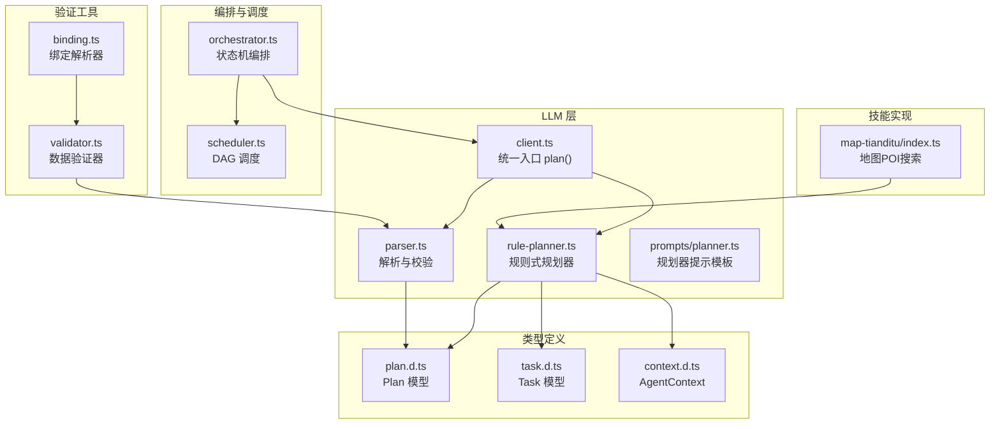
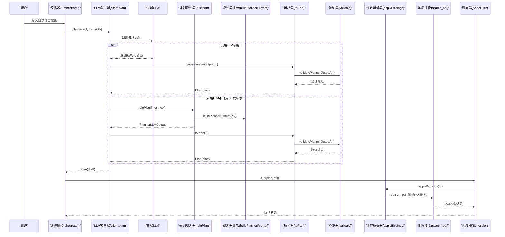
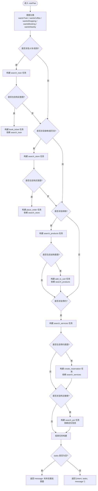
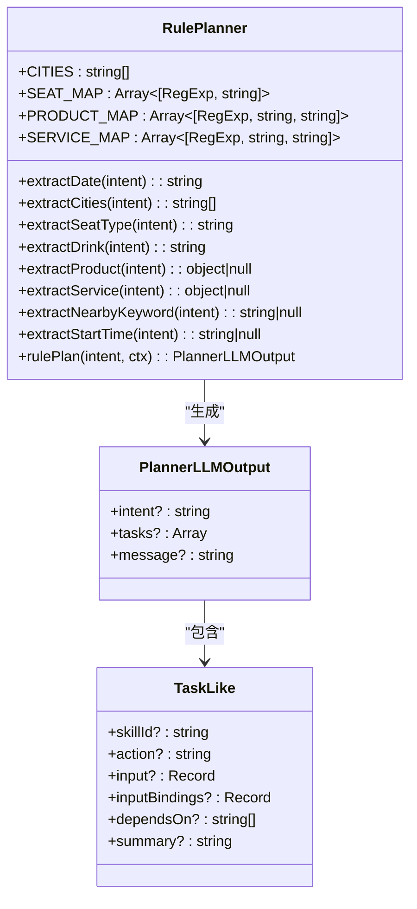
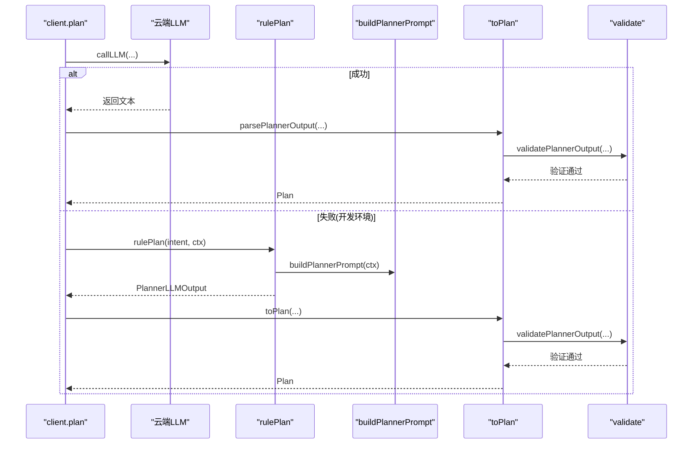
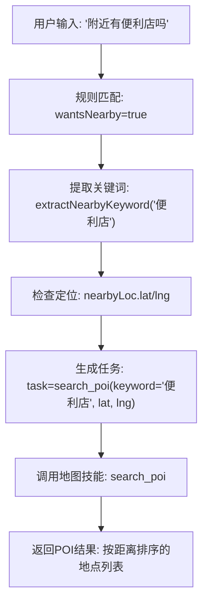
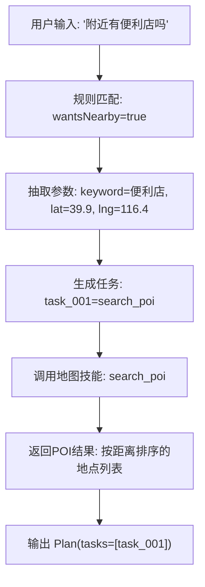
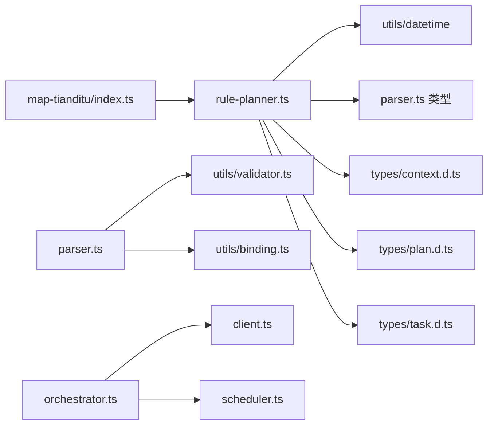

# 规则规划器

<cite>
**本文引用的文件**   
- [rule-planner.ts](file://miniprogram/src/llm/rule-planner.ts)
- [client.ts](file://miniprogram/src/llm/client.ts)
- [parser.ts](file://miniprogram/src/llm/parser.ts)
- [planner.ts](file://miniprogram/src/llm/prompts/planner.ts)
- [plan.d.ts](file://miniprogram/src/types/plan.d.ts)
- [task.d.ts](file://miniprogram/src/types/task.d.ts)
- [context.d.ts](file://miniprogram/src/types/context.d.ts)
- [orchestrator.ts](file://miniprogram/src/core/orchestrator.ts)
- [scheduler.ts](file://miniprogram/src/core/scheduler.ts)
- [validator.ts](file://miniprogram/src/utils/validator.ts)
- [binding.ts](file://miniprogram/src/utils/binding.ts)
- [map-tianditu/index.ts](file://miniprogram/src/skills/builtin/map-tianditu/index.ts)
</cite>

## 更新摘要
**变更内容**   
- 增强了解析器验证机制，新增动作特定的绑定字段白名单校验
- 更新了附近POI搜索的规划器提示和实现逻辑
- 移除了位置相关元问题的本地聊天回复功能
- 改进了输入绑定的路径验证和错误处理
- 优化了附近地点搜索的用户体验

## 目录
1. [引言](#引言)
2. [项目结构定位](#项目结构定位)
3. [核心组件](#核心组件)
4. [架构总览](#架构总览)
5. [详细组件分析](#详细组件分析)
6. [依赖关系分析](#依赖关系分析)
7. [性能与可扩展性](#性能与可扩展性)
8. [调试与测试指南](#调试与测试指南)
9. [故障排查](#故障排查)
10. [结论](#结论)

## 引言
本文件面向 WAIC-WeChat-MiniProgram 的规则规划器模块，重点说明 rulePlan 函数的实现逻辑、意图识别与任务规划算法、规则匹配机制、优先级与冲突解决策略、与 LLM 规划器的协作关系（降级方案）、规则可扩展性设计、执行流程、环境切换方式以及调试与测试方法。目标是帮助开发者在不深入源码的情况下理解并扩展该模块。

**更新** 本次更新重点反映了以下增强功能：增强的解析器验证机制（动作特定绑定字段白名单）、改进的附近POI搜索功能、优化的输入绑定验证和错误处理。

## 项目结构定位
规则规划器位于小程序前端代码的 LLM 层，作为云端 LLM 不可用时的本地降级方案，输出与 LLM Planner 同构的结构，从而让下游确认、调度、检查点等流程完全无感知。

**图表来源**
- [client.ts:56-120](file://miniprogram/src/llm/client.ts#L56-L120)
- [parser.ts:89-122](file://miniprogram/src/llm/parser.ts#L89-L122)
- [rule-planner.ts:82-164](file://miniprogram/src/llm/rule-planner.ts#L82-L164)
- [planner.ts:26-55](file://miniprogram/src/llm/prompts/planner.ts#L26-L55)
- [map-tianditu/index.ts:62-94](file://miniprogram/src/skills/builtin/map-tianditu/index.ts#L62-L94)

章节来源
- [client.ts:1-170](file://miniprogram/src/llm/client.ts#L1-L170)
- [rule-planner.ts:1-930](file://miniprogram/src/llm/rule-planner.ts#L1-L930)

## 核心组件
- **规则规划器**：rulePlan(intent, ctx)，基于关键字和模式匹配生成任务计划，支持高铁购票、星巴克点单、商品购物、服务预约、附近POI搜索等多个业务领域。
- **LLM 客户端**：plan(intent, ctx, availableSkills)，负责调用云端 LLM，并在开发环境失败时降级到规则规划器。
- **解析器**：toPlan(llmOutput, intent, planId)，将规则或 LLM 的输出标准化为 Plan，包含严格的模式验证和动作特定绑定字段白名单校验。
- **规划器提示**：buildPlannerPrompt(ctx)，提供上下文信息和附近POI搜索的优化提示。
- **类型定义**：Plan、Task、AgentContext 等，确保上下游数据结构一致。
- **编排器与调度器**：Orchestrator 管理状态机，Scheduler 执行 DAG 任务。
- **验证器与绑定解析器**：validator.ts 和 binding.ts 提供通用的 JSON Schema 验证功能和 inputBindings 路径解析。

**更新** 新增了动作特定的绑定字段白名单验证机制，增强了附近POI搜索功能，改进了错误处理和用户体验。

章节来源
- [rule-planner.ts:415-930](file://miniprogram/src/llm/rule-planner.ts#L415-L930)
- [client.ts:65-137](file://miniprogram/src/llm/client.ts#L65-L137)
- [parser.ts:112-147](file://miniprogram/src/llm/parser.ts#L112-L147)
- [planner.ts:26-55](file://miniprogram/src/llm/prompts/planner.ts#L26-L55)

## 架构总览
规则规划器在整体架构中承担"兜底"职责：当云端 LLM 不可用时，自动切换到本地规则引擎，保证全链路可在本地演示；正式环境优先走云端 LLM，保持更强的泛化能力。

**图表来源**
- [client.ts:56-120](file://miniprogram/src/llm/client.ts#L56-L120)
- [rule-planner.ts:415-930](file://miniprogram/src/llm/rule-planner.ts#L415-L930)
- [planner.ts:26-55](file://miniprogram/src/llm/prompts/planner.ts#L26-L55)
- [parser.ts:142-147](file://miniprogram/src/llm/parser.ts#L142-L147)
- [binding.ts:28-53](file://miniprogram/src/utils/binding.ts#L28-L53)
- [map-tianditu/index.ts:161-199](file://miniprogram/src/skills/builtin/map-tianditu/index.ts#L161-L199)

## 详细组件分析

### rulePlan 函数实现逻辑
rulePlan 是规则式规划的主入口，接收用户意图与 Agent 上下文，返回与 LLM Planner 同构的 PlannerLLMOutput。其核心逻辑包括：
- **意图分类**：通过正则表达式判断是否涉及高铁/火车查询购票、星巴克门店查询与点单、商品购物、服务预约、附近POI搜索等。
- **参数抽取**：从意图中提取日期、城市、座位类型、饮品名、商品信息、服务信息、附近地点关键词等关键参数。
- **任务构建**：根据意图类别生成对应的 Task 列表，包含 skillId、action、input、dependsOn、summary 等字段。
- **写操作标记**：若意图包含购买相关关键词，则追加下单类任务，交由后续 checkpoint 进行人类确认。
- **附近POI搜索**：新增的附近地点搜索功能，支持便利店、药店、银行等任意品类的位置搜索。

**更新** 新增了附近POI搜索功能，增强了意图识别的准确性和覆盖范围，改进了错误处理和用户体验。

**图表来源**
- [rule-planner.ts:415-930](file://miniprogram/src/llm/rule-planner.ts#L415-L930)

章节来源
- [rule-planner.ts:415-930](file://miniprogram/src/llm/rule-planner.ts#L415-L930)

### 规则匹配机制
规则匹配基于正则表达式对自然语言意图进行模式匹配，主要匹配项包括：
- **城市关键词集合**：支持简繁体并列，按出现顺序取前两个城市作为出发站与到达站。
- **座位类型映射**：商务座、一等座、二等座、硬座等映射到枚举值。
- **日期抽取**：后天、明天、今天默认，支持具体日期格式。
- **饮品识别**：美式、摩卡、拿铁等。
- **商品识别**：耳机、手表、保温杯、咖啡豆、按摩仪、跑步鞋等。
- **服务识别**：羽毛球、洁牙、体检、游泳、理发等。
- **附近地点关键词提取**：支持"附近的便利店"、"哪里有打印店"等模式的智能提取。
- **购买意图**：买、订、下单、来一杯、帮我点等关键词触发写操作任务。
- **预约时段**：支持具体时间点和时间段词汇映射。

**更新** 新增了附近地点关键词的智能提取功能，支持更丰富的地理位置搜索场景。

**图表来源**
- [rule-planner.ts:36-267](file://miniprogram/src/llm/rule-planner.ts#L36-L267)
- [parser.ts:25-37](file://miniprogram/src/llm/parser.ts#L25-L37)

章节来源
- [rule-planner.ts:36-267](file://miniprogram/src/llm/rule-planner.ts#L36-L267)
- [parser.ts:25-37](file://miniprogram/src/llm/parser.ts#L25-L37)

### 规则优先级与冲突解决策略
- **优先级**：规则按意图类别分支处理，先判断是否涉及火车/高铁，再判断是否涉及咖啡/星巴克、购物、预约、附近搜索；各业务域可并行存在，互不干扰。
- **冲突解决**：同一意图可能同时命中多个规则（例如既提到"高铁"又提到"咖啡"），此时会分别生成对应任务链，不存在互斥冲突。
- **购买意图**：无论属于哪一类业务，只要包含购买关键词，都会追加下单类任务，且必须经过 checkpoint 确认。
- **结算优化**：对于购物场景，如果检测到结算意图，直接跳过搜索步骤，减少不必要的 API 调用。
- **附近搜索排他性**：附近搜索已排除所有专属域词（咖啡、购物、预约、票务、交通、天气），仅承接无专属 SKILL 的品類詞。

**更新** 新增了附近搜索的排他性逻辑，避免了与其他业务域的冲突。

章节来源
- [rule-planner.ts:496-548](file://miniprogram/src/llm/rule-planner.ts#L496-L548)

### 与 LLM 规划器的协作关系
- **正常路径**：client.plan 调用云端 LLM，解析输出后生成 Plan。
- **降级路径**：当云端 LLM 不可用（开发环境）时，client.plan 捕获异常并调用 rulePlan，再通过 toPlan 转换为标准 Plan，traceId 保留用于追踪。
- **降级判定**：devFallbackReason 检测 LLMError 或 CloudNetworkError，仅在开发环境触发降级，避免掩盖真实 LLM 故障。
- **错误处理增强**：改进了错误检测和日志记录，提供更详细的故障信息。

**更新** 增强了错误处理机制，提供了更好的故障诊断信息。

**图表来源**
- [client.ts:72-99](file://miniprogram/src/llm/client.ts#L72-L99)
- [rule-planner.ts:415-930](file://miniprogram/src/llm/rule-planner.ts#L415-L930)
- [planner.ts:26-55](file://miniprogram/src/llm/prompts/planner.ts#L26-L55)
- [parser.ts:142-147](file://miniprogram/src/llm/parser.ts#L142-L147)

章节来源
- [client.ts:72-99](file://miniprogram/src/llm/client.ts#L72-L99)

### 增强的解析器验证机制
新增的动作特定绑定字段白名单验证机制确保规划输出的数据完整性和一致性：
- **JSON 结构验证**：确保 LLM 输出符合预期的 JSON 结构。
- **必填字段检查**：验证每个任务的 skillId、action、input、dependsOn 等必填字段。
- **占位符检测**：防止 LLM 输出未填充的占位符值，如 `<需要用户提供>` 或 `TBD`。
- **数据类型验证**：确保字段类型符合预期，如字符串、数字、数组等。
- **动作特定绑定字段白名单**：针对每个 action 定义了允许绑定的 fromField 路径，防止 LLM 幻觉导致的非法路径引用。
- **路径绑定验证**：验证 inputBindings 中的 fromTaskId 和 fromField 引用有效性，支持通配符匹配（如 priceCentByTrain.*）。

**更新** 新增了完整的动作特定绑定字段白名单验证系统，显著提升了规划的准确性和可靠性，有效防止 LLM 幻觉导致的绑定错误。

章节来源
- [parser.ts:110-144](file://miniprogram/src/llm/parser.ts#L110-L144)
- [parser.ts:245-320](file://miniprogram/src/llm/parser.ts#L245-L320)

### 附近POI搜索功能
新增的附近POI搜索功能为用户提供基于当前位置的地点搜索能力：
- **关键词提取**：智能提取"附近的便利店"、"哪里有打印店"等自然语言描述中的地点品类。
- **定位信息获取**：从用户上下文中获取经纬度坐标，支持授权状态检查。
- **搜索执行**：调用地图技能进行POI搜索，返回按距离排序的结果列表。
- **用户体验优化**：提供友好的提示信息，引导用户补充缺失的地点品类。

**更新** 新增了完整的附近POI搜索功能，改善了用户的地理位置搜索体验。

**图表来源**
- [rule-planner.ts:842-862](file://miniprogram/src/llm/rule-planner.ts#L842-L862)
- [map-tianditu/index.ts:161-199](file://miniprogram/src/skills/builtin/map-tianditu/index.ts#L161-L199)

章节来源
- [rule-planner.ts:207-217](file://miniprogram/src/llm/rule-planner.ts#L207-L217)
- [rule-planner.ts:842-862](file://miniprogram/src/llm/rule-planner.ts#L842-L862)
- [map-tianditu/index.ts:27-94](file://miniprogram/src/skills/builtin/map-tianditu/index.ts#L27-L94)

### 多轮对话上下文支持
针对购物和预约领域，增强了多轮对话上下文的支持：
- **会话历史维护**：通过 AgentContext.messages 维护完整的对话历史。
- **上下文提取**：从对话历史中提取用户已提供的信息，如乘车人信息、偏好设置等。
- **状态持久化**：在单次会话内保持业务状态，如购物车内容、已选服务等。
- **智能补全**：基于历史对话智能补全缺失的参数，提升用户体验。

**更新** 新增了多轮对话上下文支持，显著改善了购物和预约场景的用户体验。

章节来源
- [context.d.ts:27-36](file://miniprogram/src/types/context.d.ts#L27-L36)
- [context.d.ts:46-62](file://miniprogram/src/types/context.d.ts#L46-L62)

### 规划器提示优化
更新了规划器提示模板，提供更好的上下文信息和附近POI搜索指导：
- **上下文摘要**：buildContextString 函数提供用户位置、时间、偏好等上下文信息的结构化摘要。
- **附近POI搜索指导**：在提示中明确附近搜索的使用场景和限制条件。
- **位置权限处理**：针对不同授权状态提供相应的处理指导。
- **出行城市权威行**：明确交通任务出发城市的取值优先级，避免LLM重复追问。

**更新** 优化了规划器提示，特别是附近POI搜索的指导信息和位置权限处理逻辑。

章节来源
- [planner.ts:57-140](file://miniprogram/src/llm/prompts/planner.ts#L57-L140)

### 规则的可扩展性设计
- **新增业务规则**：在 rulePlan 中增加新的意图分类分支，并补充相应的参数抽取函数与任务构建逻辑。
- **新增任务类型**：遵循 Task 类型定义，确保 skillId、action、input、dependsOn、summary 等字段完整。
- **参数抽取**：新增正则或映射表以支持更多实体（如城市、座位、饮品、商品、服务、附近地点等）。
- **与现有体系兼容**：所有输出均通过 toPlan 标准化，无需改动下游确认与调度流程。
- **验证框架**：利用 validator.ts 的通用验证框架，确保新规则的输入输出符合规范。
- **绑定字段白名单**：新增 action 时需同步更新 BINDING_FIELDS_BY_ACTION 白名单，确保绑定路径的安全性。

**更新** 增强了可扩展性设计，提供了更完善的验证框架支持和绑定字段白名单机制。

章节来源
- [rule-planner.ts:415-930](file://miniprogram/src/llm/rule-planner.ts#L415-L930)
- [task.d.ts:29-59](file://miniprogram/src/types/task.d.ts#L29-L59)
- [parser.ts:245-268](file://miniprogram/src/llm/parser.ts#L245-L268)

### 具体规则定义示例与执行流程
- **高铁查询与购票**：
  - 输入："查后天北京到上海的二等座"
  - 生成任务：search_train（依赖为空），若含购买意图则追加 book_ticket（依赖 search_train）。
- **星巴克门店查询与点单**：
  - 输入："在上海找星巴克，帮我点一杯美式"
  - 生成任务：search_store（依赖为空），若含购买意图则追加 place_order（依赖 search_store）。
- **商品购物**：
  - 输入："搜索无线降噪耳机，加入购物车"
  - 生成任务：search_products（依赖为空），若含购买意图则追加 add_to_cart（依赖 search_products）。
- **服务预约**：
  - 输入："预约明天的羽毛球场地"
  - 生成任务：search_services（依赖为空），若含预约意图则追加 create_reservation（依赖 search_services）。
- **附近POI搜索**：
  - 输入："附近有便利店吗"
  - 生成任务：search_poi（keyword='便利店', lat, lng），依赖定位信息。

**更新** 新增了附近POI搜索的具体示例，展示了完整的地理位置搜索业务流程。

**图表来源**
- [rule-planner.ts:842-862](file://miniprogram/src/llm/rule-planner.ts#L842-L862)

章节来源
- [rule-planner.ts:558-862](file://miniprogram/src/llm/rule-planner.ts#L558-L862)

### 在不同环境下切换 LLM 规划和规则规划
- **开发环境**：云端 LLM 不可用时自动降级到规则规划器，保证本地演示。
- **生产环境**：优先使用云端 LLM，仅在极端情况下才考虑降级（当前实现仅开发环境降级）。
- **切换依据**：devFallbackReason 检测错误类型与环境标志，决定是否调用 rulePlan。
- **错误恢复**：改进了错误恢复机制，提供更详细的错误信息和重试建议。

**更新** 增强了环境切换的逻辑，提供了更好的错误恢复机制。

章节来源
- [client.ts:37-54](file://miniprogram/src/llm/client.ts#L37-L54)
- [client.ts:83-108](file://miniprogram/src/llm/client.ts#L83-L108)

## 依赖关系分析
规则规划器依赖以下模块与类型：
- **datetime 工具**：用于日期计算与格式化。
- **parser 类型**：PlannerLLMOutput 与 Task 结构。
- **context 类型**：AgentContext 提供用户画像与位置信息。
- **types 定义**：Plan、Task、AgentContext 等确保数据一致性。
- **validator 工具**：提供通用的 JSON Schema 验证功能。
- **binding 工具**：提供 inputBindings 路径解析和绑定注入功能。
- **orchestrator 与 scheduler**：消费生成的 Plan 并执行任务。
- **map-tianditu 技能**：提供附近POI搜索的具体实现。

**更新** 新增了 binding 工具和 map-tianditu 技能的依赖，增强了输入绑定解析和地理位置搜索能力。

**图表来源**
- [rule-planner.ts:24-34](file://miniprogram/src/llm/rule-planner.ts#L24-L34)
- [parser.ts:12-14](file://miniprogram/src/llm/parser.ts#L12-L14)
- [binding.ts:1-53](file://miniprogram/src/utils/binding.ts#L1-L53)
- [map-tianditu/index.ts:161-199](file://miniprogram/src/skills/builtin/map-tianditu/index.ts#L161-L199)

章节来源
- [rule-planner.ts:24-34](file://miniprogram/src/llm/rule-planner.ts#L24-L34)
- [parser.ts:12-14](file://miniprogram/src/llm/parser.ts#L12-L14)
- [binding.ts:1-53](file://miniprogram/src/utils/binding.ts#L1-L53)
- [map-tianditu/index.ts:161-199](file://miniprogram/src/skills/builtin/map-tianditu/index.ts#L161-L199)

## 性能与可扩展性
- **性能特征**：
  - 规则匹配基于正则表达式，时间复杂度与意图长度线性相关，开销极低。
  - 任务构建为常数级操作，适合本地快速响应。
  - 模式验证采用轻量级实现，不影响整体性能。
  - 附近POI搜索支持缓存机制，提升重复查询的性能。
- **可扩展性**：
  - 新增规则只需添加意图分类与参数抽取逻辑，不影响现有流程。
  - 通过 toPlan 标准化输出，确保与 LLM 路径一致，便于未来替换或增强。
  - 验证框架支持自定义 schema，便于扩展新的业务规则。
  - 绑定字段白名单机制确保新增 action 的安全性，同时保持向后兼容。

**更新** 新增了性能优化和验证框架的支持，特别是附近POI搜索的缓存机制和绑定字段白名单的安全性保障。

## 调试与测试指南
- **调试建议**：
  - 观察 client.plan 的降级日志，确认是否触发规则规划器。
  - 检查生成的 Plan 中 tasks 列表是否符合预期，特别是 dependsOn 与 inputBindings。
  - 使用 Orchestrator 的 onTaskUpdate 回调监控任务状态变化。
  - 利用验证器的错误信息定位数据问题。
  - 检查附近POI搜索的关键词提取是否正确，定位信息是否可用。
- **测试方法**：
  - 构造典型意图用例（高铁查询、星巴克点单、商品购物、服务预约、附近POI搜索），验证 rulePlan 输出。
  - 模拟云端 LLM 不可用场景，验证降级路径是否正确。
  - 使用 Scheduler 的 isRunActive 钩子验证并发与重置行为。
  - 测试模式验证功能，确保非法输入被正确拒绝。
  - 测试绑定字段白名单验证，确保非法路径被拦截。
  - 测试附近POI搜索的完整流程，包括关键词提取、定位检查、搜索执行。

**更新** 新增了验证相关的调试和测试方法，特别是绑定字段白名单和附近POI搜索的测试用例。

章节来源
- [client.ts:83-108](file://miniprogram/src/llm/client.ts#L83-L108)
- [orchestrator.ts:258-270](file://miniprogram/src/core/orchestrator.ts#L258-L270)
- [scheduler.ts:76-105](file://miniprogram/src/core/scheduler.ts#L76-L105)
- [validator.ts:154-168](file://miniprogram/src/utils/validator.ts#L154-L168)

## 故障排查
- **常见问题**：
  - 规则未匹配：检查意图中的关键词是否与预定义正则匹配。
  - 参数缺失：确认 extractDate、extractCities、extractSeatType、extractDrink、extractProduct、extractService、extractNearbyKeyword 是否能正确抽取。
  - 降级未触发：检查 devFallbackReason 的判断条件与环境标志。
  - 验证失败：检查模式验证错误信息，确认数据结构是否符合要求。
  - 绑定字段错误：检查 BINDING_FIELDS_BY_ACTION 白名单配置，确认 fromField 路径是否合法。
  - 附近搜索失败：检查定位权限状态，确认关键词提取是否正确。
- **日志定位**：
  - client.plan 中的 warn 与 error 日志用于定位 LLM 调用失败与降级原因。
  - Orchestrator 的状态转移日志用于确认流程是否正常推进。
  - 验证器的错误信息用于定位数据完整性问题。
  - 绑定解析器的错误信息用于定位 inputBindings 路径解析问题。

**更新** 新增了绑定字段白名单验证和附近POI搜索的故障排查方法和日志定位指导。

章节来源
- [client.ts:83-108](file://miniprogram/src/llm/client.ts#L83-L108)
- [orchestrator.ts:60-71](file://miniprogram/src/core/orchestrator.ts#L60-L71)
- [validator.ts:154-168](file://miniprogram/src/utils/validator.ts#L154-L168)
- [parser.ts:287-320](file://miniprogram/src/llm/parser.ts#L287-L320)

## 结论
规则规划器作为 LLM 规划器的降级方案，提供了稳定可靠的本地意图识别与任务规划能力。经过本次更新，系统在解析器验证准确性、附近POI搜索功能、绑定字段白名单验证和多轮对话上下文支持方面都得到了显著增强。其设计简洁、扩展性强，能够无缝接入现有的编排与调度体系。开发者可通过新增规则与参数抽取逻辑轻松扩展业务场景，同时在开发与生产环境中获得一致的体验与行为。

**更新** 本次更新显著提升了系统的健壮性和用户体验，特别是在解析器验证安全性、附近POI搜索功能和错误处理方面的表现得到了大幅改善。新增的动作特定绑定字段白名单机制有效防止了LLM幻觉导致的绑定错误，而附近POI搜索功能的加入为用户提供了更丰富的地理位置搜索能力。