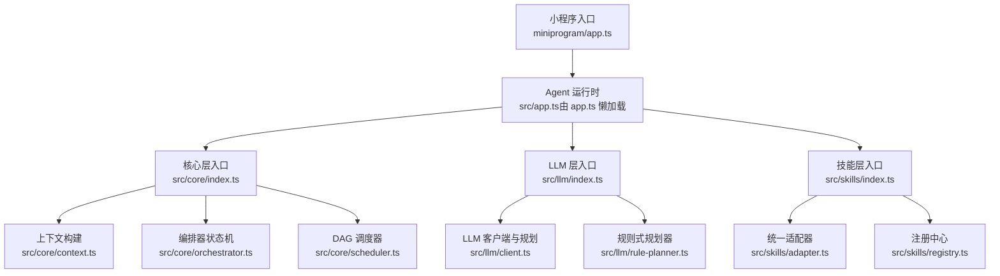
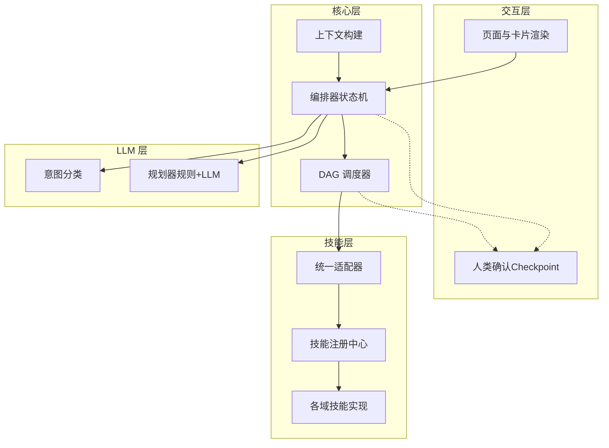
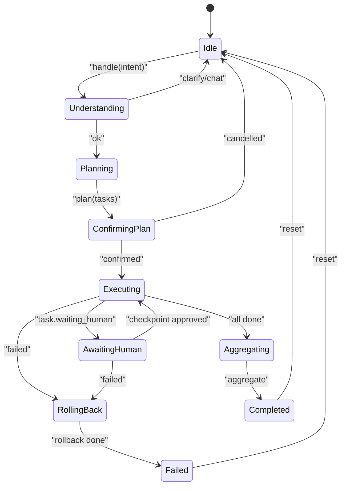
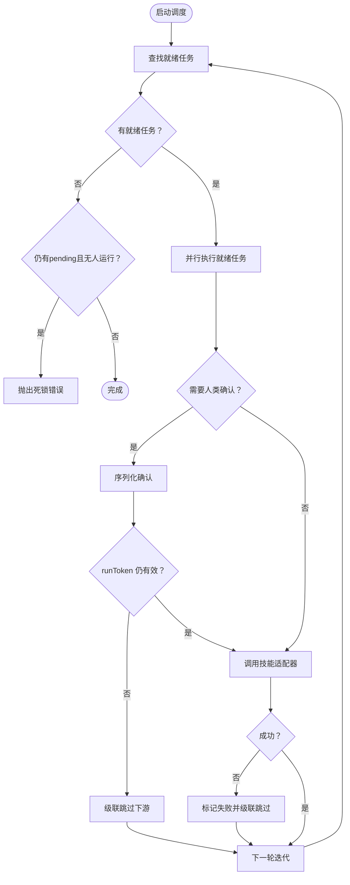
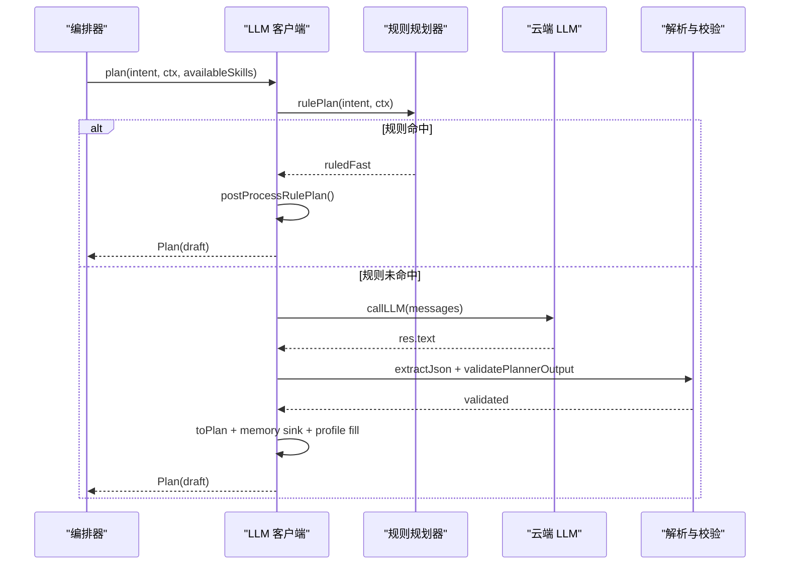
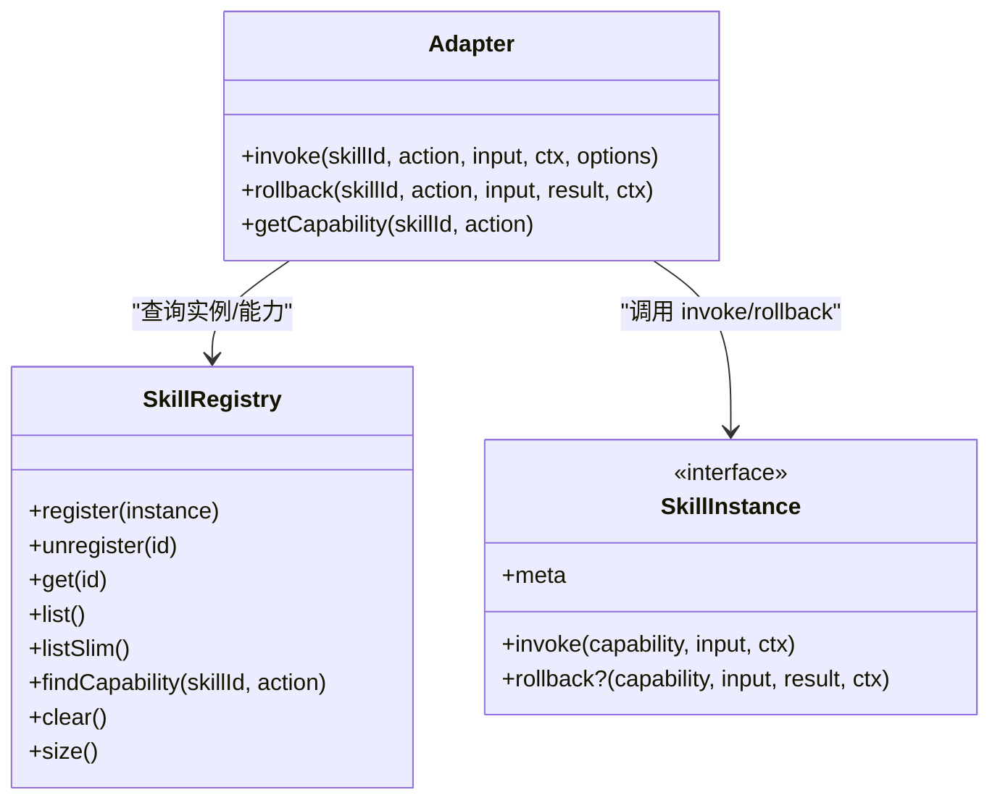
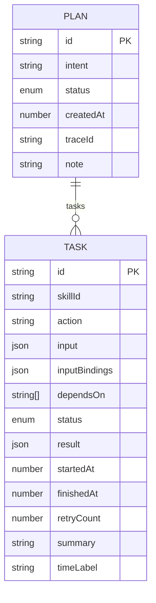
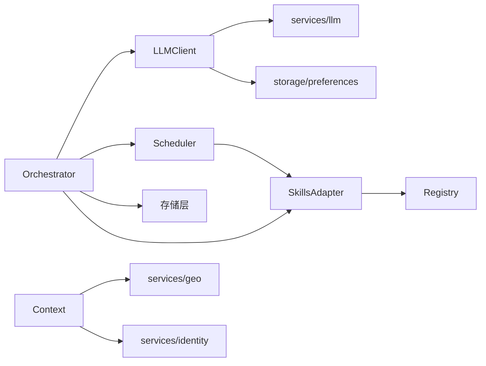

# 六域技能框架

<cite>
**本文引用的文件**   
- [miniprogram/app.ts](file://miniprogram/app.ts)
- [miniprogram/src/core/index.ts](file://miniprogram/src/core/index.ts)
- [miniprogram/src/core/context.ts](file://miniprogram/src/core/context.ts)
- [miniprogram/src/core/orchestrator.ts](file://miniprogram/src/core/orchestrator.ts)
- [miniprogram/src/core/scheduler.ts](file://miniprogram/src/core/scheduler.ts)
- [miniprogram/src/llm/client.ts](file://miniprogram/src/llm/client.ts)
- [miniprogram/src/llm/rule-planner.ts](file://miniprogram/src/llm/rule-planner.ts)
- [miniprogram/src/skills/index.ts](file://miniprogram/src/skills/index.ts)
- [miniprogram/src/skills/adapter.ts](file://miniprogram/src/skills/adapter.ts)
- [miniprogram/src/skills/registry.ts](file://miniprogram/src/skills/registry.ts)
- [miniprogram/src/types/agent-state.d.ts](file://miniprogram/src/types/agent-state.d.ts)
- [miniprogram/src/types/checkpoint.d.ts](file://miniprogram/src/types/checkpoint.d.ts)
- [miniprogram/src/types/plan.d.ts](file://miniprogram/src/types/plan.d.ts)
- [miniprogram/src/types/task.d.ts](file://miniprogram/src/types/task.d.ts)
- [miniprogram/src/types/skill.d.ts](file://miniprogram/src/types/skill.d.ts)
</cite>

## 目录
1. [引言](#引言)
2. [项目结构](#项目结构)
3. [核心组件](#核心组件)
4. [架构总览](#架构总览)
5. [详细组件分析](#详细组件分析)
6. [依赖关系分析](#依赖关系分析)
7. [性能考量](#性能考量)
8. [故障排查指南](#故障排查指南)
9. [结论](#结论)

## 引言
本文件面向“六域技能框架”的架构与实现说明，覆盖小程序端 Agent 运行时、意图理解、任务规划、DAG 调度、技能注册与调用、以及类型契约。目标是帮助读者快速理解从用户输入到多领域技能执行的全链路流程，并掌握关键设计点：状态机编排、人类确认（Checkpoint）、规则式与 LLM 双轨规划、可回滚能力、以及跨任务数据绑定。

## 项目结构
本项目采用分层组织：
- 应用入口与生命周期：miniprogram/app.ts
- 核心层（Core）：上下文构建、编排器（状态机）、DAG 调度器
- 大模型层（LLM）：客户端封装、分类器、规划器、规则式降级
- 技能层（Skills）：统一适配器、注册中心、具体技能实现
- 类型定义（Types）：Agent 状态、计划、任务、技能协议、Checkpoint 交互契约

**图表来源**
- [miniprogram/app.ts:26-58](file://miniprogram/app.ts#L26-L58)
- [miniprogram/src/core/index.ts:1-7](file://miniprogram/src/core/index.ts#L1-L7)
- [miniprogram/src/llm/index.ts:1-8](file://miniprogram/src/llm/index.ts#L1-L8)
- [miniprogram/src/skills/index.ts:1-7](file://miniprogram/src/skills/index.ts#L1-L7)

**章节来源**
- [miniprogram/app.ts:26-58](file://miniprogram/app.ts#L26-L58)
- [miniprogram/src/core/index.ts:1-7](file://miniprogram/src/core/index.ts#L1-L7)
- [miniprogram/src/llm/index.ts:1-8](file://miniprogram/src/llm/index.ts#L1-L8)
- [miniprogram/src/skills/index.ts:1-7](file://miniprogram/src/skills/index.ts#L1-L7)

## 核心组件
- 上下文构建（Context）：聚合会话 ID、用户标识、位置信息、偏好摘要、历史摘要、全局配置与追踪指标。
- 编排器（Orchestrator）：基于状态机的全链路编排，负责理解、规划、确认、执行、聚合、失败回滚与重置。
- 调度器（Scheduler）：DAG 任务调度，支持并行执行、依赖解析、人类确认序列化、死锁检测与级联跳过。
- LLM 客户端与规划（Client + Rule Planner）：规则优先、LLM 兜底；包含意图分类、Plan 生成、记忆沉淀、参数回填与校验。
- 技能适配器与注册中心（Adapter + Registry）：统一调用入口、Schema 校验、查询缓存、错误归一、回滚桥接与能力元数据查询。

**章节来源**
- [miniprogram/src/core/context.ts:152-200](file://miniprogram/src/core/context.ts#L152-L200)
- [miniprogram/src/core/orchestrator.ts:92-131](file://miniprogram/src/core/orchestrator.ts#L92-L131)
- [miniprogram/src/core/scheduler.ts:77-131](file://miniprogram/src/core/scheduler.ts#L77-L131)
- [miniprogram/src/llm/client.ts:185-310](file://miniprogram/src/llm/client.ts#L185-L310)
- [miniprogram/src/llm/rule-planner.ts:432-488](file://miniprogram/src/llm/rule-planner.ts#L432-L488)
- [miniprogram/src/skills/adapter.ts:42-117](file://miniprogram/src/skills/adapter.ts#L42-L117)
- [miniprogram/src/skills/registry.ts:16-71](file://miniprogram/src/skills/registry.ts#L16-L71)

## 架构总览
整体遵循“interaction → core → skills → llm”单向依赖原则，核心层通过类型注入 checkpoint 回调，避免反向依赖。

**图表来源**
- [miniprogram/src/core/orchestrator.ts:127-339](file://miniprogram/src/core/orchestrator.ts#L127-L339)
- [miniprogram/src/core/scheduler.ts:77-131](file://miniprogram/src/core/scheduler.ts#L77-L131)
- [miniprogram/src/llm/client.ts:330-425](file://miniprogram/src/llm/client.ts#L330-L425)
- [miniprogram/src/skills/adapter.ts:42-117](file://miniprogram/src/skills/adapter.ts#L42-L117)
- [miniprogram/src/skills/registry.ts:16-71](file://miniprogram/src/skills/registry.ts#L16-L71)

## 详细组件分析

### 编排器（Orchestrator）
- 职责：维护 Agent 状态机，串联理解、规划、确认、执行、聚合、回滚与重置。
- 关键点：
  - 状态转移受 ALLOWED_TRANSITIONS 约束，异常路径强制归位 idle 防止死锁。
  - 使用模块级运行令牌 ACTIVE_RUNS 保证 reset 后旧轮次失效，避免并发弹窗与重复下单。
  - Plan 确认后落库行程，执行结束同步行程终态。
  - 失败时按反序对可逆任务执行回滚。

**图表来源**
- [miniprogram/src/core/orchestrator.ts:62-73](file://miniprogram/src/core/orchestrator.ts#L62-L73)
- [miniprogram/src/core/orchestrator.ts:127-339](file://miniprogram/src/core/orchestrator.ts#L127-L339)

**章节来源**
- [miniprogram/src/core/orchestrator.ts:92-131](file://miniprogram/src/core/orchestrator.ts#L92-L131)
- [miniprogram/src/core/orchestrator.ts:134-339](file://miniprogram/src/core/orchestrator.ts#L134-L339)
- [miniprogram/src/core/orchestrator.ts:341-413](file://miniprogram/src/core/orchestrator.ts#L341-L413)

### 调度器（Scheduler）
- 职责：按 DAG 依赖并行执行任务，处理人类确认、失败级联跳过、死锁检测与 runToken 失效中止。
- 关键点：
  - 每轮找出 ready 任务并 Promise.allSettled 并行执行。
  - requiresHumanConfirm 的任务进入 waiting_human，并通过 serializeCheckpoint 串行化弹窗。
  - isRunActive 为 false 时 abortRun，将非终态任务标记 skipped。
  - 失败任务 cascadeSkip 下游 pending 任务。

**图表来源**
- [miniprogram/src/core/scheduler.ts:77-131](file://miniprogram/src/core/scheduler.ts#L77-L131)
- [miniprogram/src/core/scheduler.ts:143-208](file://miniprogram/src/core/scheduler.ts#L143-L208)
- [miniprogram/src/core/scheduler.ts:223-244](file://miniprogram/src/core/scheduler.ts#L223-L244)

**章节来源**
- [miniprogram/src/core/scheduler.ts:27-44](file://miniprogram/src/core/scheduler.ts#L27-L44)
- [miniprogram/src/core/scheduler.ts:77-131](file://miniprogram/src/core/scheduler.ts#L77-L131)
- [miniprogram/src/core/scheduler.ts:143-208](file://miniprogram/src/core/scheduler.ts#L143-L208)

### LLM 客户端与规划（Client + Rule Planner）
- 职责：意图分类、Plan 生成（规则优先、LLM 兜底）、记忆沉淀、参数回填与校验。
- 关键点：
  - understand 先本地短路已知元问题，再走 LLM 分类或快速通道。
  - plan 优先 rulePlan；若规则命中则直接 postProcessRulePlan；否则调用 LLM。
  - 解析失败或绑定引用无效时尝试规则兜底；兜不住则抛错。
  - applyLocalProfile 回填乘车人槽位；clarifyIfPassengerMissing 缺实名则整轮降为追问。
  - sinkMemory 区分显式长期偏好与推断提議，分别直接落盘或待确认卡。

**图表来源**
- [miniprogram/src/llm/client.ts:185-310](file://miniprogram/src/llm/client.ts#L185-L310)
- [miniprogram/src/llm/rule-planner.ts:432-488](file://miniprogram/src/llm/rule-planner.ts#L432-L488)

**章节来源**
- [miniprogram/src/llm/client.ts:330-425](file://miniprogram/src/llm/client.ts#L330-L425)
- [miniprogram/src/llm/client.ts:185-310](file://miniprogram/src/llm/client.ts#L185-L310)
- [miniprogram/src/llm/rule-planner.ts:432-488](file://miniprogram/src/llm/rule-planner.ts#L432-L488)

### 技能适配器与注册中心（Adapter + Registry）
- 职责：统一调用入口、Schema 校验、查询缓存、错误归一、回滚桥接；注册中心提供能力元数据查询与 Slim 列表。
- 关键点：
  - invoke 先查 SkillRegistry，校验 inputSchema，命中 idempotent 查询缓存，记录 trace，捕获异常包装为 SkillError。
  - rollback 调用 SkillInstance.rollback，失败仅记录警告。
  - getCapability 供 Scheduler 判断 requiresHumanConfirm 等属性。
  - Registry.listSlim 输出精简元数据给 Planner，降低 token 消耗。

**图表来源**
- [miniprogram/src/skills/registry.ts:16-71](file://miniprogram/src/skills/registry.ts#L16-L71)
- [miniprogram/src/skills/adapter.ts:42-147](file://miniprogram/src/skills/adapter.ts#L42-L147)
- [miniprogram/src/types/skill.d.ts:86-104](file://miniprogram/src/types/skill.d.ts#L86-L104)

**章节来源**
- [miniprogram/src/skills/adapter.ts:42-147](file://miniprogram/src/skills/adapter.ts#L42-L147)
- [miniprogram/src/skills/registry.ts:16-71](file://miniprogram/src/skills/registry.ts#L16-L71)
- [miniprogram/src/types/skill.d.ts:16-58](file://miniprogram/src/types/skill.d.ts#L16-L58)

### 类型契约（Plan / Task / AgentState / Checkpoint / Skill）
- Plan：描述一组 Task 的 DAG，含状态、traceId、note、trip 等。
- Task：最小执行单元，含依赖、绑定、状态、结果、时间戳与摘要。
- AgentState：状态机状态集合与转移表类型。
- Checkpoint：人类确认入参与回调类型，确保 core 不反向依赖 interaction。
- Skill：SkillMeta/SkillCapability/SkillResult/SkillInstance/JumpPackage 等协议。

**图表来源**
- [miniprogram/src/types/plan.d.ts:20-38](file://miniprogram/src/types/plan.d.ts#L20-L38)
- [miniprogram/src/types/task.d.ts:30-61](file://miniprogram/src/types/task.d.ts#L30-L61)

**章节来源**
- [miniprogram/src/types/plan.d.ts:12-38](file://miniprogram/src/types/plan.d.ts#L12-L38)
- [miniprogram/src/types/task.d.ts:11-61](file://miniprogram/src/types/task.d.ts#L11-L61)
- [miniprogram/src/types/agent-state.d.ts:7-17](file://miniprogram/src/types/agent-state.d.ts#L7-L17)
- [miniprogram/src/types/checkpoint.d.ts:17-44](file://miniprogram/src/types/checkpoint.d.ts#L17-L44)
- [miniprogram/src/types/skill.d.ts:16-161](file://miniprogram/src/types/skill.d.ts#L16-L161)

## 依赖关系分析
- 依赖方向：interaction → core → skills → llm（core 仅依赖 types 中的接口）。
- 耦合点：
  - Orchestrator 依赖 LLM client、Scheduler、Storage、Skills adapter。
  - Scheduler 依赖 Skills adapter 与 types（Task/Plan/Capability）。
  - Adapter 依赖 Registry、Validator、Cache、Logger。
  - LLM client 依赖 services/llm、storage/preferences、utils/passenger、prompts。
- 外部集成：
  - 云端 LLM 调用（callLLM）与网络错误处理。
  - 微信定位 API（getLocation）与地理编码服务。
  - 存储层（preferences/session/address/trip）用于记忆与行程持久化。

**图表来源**
- [miniprogram/src/core/orchestrator.ts:13-28](file://miniprogram/src/core/orchestrator.ts#L13-L28)
- [miniprogram/src/core/scheduler.ts:18-25](file://miniprogram/src/core/scheduler.ts#L18-L25)
- [miniprogram/src/skills/adapter.ts:14-20](file://miniprogram/src/skills/adapter.ts#L14-L20)
- [miniprogram/src/llm/client.ts:9-31](file://miniprogram/src/llm/client.ts#L9-L31)
- [miniprogram/src/core/context.ts:16-23](file://miniprogram/src/core/context.ts#L16-L23)

**章节来源**
- [miniprogram/src/core/orchestrator.ts:13-28](file://miniprogram/src/core/orchestrator.ts#L13-L28)
- [miniprogram/src/core/scheduler.ts:18-25](file://miniprogram/src/core/scheduler.ts#L18-L25)
- [miniprogram/src/skills/adapter.ts:14-20](file://miniprogram/src/skills/adapter.ts#L14-L20)
- [miniprogram/src/llm/client.ts:9-31](file://miniprogram/src/llm/client.ts#L9-L31)
- [miniprogram/src/core/context.ts:16-23](file://miniprogram/src/core/context.ts#L16-L23)

## 性能考量
- 规则优先规划：对常见六域意图零 LLM 延迟，减少幻觉与重试成本。
- 查询缓存：idempotent 查询类能力 TTL 缓存，避免重复云端调用。
- 并行执行：ready 任务 Promise.allSettled 并行，缩短端到端耗时。
- 消息历史上限：ctx.messages 保留最近 20 条，控制 planner Prompt token。
- 懒加载运行时：App globalData.agent 首次访问才构造，降低冷启动开销。

[本节为通用指导，无需代码来源]

## 故障排查指南
- 死锁检测：Scheduler 在无可执行任务且仍有 pending 时抛出死锁错误，需检查 dependsOn 与 binding 引用。
- 人类确认冲突：serializeCheckpoint 串行化弹窗，避免 wx.showModal 覆盖导致确认丢失。
- runToken 失效：Orchestrator.reset 清空 ACTIVE_RUNS，Scheduler 检测到 shouldAbort 即中止并级联跳过。
- 参数校验失败：Adapter 返回 INVALID_INPUT，结合 fieldLabel 提示用户补充字段。
- LLM 不可用：开发环境自动降级规则规划；release 严格失败，需检查云端配置与网络。
- 回滚失败：单任务回滚失败仅记录错误继续其余回滚，最终由 Orchestrator 汇总失败文案。

**章节来源**
- [miniprogram/src/core/scheduler.ts:46-52](file://miniprogram/src/core/scheduler.ts#L46-L52)
- [miniprogram/src/core/scheduler.ts:62-74](file://miniprogram/src/core/scheduler.ts#L62-L74)
- [miniprogram/src/core/scheduler.ts:85-131](file://miniprogram/src/core/scheduler.ts#L85-L131)
- [miniprogram/src/skills/adapter.ts:64-86](file://miniprogram/src/skills/adapter.ts#L64-L86)
- [miniprogram/src/llm/client.ts:50-66](file://miniprogram/src/llm/client.ts#L50-L66)
- [miniprogram/src/core/orchestrator.ts:357-388](file://miniprogram/src/core/orchestrator.ts#L357-L388)

## 结论
六域技能框架以“规则优先、LLM 兜底”的规划策略为核心，配合状态机编排与 DAG 调度，实现了高确定性与可扩展性的智能体执行链路。通过人类确认、可回滚能力与跨任务绑定，系统在安全与灵活性之间取得平衡。未来可在更多域的规则覆盖、缓存策略优化与监控埋点上持续演进。