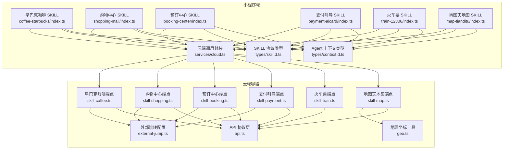
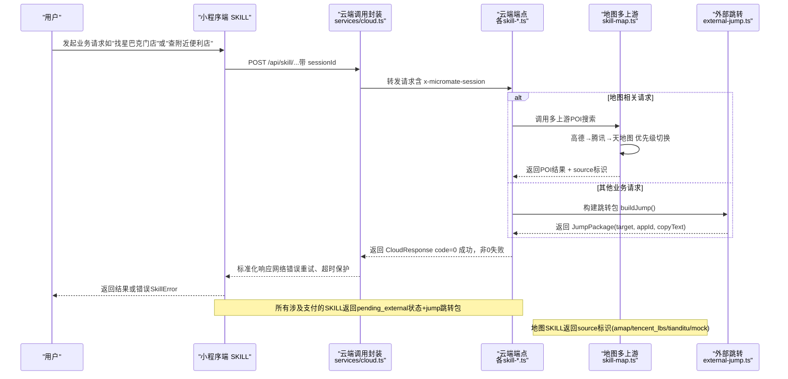
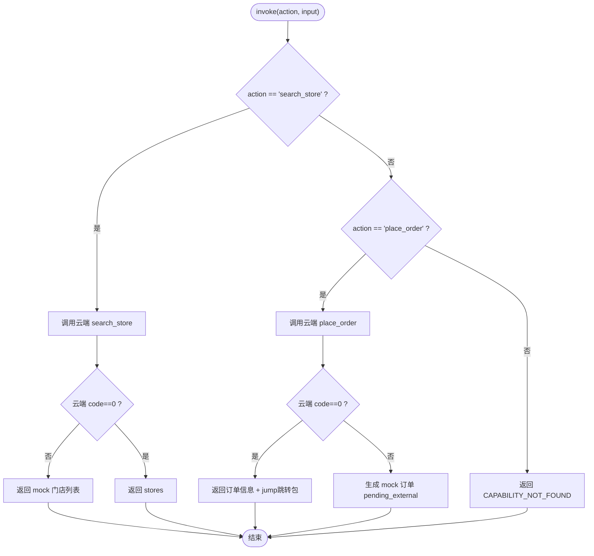
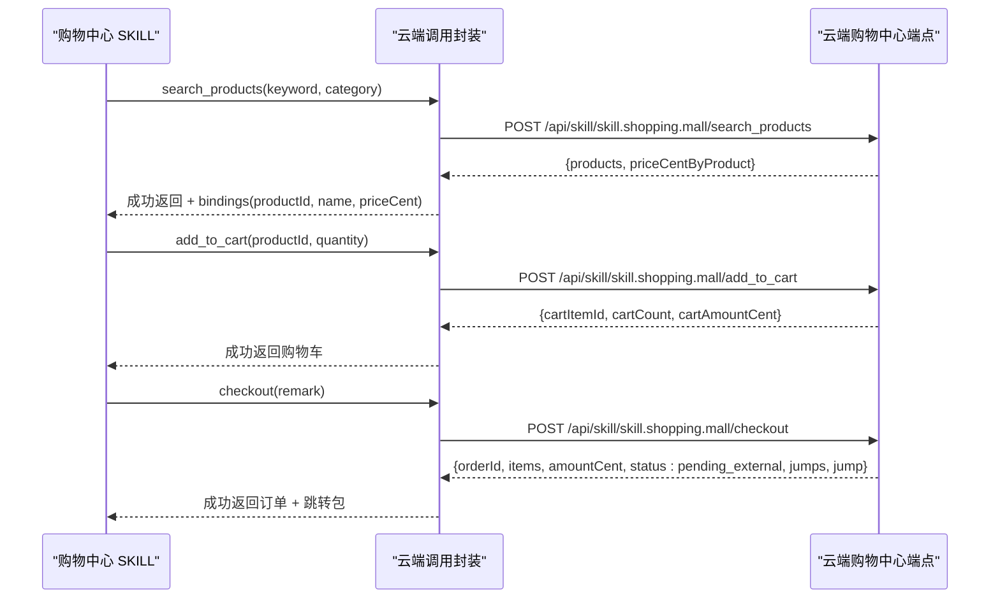
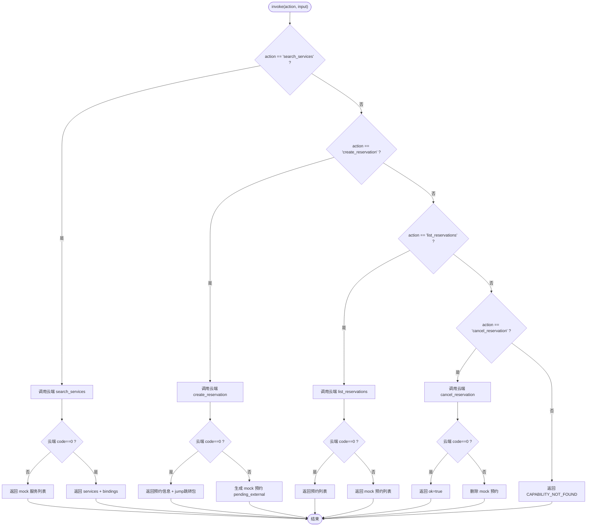
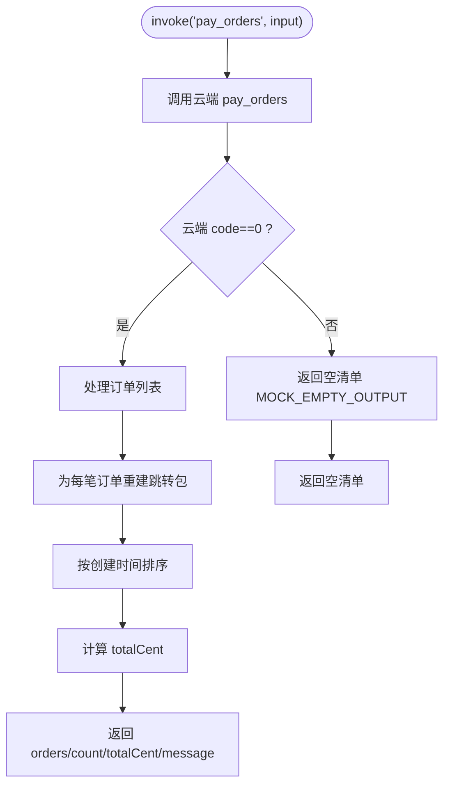
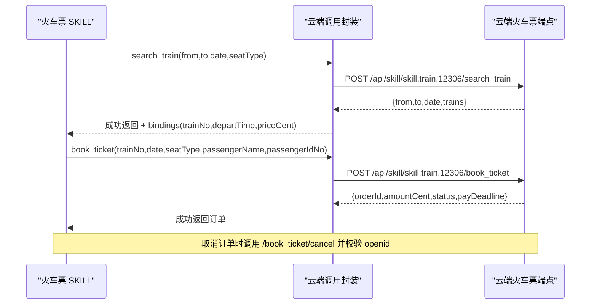
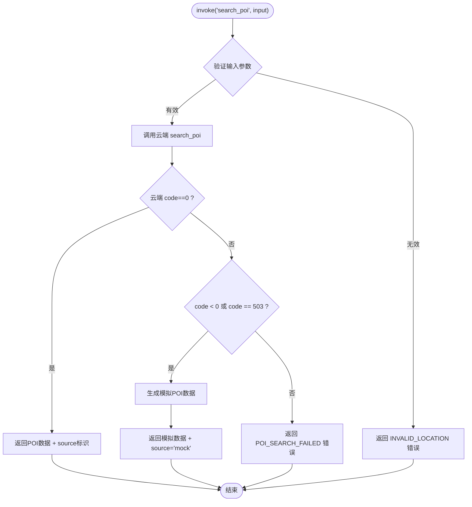
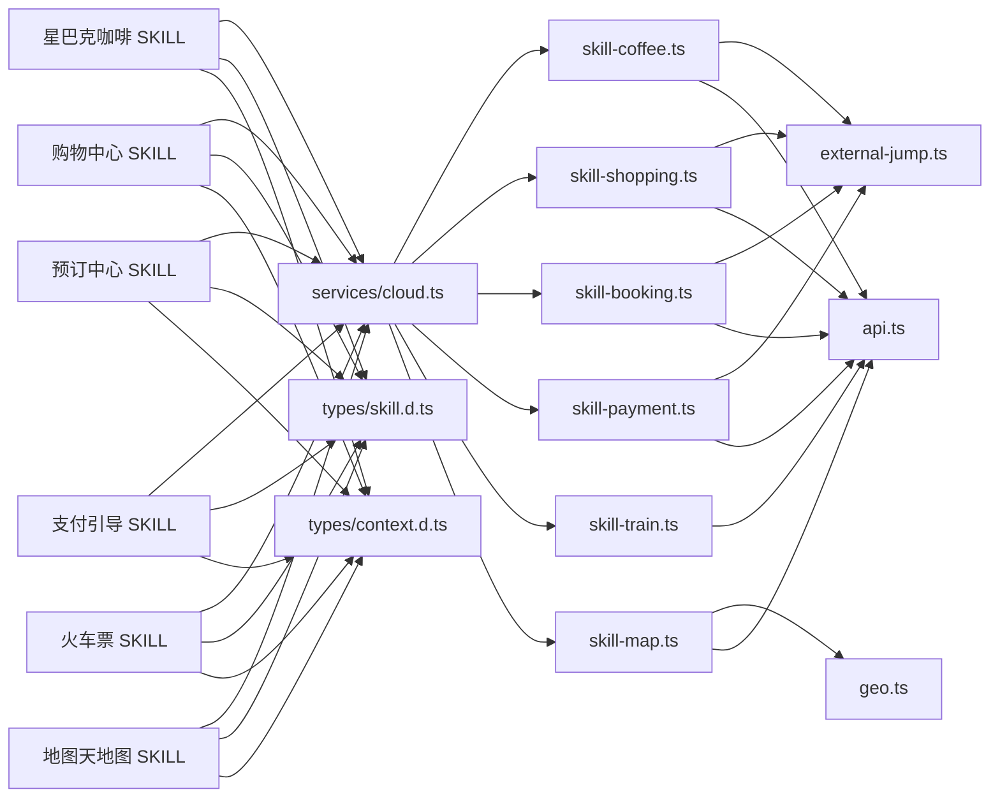

# 内置SKILL

<cite>
**本文引用的文件**   
- [星巴克咖啡 SKILL（小程序端）](file://miniprogram/src/skills/builtin/coffee-starbucks/index.ts)
- [购物中心 SKILL（小程序端）](file://miniprogram/src/skills/builtin/shopping-mall/index.ts)
- [预订中心 SKILL（小程序端）](file://miniprogram/src/skills/builtin/booking-center/index.ts)
- [支付引导 SKILL（小程序端）](file://miniprogram/src/skills/builtin/payment-aicard/index.ts)
- [火车票 SKILL（小程序端）](file://miniprogram/src/skills/builtin/train-12306/index.ts)
- [地图天地图 SKILL（小程序端）](file://miniprogram/src/skills/builtin/map-tianditu/index.ts)
- [星巴克咖啡云端端点](file://cloudrun/src/skill-coffee.ts)
- [购物中心云端端点](file://cloudrun/src/skill-shopping.ts)
- [预订中心云端端点](file://cloudrun/src/skill-booking.ts)
- [支付引导云端端点](file://cloudrun/src/skill-payment.ts)
- [火车票云端端点](file://cloudrun/src/skill-train.ts)
- [地图天地图云端端点](file://cloudrun/src/skill-map.ts)
- [外部跳转配置](file://cloudrun/src/external-jump.ts)
- [云端 API 协议层](file://cloudrun/src/api.ts)
- [微信云开发容器调用封装](file://miniprogram/src/services/cloud.ts)
- [SKILL 协议类型定义](file://miniprogram/src/types/skill.d.ts)
- [Agent 会话上下文类型](file://miniprogram/src/types/context.d.ts)
</cite>

## 更新摘要
**变更内容**   
- 新增地图天地图 SKILL：POI 搜索能力，支持多上游策略（高德优先、腾讯位置服务次之、天地图兜底）
- 新增地图天地图云端端点：实现三上游切换、坐标系统转换、缓存机制和降级策略
- 扩展规则规划器：集成附近地点搜索任务生成逻辑
- 统一采用"多上游容错"模式：所有地图相关SKILL都具备多源数据获取和自动降级能力

## 目录
1. [引言](#引言)
2. [项目结构](#项目结构)
3. [核心组件](#核心组件)
4. [架构总览](#架构总览)
5. [详细组件分析](#详细组件分析)
6. [依赖关系分析](#依赖关系分析)
7. [性能与可靠性](#性能与可靠性)
8. [故障排查指南](#故障排查指南)
9. [结论](#结论)
10. [附录：调用示例与参数说明](#附录调用示例与参数说明)

## 引言
本技术文档面向 WAIC-WeChat-MiniProgram 的内置 SKILL，重点覆盖七类能力：
- **星巴克咖啡预订 SKILL**：门店搜索、订单创建，采用跳转模式完成真实交易。
- **购物中心 SKILL**：商品搜索、购物车管理、结算跳转至京东/淘宝。
- **预订中心 SKILL**：生活服务预约，跳转至美团小程序。
- **支付引导 SKILL**：聚合全域待支付订单，引导前往各渠道收银台。
- **火车票预订 SKILL**：车次查询、座位选择、购票确认。
- **地图天地图 SKILL**：POI 搜索、多上游策略、坐标系统转换。
- **机票预订 SKILL**：航班查询、座位选择、购票确认。

文档从系统架构、组件职责、数据流、错误处理、状态同步、云端通信协议等维度展开，并提供可操作的调用示例与参数说明，帮助开发者快速理解并扩展这些内置 SKILL。

**重要更新**：2026年10月引入"跳转外部应用"模式和"多上游容错"模式，所有涉及支付的SKILL都采用pending_external订单状态并通过跳转官方小程序完成真实交易；地图相关SKILL采用多上游策略确保服务高可用性。

## 项目结构
本项目采用"小程序端 SKILL + 云端容器端点"的分层设计，统一采用跳转外部应用模式和多上游容错模式：
- 小程序端负责 SKILL 元数据声明、能力调度、用户交互、云端调用封装与错误归一化。
- 云端容器提供确定性模拟数据、基础鉴权、订单生命周期管理与跳转包构建。

**图表来源**
- [地图天地图 SKILL（小程序端）:1-224](file://miniprogram/src/skills/builtin/map-tianditu/index.ts#L1-L224)
- [地图天地图云端端点:1-532](file://cloudrun/src/skill-map.ts#L1-L532)
- [外部跳转配置:1-114](file://cloudrun/src/external-jump.ts#L1-L114)

章节来源
- [地图天地图 SKILL（小程序端）:1-224](file://miniprogram/src/skills/builtin/map-tianditu/index.ts#L1-L224)
- [地图天地图云端端点:1-532](file://cloudrun/src/skill-map.ts#L1-L532)
- [外部跳转配置:1-114](file://cloudrun/src/external-jump.ts#L1-L114)

## 核心组件
本节聚焦七个内置 SKILL 的职责边界、能力声明与关键流程。

### 星巴克咖啡 SKILL
- **能力**：search_store（幂等、无需确认）、place_order（非幂等、需确认、可回滚）。
- **输入输出**：通过 JSON Schema 描述；支持门店绑定字段注入下游。
- **云端接口**：/api/skill/skill.coffee.starbucks/search_store、/place_order、/place_order/cancel。
- **跳转模式**：生成pending_external订单+跳转星巴克小程序，真实交易在星巴克侧完成。

### 购物中心 SKILL
- **能力**：search_products（幂等、无需确认）、add_to_cart（非幂等、需确认、可回滚）、checkout（非幂等、需确认、可回滚）。
- **输入输出**：通过 JSON Schema 描述；支持商品绑定字段注入下游。
- **云端接口**：/api/skill/skill.shopping.mall/search_products、/add_to_cart、/checkout、/checkout/cancel。
- **跳转模式**：支持京东小程序跳转和淘口令复制，真实交易在京东/淘宝侧完成。

### 预订中心 SKILL
- **能力**：search_services（幂等、无需确认）、create_reservation（非幂等、需确认、可回滚）、list_reservations（幂等、无需确认）、cancel_reservation（非幂等、需确认、不可回滚）。
- **输入输出**：通过 JSON Schema 描述；支持服务绑定字段注入下游。
- **云端接口**：/api/skill/skill.booking.center/search_services、/create_reservation、/list_reservations、/cancel_reservation。
- **跳转模式**：生成pending_external预约+跳转美团小程序，真实预约在美团侧完成。

### 支付引导 SKILL
- **能力**：pay_orders（幂等、无需确认、纯读无rollback）。
- **集成方式**：聚合全部pending_external订单，为每笔订单生成渠道跳转包。
- **云端接口**：/api/skill/skill.payment.aicard/pay_orders。
- **纯读模式**：不产生资金流，仅展示待支付订单清单供用户逐单前往渠道收银台。

### 火车票 SKILL
- **能力**：search_train（幂等、无需确认）、book_ticket（非幂等、需确认、可回滚）。
- **输入输出**：通过 JSON Schema 描述；search_train返回bindings供book_ticket引用。
- **云端接口**：/api/skill/skill.train.12306/search_train、/book_ticket、/book_ticket/cancel。

### 地图天地图 SKILL
- **能力**：search_poi（幂等、无需确认、不可回滚）。
- **多上游策略**：高德优先、腾讯位置服务次之、天地图兜底，自动切换保证服务可用性。
- **坐标系统**：支持gcj02和wgs84坐标转换，统一输出gcj02格式。
- **缓存机制**：内存级缓存提升性能，TTL 10分钟，上限1000条。
- **降级策略**：云端不可用或上游全部失败时返回模拟数据，卡片标识"模拟数据"。
- **云端接口**：/api/skill/skill.map.tianditu/search_poi。

章节来源
- [星巴克咖啡 SKILL（小程序端）:65-153](file://miniprogram/src/skills/builtin/coffee-starbucks/index.ts#L65-L153)
- [购物中心 SKILL（小程序端）:73-175](file://miniprogram/src/skills/builtin/shopping-mall/index.ts#L73-L175)
- [预订中心 SKILL（小程序端）:93-234](file://miniprogram/src/skills/builtin/booking-center/index.ts#L93-L234)
- [支付引导 SKILL（小程序端）:51-89](file://miniprogram/src/skills/builtin/payment-aicard/index.ts#L51-L89)
- [火车票 SKILL（小程序端）:18-67](file://miniprogram/src/skills/builtin/train-12306/index.ts#L18-L67)
- [地图天地图 SKILL（小程序端）:72-117](file://miniprogram/src/skills/builtin/map-tianditu/index.ts#L72-L117)

## 架构总览
下图展示小程序端 SKILL 与云端容器的交互路径、统一封装与错误归一化机制，以及跳转外部应用的统一模式和多上游容错策略。

**图表来源**
- [云端调用封装:64-149](file://miniprogram/src/services/cloud.ts#L64-L149)
- [地图天地图云端端点:438-476](file://cloudrun/src/skill-map.ts#L438-L476)
- [外部跳转配置:92-113](file://cloudrun/src/external-jump.ts#L92-L113)

## 详细组件分析

### 星巴克咖啡 SKILL
- **能力与元数据**
  - search_store：查询附近门店，幂等，无需人类确认。
  - place_order：下单，非幂等，需要人类确认，可回滚。
- **输入输出 Schema**
  - search_store 输入包含 city、可选 lat/lng/limit；输出 stores 数组。
  - place_order 输入包含 storeId、items、pickupType、可选 storeName；输出 orderId、amountCent、status 等。
- **业务流程**
  - 门店搜索：调用云端 search_store，若云端不可用则返回 mock 数据。
  - 订单创建：调用云端 place_order，若云端不可用则生成 mock 订单并标记 pending_external。
  - 订单取消：通过 rollback 调用云端 cancel，校验归属权限后删除订单。
- **错误处理**
  - 云端 code=0 成功；code=-1 降级为本地 mock；其他错误映射为 SkillError。
  - 回滚失败抛出异常，便于上层 Orchestrator 感知。

**图表来源**
- [星巴克咖啡 SKILL（小程序端）:157-169](file://miniprogram/src/skills/builtin/coffee-starbucks/index.ts#L157-L169)
- [星巴克咖啡 SKILL（小程序端）:186-249](file://miniprogram/src/skills/builtin/coffee-starbucks/index.ts#L186-L249)

章节来源
- [星巴克咖啡 SKILL（小程序端）:15-64](file://miniprogram/src/skills/builtin/coffee-starbucks/index.ts#L15-L64)
- [星巴克咖啡 SKILL（小程序端）:65-153](file://miniprogram/src/skills/builtin/coffee-starbucks/index.ts#L65-L153)
- [星巴克咖啡 SKILL（小程序端）:157-259](file://miniprogram/src/skills/builtin/coffee-starbucks/index.ts#L157-L259)
- [星巴克咖啡云端端点:82-102](file://cloudrun/src/skill-coffee.ts#L82-L102)
- [星巴克咖啡云端端点:110-175](file://cloudrun/src/skill-coffee.ts#L110-L175)

### 购物中心 SKILL
- **能力与元数据**
  - search_products：查询商品，幂等，无需人类确认。
  - add_to_cart：加入购物车，非幂等，需要人类确认，可回滚。
  - checkout：结算订单，非幂等，需要人类确认，可回滚。
- **输入输出 Schema**
  - search_products 输入包含 keyword/category/limit；输出 products 数组及 priceCentByProduct。
  - add_to_cart 输入包含 productId/quantity/name/priceCent；输出 cartItemId/cartCount/cartAmountCent。
  - checkout 输入包含 remark；输出 orderId/items/amountCent/status/jumps/jump。
- **业务流程**
  - 商品搜索：调用云端 search_products，云端不可用时返回 mock 数据，同时构造 bindings（productId/name/priceCent）供下游引用。
  - 购物车管理：调用云端 add_to_cart，云端不可用时返回 mock 购物车并设置 cartCount。
  - 订单结算：调用云端 checkout，云端不可用时返回 mock 订单并设置 pending_external 状态。
  - 订单取消：通过 rollback 调用云端 cancel，校验归属权限后删除订单。
- **错误处理**
  - 云端 code=0 成功；code=-1 降级为本地 mock；特定业务码（如 409 SOLD_OUT）映射为对应错误。
  - 回滚失败抛出异常，便于上层 Orchestrator 感知。

**图表来源**
- [购物中心 SKILL（小程序端）:196-211](file://miniprogram/src/skills/builtin/shopping-mall/index.ts#L196-L211)
- [购物中心 SKILL（小程序端）:231-313](file://miniprogram/src/skills/builtin/shopping-mall/index.ts#L231-L313)
- [购物中心云端端点:69-121](file://cloudrun/src/skill-shopping.ts#L69-L121)
- [购物中心云端端点:168-211](file://cloudrun/src/skill-shopping.ts#L168-L211)
- [购物中心云端端点:295-384](file://cloudrun/src/skill-shopping.ts#L295-L384)

章节来源
- [购物中心 SKILL（小程序端）:19-72](file://miniprogram/src/skills/builtin/shopping-mall/index.ts#L19-L72)
- [购物中心 SKILL（小程序端）:73-175](file://miniprogram/src/skills/builtin/shopping-mall/index.ts#L73-L175)
- [购物中心 SKILL（小程序端）:194-340](file://miniprogram/src/skills/builtin/shopping-mall/index.ts#L194-L340)
- [购物中心云端端点:1-418](file://cloudrun/src/skill-shopping.ts#L1-L418)

### 预订中心 SKILL
- **能力与元数据**
  - search_services：查询可预约服务，幂等，无需人类确认。
  - create_reservation：创建预约，非幂等，需要人类确认，可回滚。
  - list_reservations：查询我的预约，幂等，无需人类确认。
  - cancel_reservation：取消预约，非幂等，需要人类确认，不可回滚。
- **输入输出 Schema**
  - search_services 输入包含 keyword/category/date；输出 services 数组及 firstAvailableStartTimeByService。
  - create_reservation 输入包含 serviceId/date/startTime/contactName/contactPhone；输出 reservationId/serviceId/name/provider/address/date/startTime/endTime/contactName/status/jump。
  - list_reservations 输出 reservations 数组。
  - cancel_reservation 输入包含 reservationId；输出 ok。
- **业务流程**
  - 服务搜索：调用云端 search_services，云端不可用时返回 mock 数据，同时构造 bindings（serviceId/firstAvailableStartTime/priceCent）供下游引用。
  - 预约创建：调用云端 create_reservation，云端不可用时返回 mock 预约并设置 pending_external 状态。
  - 预约查询：调用云端 list_reservations，云端不可用时返回 mock 预约列表。
  - 预约取消：调用云端 cancel_reservation，校验归属权限后删除预约。
- **错误处理**
  - 云端 code=0 成功；code=-1 降级为本地 mock；特定业务码（如 SLOT_UNAVAILABLE、DUPLICATED_RESERVATION）映射为对应错误。
  - 回滚失败抛出异常，便于上层 Orchestrator 感知。

**图表来源**
- [预订中心 SKILL（小程序端）:285-303](file://miniprogram/src/skills/builtin/booking-center/index.ts#L285-L303)
- [预订中心 SKILL（小程序端）:320-437](file://miniprogram/src/skills/builtin/booking-center/index.ts#L320-L437)

章节来源
- [预订中心 SKILL（小程序端）:21-92](file://miniprogram/src/skills/builtin/booking-center/index.ts#L21-L92)
- [预订中心 SKILL（小程序端）:93-234](file://miniprogram/src/skills/builtin/booking-center/index.ts#L93-L234)
- [预订中心 SKILL（小程序端）:283-466](file://miniprogram/src/skills/builtin/booking-center/index.ts#L283-L466)
- [预订中心云端端点:98-169](file://cloudrun/src/skill-booking.ts#L98-L169)
- [预订中心云端端点:179-243](file://cloudrun/src/skill-booking.ts#L179-L243)
- [预订中心云端端点:269-295](file://cloudrun/src/skill-booking.ts#L269-L295)

### 支付引导 SKILL
- **能力与元数据**
  - pay_orders：聚合全部待支付订单，幂等，无需人类确认，纯读无rollback。
- **集成方式**
  - 聚合 train/flight/coffee/ticket/booking/shop 域的 pending_external 订单。
  - 为每笔订单重建渠道跳转包，前端渲染为"待办订单清单 + 逐单前往渠道收银台"。
  - 真实支付一律发生在渠道侧，本SKILL不碰任何资金流。
- **错误处理**
  - 云端不可用（负数码）：空清单降级，不假装有任何订单。
  - 无 rollback：pay_orders 为纯读聚合，不产生需撤销的副作用。

**图表来源**
- [支付引导 SKILL（小程序端）:93-114](file://miniprogram/src/skills/builtin/payment-aicard/index.ts#L93-L114)
- [支付引导云端端点:82-118](file://cloudrun/src/skill-payment.ts#L82-L118)

章节来源
- [支付引导 SKILL（小程序端）:18-50](file://miniprogram/src/skills/builtin/payment-aicard/index.ts#L18-L50)
- [支付引导 SKILL（小程序端）:51-89](file://miniprogram/src/skills/builtin/payment-aicard/index.ts#L51-L89)
- [支付引导 SKILL（小程序端）:91-117](file://miniprogram/src/skills/builtin/payment-aicard/index.ts#L91-L117)
- [支付引导云端端点:1-124](file://cloudrun/src/skill-payment.ts#L1-L124)

### 火车票 SKILL
- **能力与元数据**
  - search_train：查询车次，幂等，无需人类确认。
  - book_ticket：购票，非幂等，需要人类确认，可回滚。
- **输入输出 Schema**
  - search_train 输入包含 from/to/date/seatType/highSpeedOnly；输出 trains 数组及 from/to/date。
  - book_ticket 输入包含 trainNo/date/seatType/passengerName/passengerIdNo；输出 orderId、amountCent、status、payDeadline。
- **业务流程**
  - 车次查询：调用云端 search_train，云端不可用时返回 mock 数据，同时构造 bindings（trainNo/departTime/priceCent）供下游引用。
  - 购票确认：调用云端 book_ticket，云端不可用时返回 mock 订单并设置支付截止时间。
  - 订单取消：通过 rollback 调用云端 cancel，校验归属权限后删除订单。
- **错误处理**
  - 云端 code=0 成功；code=-1 降级为本地 mock；特定业务码（如 1001）映射为 NO_TICKETS。
  - 回滚失败抛出异常，便于上层 Orchestrator 感知。

**图表来源**
- [火车票 SKILL（小程序端）:192-276](file://miniprogram/src/skills/builtin/train-12306/index.ts#L192-L276)
- [火车票云端端点:46-77](file://cloudrun/src/skill-train.ts#L46-L77)
- [火车票云端端点:89-116](file://cloudrun/src/skill-train.ts#L89-L116)
- [火车票云端端点:122-141](file://cloudrun/src/skill-train.ts#L122-L141)

章节来源
- [火车票 SKILL（小程序端）:18-67](file://miniprogram/src/skills/builtin/train-12306/index.ts#L18-L67)
- [火车票 SKILL（小程序端）:69-157](file://miniprogram/src/skills/builtin/train-12306/index.ts#L69-L157)
- [火车票 SKILL（小程序端）:192-293](file://miniprogram/src/skills/builtin/train-12306/index.ts#L192-L293)
- [火车票云端端点:1-148](file://cloudrun/src/skill-train.ts#L1-L148)

### 地图天地图 SKILL
- **能力与元数据**
  - search_poi：按关键词搜索附近地点，幂等，无需人类确认，不可回滚。
- **多上游策略**
  - 高德优先（AMAP_KEY）：原生gcj02坐标，零转换，半径原生支援。
  - 腾讯位置服务次之（TENCENT_LBS_KEY）：微信生态同源，免费额度约1万次/日。
  - 天地图兜底（TIANDITU_KEY）：CGCS2000坐标系，需要双道坐标转换。
- **坐标系统处理**
  - 输入：gcj02坐标（中国大陆标准）。
  - 处理：天地图需要gcj02→wgs84→gcj02转换。
  - 输出：统一gcj02坐标格式。
- **缓存机制**
  - 内存级缓存，TTL 10分钟，上限1000条。
  - 缓存键：网格坐标+关键词，粒度0.02°（约2.2km）。
  - 缓存命中时重算距离值，避免中心移动导致的数据偏差。
- **降级策略**
  - 云端不可用（负数码）或上游全部失败（业务503）：返回模拟数据。
  - 模拟数据使用djb2哈希算法保证确定性，同词同位置稳定。
  - 卡片以source='mock'标识"模拟数据"，不误导用户。
- **错误处理**
  - 云端code=0成功；code=-1或503降级为本地mock；其他错误映射为POI_SEARCH_FAILED。
  - 坐标验证：gcj02覆盖范围检查（lat:3-54, lng:73-136）。
  - 半径限制：300-20000米，默认5000米。
  - 返回数量限制：1-10条，默认5条。

**图表来源**
- [地图天地图 SKILL（小程序端）:163-223](file://miniprogram/src/skills/builtin/map-tianditu/index.ts#L163-L223)
- [地图天地图云端端点:487-527](file://cloudrun/src/skill-map.ts#L487-L527)

章节来源
- [地图天地图 SKILL（小程序端）:27-117](file://miniprogram/src/skills/builtin/map-tianditu/index.ts#L27-L117)
- [地图天地图 SKILL（小程序端）:119-159](file://miniprogram/src/skills/builtin/map-tianditu/index.ts#L119-L159)
- [地图天地图 SKILL（小程序端）:161-224](file://miniprogram/src/skills/builtin/map-tianditu/index.ts#L161-L224)
- [地图天地图云端端点:1-532](file://cloudrun/src/skill-map.ts#L1-L532)

## 依赖关系分析
- 小程序端 SKILL 依赖 services/cloud.ts 进行云端调用，统一封装超时、重试、错误归一化。
- 云端端点依赖 api.ts 提供的 ok/fail/badRequest/unauthorized/forbidden 工具函数，保证协议一致。
- 所有涉及跳转的SKILL依赖 external-jump.ts 构建统一的 JumpPackage。
- 地图天地图SKILL依赖 geo.ts 进行坐标系统转换。
- SKILL 元数据与能力声明遵循 types/skill.d.ts 定义的 SkillMeta/SkillCapability/SkillInstance 接口。
- AgentContext 提供会话级上下文，包括 sessionId、userId、globals 等，用于云端鉴权与会话关联。

**图表来源**
- [地图天地图 SKILL（小程序端）:1-224](file://miniprogram/src/skills/builtin/map-tianditu/index.ts#L1-L224)
- [地图天地图云端端点:1-532](file://cloudrun/src/skill-map.ts#L1-L532)
- [外部跳转配置:1-114](file://cloudrun/src/external-jump.ts#L1-L114)

章节来源
- [外部跳转配置:1-114](file://cloudrun/src/external-jump.ts#L1-L114)
- [SKILL 协议类型定义:1-161](file://miniprogram/src/types/skill.d.ts#L1-L161)
- [Agent 会话上下文类型:1-62](file://miniprogram/src/types/context.d.ts#L1-L62)

## 性能与可靠性
- 云端调用封装
  - 默认超时 15 秒，支持可配置 timeoutMs。
  - 重试策略：最多 3 次，基础延迟 600ms，针对 CloudNetworkError 自动重试。
  - 开发环境降级：wx.cloud.callContainer 不可用时返回 code:-1，允许 SKILL mock 兜底。
- 幂等性与回滚
  - search_store/search_products/search_services/search_train/search_poi 为幂等操作，适合重复调用。
  - place_order/add_to_cart/checkout/create_reservation/book_ticket 为非幂等写操作，必须 requiresHumanConfirm=true，且实现 rollback。
- 跳转模式一致性
  - 所有涉及支付的SKILL统一返回 pending_external 状态 + JumpPackage。
  - JumpPackage 包含 target/appId/path/copyText/note，前端根据 appId 是否为空决定显示跳转按钮还是仅复制信息。
- 外部跳转配置
  - EXTERNAL_JUMP 环境变量集中管理各渠道 appId 与 path。
  - 未配置的渠道自动降级为 copy-only 模式。
- 多上游容错策略
  - 地图SKILL采用三上游优先级切换：高德→腾讯→天地图。
  - 上游失败仅指请求/业务错（null），零结果（[]）为正常语义不触发回落。
  - 三把金钥皆无则交由handler统一翻译为业务503。
- 缓存优化
  - 内存级缓存TTL 10分钟，上限1000条，超限淘汰最早插入者。
  - 缓存键使用0.02°网格坐标+关键词，平衡精度与命中率。
  - 缓存命中时重算距离值，避免中心移动导致的数据偏差。

章节来源
- [外部跳转配置:8-16](file://cloudrun/src/external-jump.ts#L8-L16)
- [外部跳转配置:42-55](file://cloudrun/src/external-jump.ts#L42-L55)
- [外部跳转配置:82-85](file://cloudrun/src/external-jump.ts#L82-L85)
- [地图天地图云端端点:49-52](file://cloudrun/src/skill-map.ts#L49-L52)
- [地图天地图云端端点:59-83](file://cloudrun/src/skill-map.ts#L59-L83)
- [地图天地图云端端点:406-476](file://cloudrun/src/skill-map.ts#L406-L476)

## 故障排查指南
- 云端调用失败
  - 检查 isDevEnv 判定与 wx.cloud.init 初始化是否成功。
  - 观察 callContainer 抛出的 CloudNetworkError 与重试次数。
- 业务错误码
  - 星巴克：STORE_SEARCH_FAILED、PLACE_ORDER_FAILED、STORE_NOT_FOUND。
  - 购物中心：PRODUCT_SEARCH_FAILED、ADD_TO_CART_FAILED、CHECKOUT_FAILED、SOLD_OUT。
  - 预订中心：SERVICE_SEARCH_FAILED、RESERVATION_FAILED、SLOT_UNAVAILABLE、DUPLICATED_RESERVATION。
  - 支付引导：PAY_GUIDE_FAILED。
  - 火车票：SEARCH_FAILED、NO_TICKETS、BOOK_FAILED。
  - 地图天地图：POI_SEARCH_FAILED、INVALID_LOCATION。
- 地图相关故障
  - 检查 AMAP_KEY/TENCENT_LBS_KEY/TIANDITU_KEY 环境变量是否正确配置。
  - 验证坐标是否在gcj02覆盖范围内（lat:3-54, lng:73-136）。
  - 确认radiusM在300-20000米范围内，limit在1-10范围内。
  - 检查上游服务可用性：高德Web服务、腾讯位置服务、天地图v2搜索。
- 鉴权问题
  - 云端端点要求携带 x-wx-openid，缺失将返回 unauthorized。
  - 订单取消需校验 owner 与 openid 匹配，否则返回 forbidden。
- 跳转配置问题
  - 检查 EXTERNAL_JUMP 环境变量是否正确配置。
  - 确认目标小程序 appId 是否有效。
  - 验证 path 路径是否正确指向目标页面。

章节来源
- [星巴克咖啡 SKILL（小程序端）:192-226](file://miniprogram/src/skills/builtin/coffee-starbucks/index.ts#L192-L226)
- [购物中心 SKILL（小程序端）:247-272](file://miniprogram/src/skills/builtin/shopping-mall/index.ts#L247-L272)
- [预订中心 SKILL（小程序端）:336-396](file://miniprogram/src/skills/builtin/booking-center/index.ts#L336-L396)
- [支付引导 SKILL（小程序端）:101-114](file://miniprogram/src/skills/builtin/payment-aicard/index.ts#L101-L114)
- [火车票 SKILL（小程序端）:212-275](file://miniprogram/src/skills/builtin/train-12306/index.ts#L212-L275)
- [地图天地图 SKILL（小程序端）:170-186](file://miniprogram/src/skills/builtin/map-tianditu/index.ts#L170-L186)

## 结论
内置 SKILL 通过清晰的元数据与能力声明，结合统一的云端调用封装与跳转包构建，实现了可扩展、可观测、可回滚的业务流程。2026年10月引入的"跳转外部应用"模式统一了所有涉及支付的SKILL行为：生成pending_external订单+跳转官方小程序完成真实交易。新增的地图天地图SKILL采用多上游容错策略，确保服务高可用性：高德优先、腾讯位置服务次之、天地图兜底，三把金钥谁配了用谁。这种设计既保证了用户体验的一致性，又避免了个人主体无法开通微信支付的技术限制，同时通过多上游策略提升了地图服务的稳定性和可靠性。整体架构兼顾开发与生产环境的稳定性与可维护性。

## 附录：调用示例与参数说明

### 星巴克咖啡 SKILL
- **门店搜索**
  - 动作：search_store
  - 输入字段：city（必填）、lat（可选）、lng（可选）、limit（可选，1-20）
  - 输出字段：stores[]（storeId、name、address、distanceM、openNow）
  - 示例调用路径：POST /api/skill/skill.coffee.starbucks/search_store
- **订单创建**
  - 动作：place_order
  - 输入字段：storeId（必填）、items[]（sku、name、quantity、size）、pickupType（in_store/takeaway）、storeName（可选）
  - 输出字段：orderId、storeId、items[]、amountCent、status（pending_external/paid）、jump（跳转包）
  - 示例调用路径：POST /api/skill/skill.coffee.starbucks/place_order
- **订单取消**
  - 动作：rollback（内部调用）
  - 输入字段：orderId（来自 place_order 输出）
  - 示例调用路径：POST /api/skill/skill.coffee.starbucks/place_order/cancel

章节来源
- [星巴克咖啡 SKILL（小程序端）:65-153](file://miniprogram/src/skills/builtin/coffee-starbucks/index.ts#L65-L153)
- [星巴克咖啡 SKILL（小程序端）:157-259](file://miniprogram/src/skills/builtin/coffee-starbucks/index.ts#L157-L259)
- [星巴克咖啡云端端点:82-102](file://cloudrun/src/skill-coffee.ts#L82-L102)
- [星巴克咖啡云端端点:110-175](file://cloudrun/src/skill-coffee.ts#L110-L175)

### 购物中心 SKILL
- **商品搜索**
  - 动作：search_products
  - 输入字段：keyword（可选）、category（可选）、limit（可选，1-20）
  - 输出字段：products[]（productId、name、category、priceCent、stock、rating）、priceCentByProduct
  - 示例调用路径：POST /api/skill/skill.shopping.mall/search_products
- **加入购物车**
  - 动作：add_to_cart
  - 输入字段：productId（必填）、quantity（必填，1-99）、name（可选）、priceCent（可选）
  - 输出字段：cartItemId、productId、name、quantity、priceCent、cartCount、cartAmountCent
  - 示例调用路径：POST /api/skill/skill.shopping.mall/add_to_cart
- **订单结算**
  - 动作：checkout
  - 输入字段：remark（可选）
  - 输出字段：orderId、items[]、amountCent、status（pending_external）、jumps[]、jump（主跳转包）
  - 示例调用路径：POST /api/skill/skill.shopping.mall/checkout
- **订单取消**
  - 动作：rollback（内部调用）
  - 输入字段：orderId（来自 checkout 输出）
  - 示例调用路径：POST /api/skill/skill.shopping.mall/checkout/cancel

章节来源
- [购物中心 SKILL（小程序端）:73-175](file://miniprogram/src/skills/builtin/shopping-mall/index.ts#L73-L175)
- [购物中心 SKILL（小程序端）:194-340](file://miniprogram/src/skills/builtin/shopping-mall/index.ts#L194-L340)
- [购物中心云端端点:69-121](file://cloudrun/src/skill-shopping.ts#L69-L121)
- [购物中心云端端点:168-211](file://cloudrun/src/skill-shopping.ts#L168-L211)
- [购物中心云端端点:295-384](file://cloudrun/src/skill-shopping.ts#L295-L384)

### 预订中心 SKILL
- **服务搜索**
  - 动作：search_services
  - 输入字段：keyword（可选）、category（可选）、date（YYYY-MM-DD，缺省今天）
  - 输出字段：services[]（serviceId、name、provider、address、durationMin、priceCent、date、slots[]）、priceCentByService、firstAvailableStartTimeByService、firstServiceId、firstAvailableServiceId、firstAvailableStartTime、firstPriceCent
  - 示例调用路径：POST /api/skill/skill.booking.center/search_services
- **创建预约**
  - 动作：create_reservation
  - 输入字段：serviceId（必填）、date（必填）、startTime（必填）、contactName（可选）、contactPhone（可选）、priceCent（可选）
  - 输出字段：reservationId、serviceId、name、provider、address、date、startTime、endTime、contactName、status（pending_external）、jump（跳转包）
  - 示例调用路径：POST /api/skill/skill.booking.center/create_reservation
- **查询预约**
  - 动作：list_reservations
  - 输入字段：无
  - 输出字段：reservations[]（reservationId、serviceId、name、provider、address、date、startTime、endTime、contactName、status）
  - 示例调用路径：POST /api/skill/skill.booking.center/list_reservations
- **取消预约**
  - 动作：cancel_reservation
  - 输入字段：reservationId（必填）
  - 输出字段：ok（boolean）
  - 示例调用路径：POST /api/skill/skill.booking.center/cancel_reservation

章节来源
- [预订中心 SKILL（小程序端）:93-234](file://miniprogram/src/skills/builtin/booking-center/index.ts#L93-L234)
- [预订中心 SKILL（小程序端）:283-466](file://miniprogram/src/skills/builtin/booking-center/index.ts#L283-L466)
- [预订中心云端端点:98-169](file://cloudrun/src/skill-booking.ts#L98-L169)
- [预订中心云端端点:179-243](file://cloudrun/src/skill-booking.ts#L179-L243)
- [预订中心云端端点:269-295](file://cloudrun/src/skill-booking.ts#L269-L295)

### 支付引导 SKILL
- **聚合待支付订单**
  - 动作：pay_orders
  - 输入字段：无
  - 输出字段：orders[]（orderId、domain、domainLabel、title、amountCent、status、createdAt、jump）、count、totalCent、message
  - 行为：聚合全部pending_external订单，为每笔订单重建渠道跳转包
  - 示例调用路径：POST /api/skill/skill.payment.aicard/pay_orders

章节来源
- [支付引导 SKILL（小程序端）:51-89](file://miniprogram/src/skills/builtin/payment-aicard/index.ts#L51-L89)
- [支付引导 SKILL（小程序端）:91-117](file://miniprogram/src/skills/builtin/payment-aicard/index.ts#L91-L117)
- [支付引导云端端点:82-118](file://cloudrun/src/skill-payment.ts#L82-L118)

### 火车票 SKILL
- **车次查询**
  - 动作：search_train
  - 输入字段：from（必填）、to（必填）、date（YYYY-MM-DD）、seatType（business/first_class/second_class/hard_seat）、highSpeedOnly（可选）
  - 输出字段：from、to、date、trains[]（trainNo、departTime、arriveTime、priceCent、ticketsLeft）
  - 示例调用路径：POST /api/skill/skill.train.12306/search_train
- **购票确认**
  - 动作：book_ticket
  - 输入字段：trainNo（必填）、date（必填）、seatType（必填）、passengerName（必填）、passengerIdNo（必填）、from（可选）、to（可选）
  - 输出字段：orderId、trainNo、amountCent、status（pending_payment/paid）、payDeadline（毫秒时间戳）
  - 示例调用路径：POST /api/skill/skill.train.12306/book_ticket
- **订单取消**
  - 动作：rollback（内部调用）
  - 输入字段：orderId（来自 book_ticket 输出）
  - 示例调用路径：POST /api/skill/skill.train.12306/book_ticket/cancel

章节来源
- [火车票 SKILL（小程序端）:18-67](file://miniprogram/src/skills/builtin/train-12306/index.ts#L18-L67)
- [火车票 SKILL（小程序端）:69-157](file://miniprogram/src/skills/builtin/train-12306/index.ts#L69-L157)
- [火车票 SKILL（小程序端）:192-293](file://miniprogram/src/skills/builtin/train-12306/index.ts#L192-L293)
- [火车票云端端点:46-77](file://cloudrun/src/skill-train.ts#L46-L77)
- [火车票云端端点:89-116](file://cloudrun/src/skill-train.ts#L89-L116)
- [火车票云端端点:122-141](file://cloudrun/src/skill-train.ts#L122-L141)

### 地图天地图 SKILL
- **POI搜索**
  - 动作：search_poi
  - 输入字段：keyword（必填，≤20字）、lat（必填，gcj02纬度）、lng（必填，gcj02经度）、radiusM（可选，300-20000米，默认5000）、limit（可选，1-10，默认5）
  - 输出字段：keyword、radiusM、pois[]（name、address、phone、lat、lng、distanceM）、source（amap/tencent_lbs/tianditu/mock）
  - 行为：按距离升序返回POI列表，source标识数据来源
  - 示例调用路径：POST /api/skill/skill.map.tianditu/search_poi
  - 示例请求：{"keyword":"便利店","lat":39.9042,"lng":116.4074}
  - 示例响应：{"code":0,"data":{"keyword":"便利店","radiusM":5000,"pois":[{"name":"全家便利店","address":"北京市朝阳区建国路100号","lat":39.9045,"lng":116.4078,"distanceM":150}],"source":"amap"}}

章节来源
- [地图天地图 SKILL（小程序端）:27-117](file://miniprogram/src/skills/builtin/map-tianditu/index.ts#L27-L117)
- [地图天地图 SKILL（小程序端）:161-224](file://miniprogram/src/skills/builtin/map-tianditu/index.ts#L161-L224)
- [地图天地图云端端点:487-527](file://cloudrun/src/skill-map.ts#L487-L527)