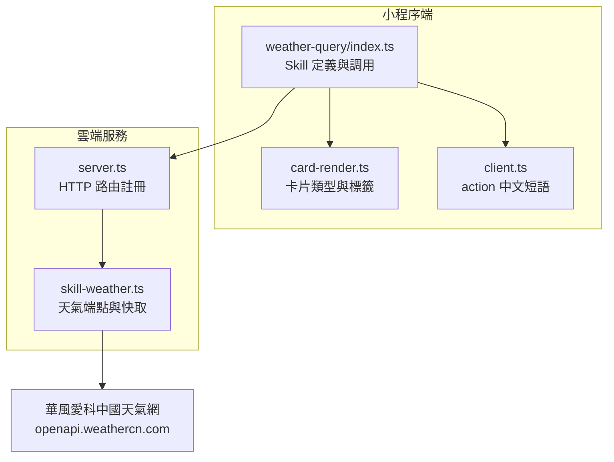
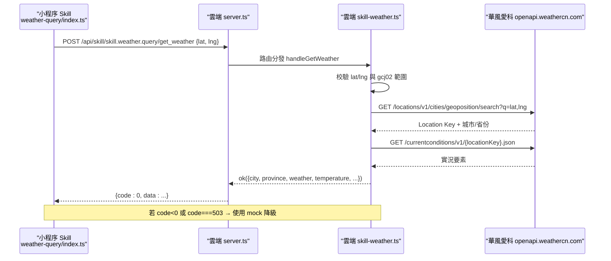
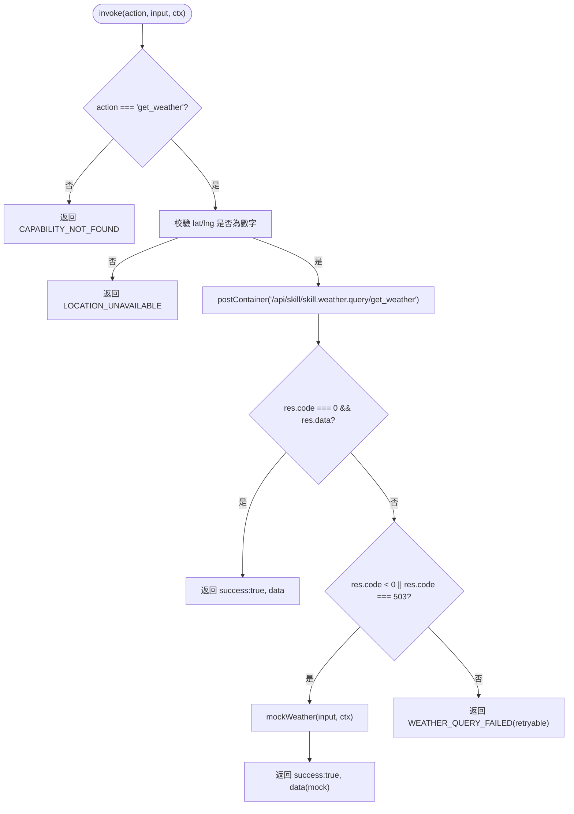
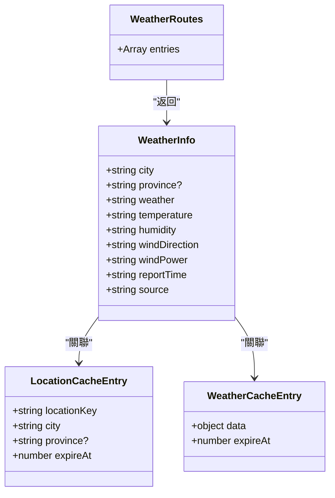
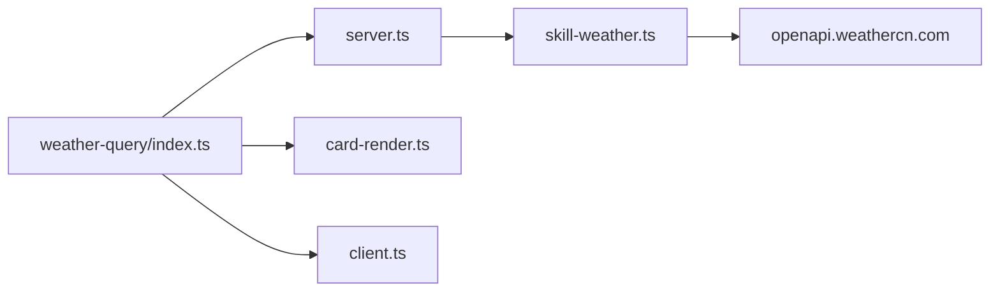

# 天氣查詢 SKILL

<cite>
**本文引用的文件**   
- [miniprogram/src/skills/builtin/weather-query/index.ts](file://miniprogram/src/skills/builtin/weather-query/index.ts)
- [cloudrun/src/skill-weather.ts](file://cloudrun/src/skill-weather.ts)
- [cloudrun/src/server.ts](file://cloudrun/src/server.ts)
- [miniprogram/src/interaction/card-render.ts](file://miniprogram/src/interaction/card-render.ts)
- [miniprogram/src/llm/client.ts](file://miniprogram/src/llm/client.ts)
</cite>

## 目錄
1. [簡介](#簡介)
2. [項目結構與定位](#項目結構與定位)
3. [核心組件](#核心組件)
4. [架構總覽](#架構總覽)
5. [詳細組件分析](#詳細組件分析)
6. [依賴關係分析](#依賴關係分析)
7. [性能與快取特性](#性能與快取特性)
8. [故障診斷與排錯](#故障診斷與排錯)
9. [結論](#結論)

## 簡介
本文件聚焦「天氣查詢 SKILL」的端到端實現：從微信小程序端的 Skill 定義、雲端路由與業務處理，到外部天氣上游（華風愛科中國天氣網開放平台）以及前端卡片渲染。該能力僅支援查詢用戶當前位置的實時天氣，不支援指定城市或未來預報；當雲端不可用或上游失敗時，小程序端會以確定性模擬數據降級，並在卡片中以 `source` 字段明示數據來源。

## 項目結構與定位
天氣查詢 SKILL 橫跨兩端：
- 小程序端：位於 `miniprogram/src/skills/builtin/weather-query/index.ts`，定義 Skill 元信息、入出參 Schema、調用邏輯與本地模擬降級。
- 雲端服務：位於 `cloudrun/src/skill-weather.ts`，提供 `/api/skill/skill.weather.query/get_weather` 端點，負責座標解析、位置 Key 查詢、實況拉取與記憶體快取。
- 雲端路由註冊：`cloudrun/src/server.ts` 匯入並註冊 weather 路由。
- 前端展示：`miniprogram/src/interaction/card-render.ts` 將天氣結果映射為卡片類型與中文標籤；`miniprogram/src/llm/client.ts` 提供 action 中文短語與任務摘要展示。

**圖表來源**
- [miniprogram/src/skills/builtin/weather-query/index.ts:52-94](file://miniprogram/src/skills/builtin/weather-query/index.ts#L52-L94)
- [cloudrun/src/server.ts:31-54](file://cloudrun/src/server.ts#L31-L54)
- [cloudrun/src/skill-weather.ts:302-304](file://cloudrun/src/skill-weather.ts#L302-L304)
- [miniprogram/src/interaction/card-render.ts:51-55](file://miniprogram/src/interaction/card-render.ts#L51-L55)
- [miniprogram/src/llm/client.ts:275-281](file://miniprogram/src/llm/client.ts#L275-L281)

**章節來源**
- [miniprogram/src/skills/builtin/weather-query/index.ts:1-191](file://miniprogram/src/skills/builtin/weather-query/index.ts#L1-L191)
- [cloudrun/src/skill-weather.ts:1-305](file://cloudrun/src/skill-weather.ts#L1-L305)
- [cloudrun/src/server.ts:1-60](file://cloudrun/src/server.ts#L1-L60)
- [miniprogram/src/interaction/card-render.ts:1-138](file://miniprogram/src/interaction/card-render.ts#L1-L138)
- [miniprogram/src/llm/client.ts:270-308](file://miniprogram/src/llm/client.ts#L270-L308)

## 核心組件
- 小程序 Skill 實例：定義能力 `get_weather`、Schema、invoke 流程與 mock 降級。
- 雲端 Weather 端點：校驗輸入、座標→Location Key、實況查詢、雙層快取、統一出參。
- 雲端路由：將 weather 路由加入全局 Map，完成 HTTP 分發。
- 卡片渲染：根據 skillId 選擇天氣卡片類型，並對天氣欄位進行中文標籤映射。
- LLM 客戶端：提供 `get_weather` 的中文短語與任務摘要展示。

**章節來源**
- [miniprogram/src/skills/builtin/weather-query/index.ts:52-94](file://miniprogram/src/skills/builtin/weather-query/index.ts#L52-L94)
- [cloudrun/src/skill-weather.ts:58-75](file://cloudrun/src/skill-weather.ts#L58-L75)
- [cloudrun/src/server.ts:43-59](file://cloudrun/src/server.ts#L43-L59)
- [miniprogram/src/interaction/card-render.ts:73-93](file://miniprogram/src/interaction/card-render.ts#L73-L93)
- [miniprogram/src/llm/client.ts:275-281](file://miniprogram/src/llm/client.ts#L275-L281)

## 架構總覽
以下序列圖展示一次天氣查詢的完整調用鏈：小程序 Skill 調用雲端端點，雲端服務校驗後查詢上游，返回實況或錯誤；小程序端在雲端不可用或業務 503 時回退到本地模擬數據。

**圖表來源**
- [miniprogram/src/skills/builtin/weather-query/index.ts:168-190](file://miniprogram/src/skills/builtin/weather-query/index.ts#L168-L190)
- [cloudrun/src/server.ts:165-180](file://cloudrun/src/server.ts#L165-L180)
- [cloudrun/src/skill-weather.ts:244-299](file://cloudrun/src/skill-weather.ts#L244-L299)

## 詳細組件分析

### 小程序端天氣 Skill
- 能力定義：`get_weather`，要求 `lat`、`lng`，返回包含 `weather`、`temperature` 等字段的結構化數據。
- 調用流程：`instance.invoke` 校驗 action 與座標，再調用 `invokeGetWeather` 發送雲端請求。
- 降級策略：雲端返回 `code < 0` 或 `code === 503` 時，使用 `mockWeather` 生成確定性模擬數據，並以 `source='mock'` 標示。
- Mock 穩定性：基於日期與座標網格化的 djb2 雜湊 seed，確保同日同位置演示數據穩定。

**圖表來源**
- [miniprogram/src/skills/builtin/weather-query/index.ts:143-190](file://miniprogram/src/skills/builtin/weather-query/index.ts#L143-L190)

**章節來源**
- [miniprogram/src/skills/builtin/weather-query/index.ts:27-50](file://miniprogram/src/skills/builtin/weather-query/index.ts#L27-L50)
- [miniprogram/src/skills/builtin/weather-query/index.ts:96-141](file://miniprogram/src/skills/builtin/weather-query/index.ts#L96-L141)
- [miniprogram/src/skills/builtin/weather-query/index.ts:143-190](file://miniprogram/src/skills/builtin/weather-query/index.ts#L143-L190)

### 雲端天氣端點
- 路由：`POST /api/skill/skill.weather.query/get_weather`，由 `weatherRoutes` 暴露。
- 輸入校驗：要求 `lat`、`lng` 為數字且落在中國大陸 gcj02 覆蓋範圍。
- 配置門控：未設置 `WEATHERCN_KEY` 時直接返回業務 503。
- 資料鏈路：
  - 座標 → Location Key：`/locations/v1/cities/geoposition/search?q={lat},{lng}`
  - Location Key → 實況：`/currentconditions/v1/{locationKey}.json`
- 快取機制：
  - 位置鏈：網格座標 → `{ locationKey, city, province }`，TTL 24h，上限 1000。
  - 實況鏈：`locationKey` → 實況要素，TTL 10 分鐘，上限 1000。
- 響應映射：將上游 AccuWeather 同構字段映射為統一出參，補充 `source='weathercn_realtime'`。

**圖表來源**
- [cloudrun/src/skill-weather.ts:58-75](file://cloudrun/src/skill-weather.ts#L58-L75)
- [cloudrun/src/skill-weather.ts:77-95](file://cloudrun/src/skill-weather.ts#L77-L95)
- [cloudrun/src/skill-weather.ts:302-304](file://cloudrun/src/skill-weather.ts#L302-L304)

**章節來源**
- [cloudrun/src/skill-weather.ts:1-38](file://cloudrun/src/skill-weather.ts#L1-L38)
- [cloudrun/src/skill-weather.ts:43-56](file://cloudrun/src/skill-weather.ts#L43-L56)
- [cloudrun/src/skill-weather.ts:97-105](file://cloudrun/src/skill-weather.ts#L97-L105)
- [cloudrun/src/skill-weather.ts:148-167](file://cloudrun/src/skill-weather.ts#L148-L167)
- [cloudrun/src/skill-weather.ts:174-206](file://cloudrun/src/skill-weather.ts#L174-L206)
- [cloudrun/src/skill-weather.ts:218-236](file://cloudrun/src/skill-weather.ts#L218-L236)
- [cloudrun/src/skill-weather.ts:244-299](file://cloudrun/src/skill-weather.ts#L244-L299)

### 雲端路由註冊
- `server.ts` 匯入 `weatherRoutes` 並將其合併進全局路由 Map。
- 健康檢查與請求體解析、異常處理與 JSON 回應格式統一。

**章節來源**
- [cloudrun/src/server.ts:31-54](file://cloudrun/src/server.ts#L31-L54)
- [cloudrun/src/server.ts:108-194](file://cloudrun/src/server.ts#L108-L194)

### 前端卡片渲染與展示
- 卡片類型選擇：若 skillId 包含 `weather`，則卡片類型為 `weather`。
- 欄位標籤映射：`weather`、`temperature`、`humidity`、`windDirection`、`windPower`、`reportTime` 等鍵對應中文標籤。
- LLM 客戶端：`get_weather` 對應中文短語「查詢實時天氣」，用於任務摘要與計劃卡標題。

**章節來源**
- [miniprogram/src/interaction/card-render.ts:51-55](file://miniprogram/src/interaction/card-render.ts#L51-L55)
- [miniprogram/src/interaction/card-render.ts:73-93](file://miniprogram/src/interaction/card-render.ts#L73-L93)
- [miniprogram/src/llm/client.ts:275-281](file://miniprogram/src/llm/client.ts#L275-L281)

## 依賴關係分析
- 小程序 Skill 依賴雲端端點 `/api/skill/skill.weather.query/get_weather`。
- 雲端端點依賴環境變數 `WEATHERCN_KEY` 與外部 API `openapi.weathercn.com`。
- 前端卡片渲染依賴 skillId 匹配規則與欄位標籤白名單。
- LLM 客戶端提供 action 中文短語，影響任務摘要與計劃卡顯示。

**圖表來源**
- [miniprogram/src/skills/builtin/weather-query/index.ts:168-190](file://miniprogram/src/skills/builtin/weather-query/index.ts#L168-L190)
- [cloudrun/src/server.ts:31-54](file://cloudrun/src/server.ts#L31-L54)
- [cloudrun/src/skill-weather.ts:302-304](file://cloudrun/src/skill-weather.ts#L302-L304)
- [miniprogram/src/interaction/card-render.ts:51-55](file://miniprogram/src/interaction/card-render.ts#L51-L55)
- [miniprogram/src/llm/client.ts:275-281](file://miniprogram/src/llm/client.ts#L275-L281)

**章節來源**
- [miniprogram/src/skills/builtin/weather-query/index.ts:168-190](file://miniprogram/src/skills/builtin/weather-query/index.ts#L168-L190)
- [cloudrun/src/server.ts:31-54](file://cloudrun/src/server.ts#L31-L54)
- [cloudrun/src/skill-weather.ts:302-304](file://cloudrun/src/skill-weather.ts#L302-L304)
- [miniprogram/src/interaction/card-render.ts:51-55](file://miniprogram/src/interaction/card-render.ts#L51-L55)
- [miniprogram/src/llm/client.ts:275-281](file://miniprogram/src/llm/client.ts#L275-L281)

## 性能與快取特性
- 雲端雙層快取：
  - 位置鏈 TTL 24 小時，減少重複座標解析。
  - 實況鏈 TTL 10 分鐘，匹配上游更新頻率，避免過度消耗額度。
- 快取上限：每類快取最多 1000 條，淘汰最早插入者，防止無界增長。
- 上游超時：單次請求超時 8 秒，避免長尾阻塞。
- 小程序端 mock 降級：在雲端不可用或業務 503 時立即回退，保證演示與自動化驗證鏈路完整。

**章節來源**
- [cloudrun/src/skill-weather.ts:43-56](file://cloudrun/src/skill-weather.ts#L43-L56)
- [cloudrun/src/skill-weather.ts:91-95](file://cloudrun/src/skill-weather.ts#L91-L95)
- [cloudrun/src/skill-weather.ts:148-167](file://cloudrun/src/skill-weather.ts#L148-L167)
- [cloudrun/src/skill-weather.ts:289-293](file://cloudrun/src/skill-weather.ts#L289-L293)
- [miniprogram/src/skills/builtin/weather-query/index.ts:180-185](file://miniprogram/src/skills/builtin/weather-query/index.ts#L180-L185)

## 故障診斷與排錯
常見問題與排查建議：
- 缺少 `WEATHERCN_KEY`：雲端直接返回業務 503，小程序端觸發 mock 降級。請確認雲端環境已正確配置該變數。
- 座標超出 gcj02 範圍：雲端校驗失敗，返回 bad request。請檢查小程序端座標是否為 GCJ-02 且落在中國大陸範圍內。
- 上游服務不可達或無實況數據：雲端返回業務 503，小程序端回退 mock。可觀察雲端日誌中 `[weather]` 開頭的錯誤訊息。
- 卡片未顯示天氣欄位：檢查 `card-render.ts` 中的 `FIELD_LABELS` 是否包含所需欄位鍵名。
- 任務摘要顯示技術形態：確認 `client.ts` 中 `ACTION_LABELS` 是否包含 `get_weather`。

**章節來源**
- [cloudrun/src/skill-weather.ts:254-257](file://cloudrun/src/skill-weather.ts#L254-L257)
- [cloudrun/src/skill-weather.ts:247-253](file://cloudrun/src/skill-weather.ts#L247-L253)
- [cloudrun/src/skill-weather.ts:152-167](file://cloudrun/src/skill-weather.ts#L152-L167)
- [miniprogram/src/interaction/card-render.ts:73-93](file://miniprogram/src/interaction/card-render.ts#L73-L93)
- [miniprogram/src/llm/client.ts:275-281](file://miniprogram/src/llm/client.ts#L275-L281)

## 結論
天氣查詢 SKILL 通過小程序端 Skill 定義與雲端端點協作，實現了從座標解析、位置 Key 查詢到實況拉取的完整鏈路。雲端側引入雙層記憶體快取與上游超時控制，提升穩定性與效率；小程序端在雲端不可用時提供確定性 mock 降級，確保演示與自動化驗證不受影響。前端卡片渲染與 LLM 客戶端共同保障最終用戶看到人類可讀的結果與摘要。整體設計清晰、容錯完善，適合在微信雲托管環境中穩定運行。