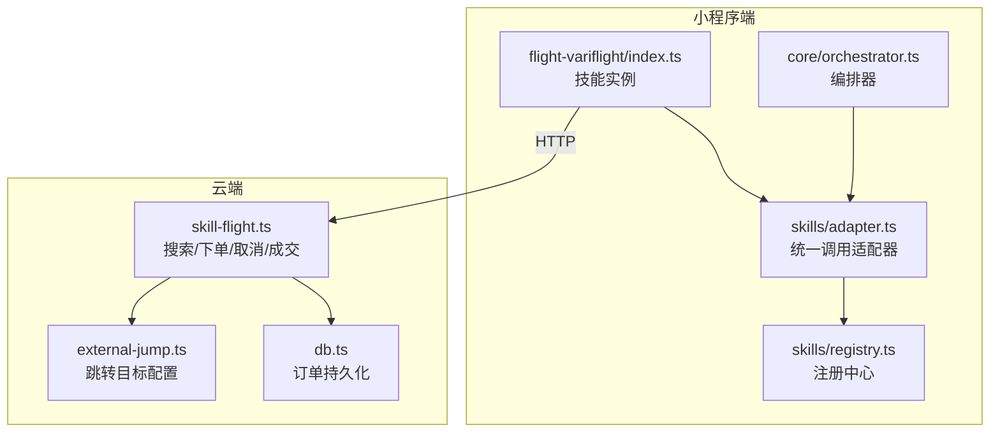
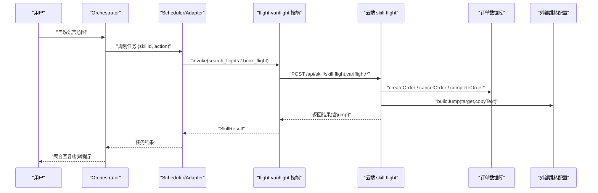
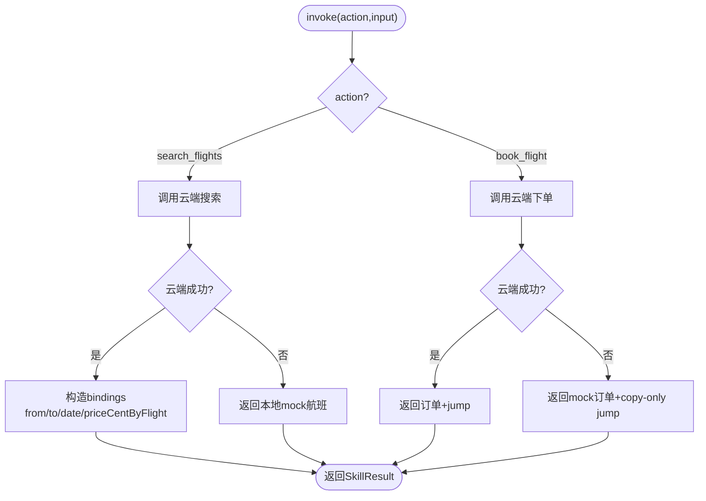
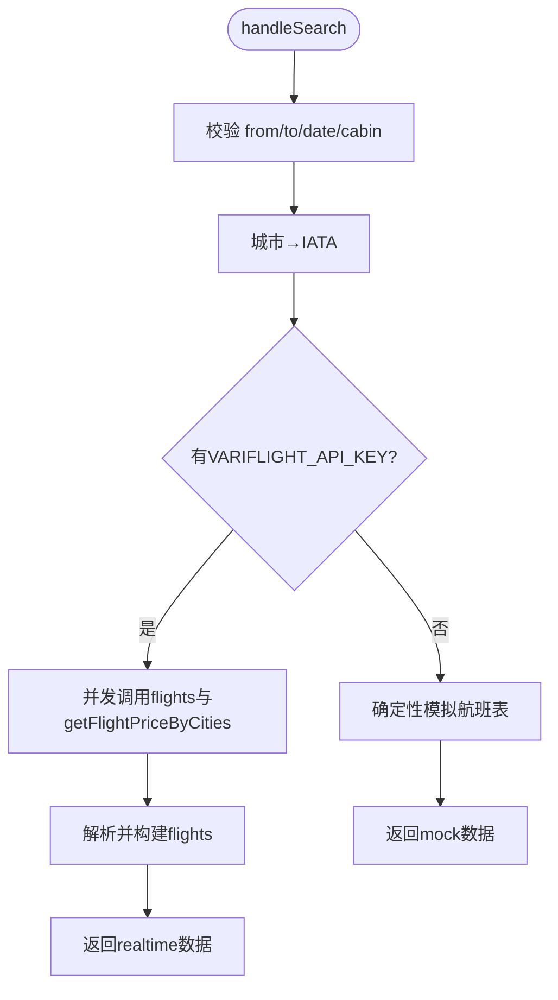
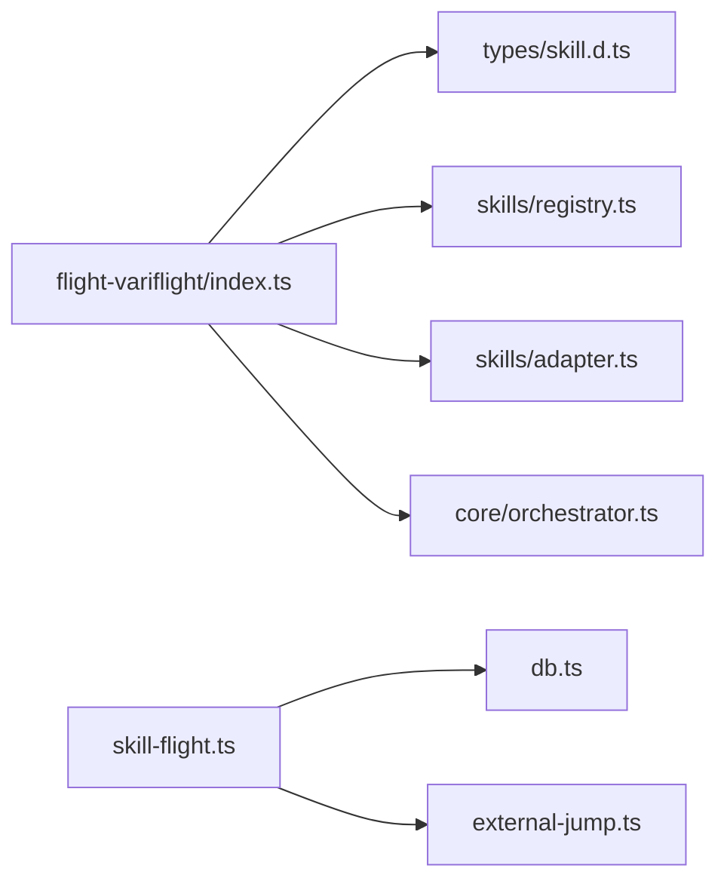

# 航班預訂 SKILL

<cite>
**本文引用的文件**   
- [miniprogram/src/skills/builtin/flight-variflight/index.ts](file://miniprogram/src/skills/builtin/flight-variflight/index.ts)
- [cloudrun/src/skill-flight.ts](file://cloudrun/src/skill-flight.ts)
- [miniprogram/src/types/skill.d.ts](file://miniprogram/src/types/skill.d.ts)
- [miniprogram/src/skills/registry.ts](file://miniprogram/src/skills/registry.ts)
- [miniprogram/src/core/orchestrator.ts](file://miniprogram/src/core/orchestrator.ts)
- [miniprogram/src/skills/adapter.ts](file://miniprogram/src/skills/adapter.ts)
- [cloudrun/src/db.ts](file://cloudrun/src/db.ts)
- [cloudrun/src/external-jump.ts](file://cloudrun/src/external-jump.ts)
- [miniprogram/src/app.ts](file://miniprogram/src/app.ts)
</cite>

## 目录
1. [引言](#引言)
2. [项目结构](#项目结构)
3. [核心组件](#核心组件)
4. [架构总览](#架构总览)
5. [详细组件分析](#详细组件分析)
6. [依赖关系分析](#依赖关系分析)
7. [性能与可靠性](#性能与可靠性)
8. [故障排查指南](#故障排查指南)
9. [结论](#结论)

## 引言
本文件面向“国内机票”能力（SKILL），围绕小程序端 `skill.flight.variflight` 与云端 `skill-flight.ts` 的端到端实现，说明其数据源、接口契约、下单跳转模式、订单持久化与回滚机制。该能力提供：
- 查询航班时刻与舱位票价（幂等）
- 生成购票信息卡并跳转 OTA 小程序完成真实交易（非幂等、可回滚）

## 项目结构
围绕航班预订 SKILL 的关键文件分布如下：
- 小程序端技能实现：`miniprogram/src/skills/builtin/flight-variflight/index.ts`
- 云端路由与业务处理：`cloudrun/src/skill-flight.ts`
- 订单持久化：`cloudrun/src/db.ts`
- 外部渠道跳转配置：`cloudrun/src/external-jump.ts`
- 技能注册中心与调度适配：`miniprogram/src/skills/registry.ts`、`miniprogram/src/skills/adapter.ts`
- 编排器与状态机：`miniprogram/src/core/orchestrator.ts`
- 技能协议类型定义：`miniprogram/src/types/skill.d.ts`
- 应用启动与技能注册入口：`miniprogram/src/app.ts`

图表来源
- [miniprogram/src/skills/builtin/flight-variflight/index.ts:85-176](file://miniprogram/src/skills/builtin/flight-variflight/index.ts#L85-L176)
- [miniprogram/src/skills/registry.ts:16-60](file://miniprogram/src/skills/registry.ts#L16-L60)
- [miniprogram/src/skills/adapter.ts:42-117](file://miniprogram/src/skills/adapter.ts#L42-L117)
- [miniprogram/src/core/orchestrator.ts:120-224](file://miniprogram/src/core/orchestrator.ts#L120-L224)
- [cloudrun/src/skill-flight.ts:475-480](file://cloudrun/src/skill-flight.ts#L475-L480)
- [cloudrun/src/db.ts:162-197](file://cloudrun/src/db.ts#L162-L197)
- [cloudrun/src/external-jump.ts:80-101](file://cloudrun/src/external-jump.ts#L80-L101)

章节来源
- [miniprogram/src/app.ts:1-23](file://miniprogram/src/app.ts#L1-L23)

## 核心组件
- 技能元信息与能力声明：定义 `search_flights` 与 `book_flight` 的能力、输入输出 Schema、幂等性与人类确认要求。
- 技能实例：封装 invoke 与 rollback，分别调用云端 `/api/skill/skill.flight.variflight/search_flights` 与 `/api/skill/skill.flight.variflight/book_flight`，并在失败时降级为本地 mock。
- 云端路由：实现搜索、下单、取消、成交四个端点；优先走飞常準实时数据，不可用时确定性模拟；下单采用“跳转模式”，生成 pending_external 订单并返回跳转包。
- 订单持久化：MySQL 持久化 + 内存降级，支持按 owner 鉴权取消与成交。
- 外部跳转：集中配置跳转目标 appId 与 path，未配置则 copy-only。
- 注册中心与适配器：统一注册、查找、校验、缓存、埋点与错误转换。
- 编排器：负责理解、规划、确认、执行、聚合、回滚的状态机流转。

章节来源
- [miniprogram/src/skills/builtin/flight-variflight/index.ts:85-176](file://miniprogram/src/skills/builtin/flight-variflight/index.ts#L85-L176)
- [miniprogram/src/skills/builtin/flight-variflight/index.ts:178-209](file://miniprogram/src/skills/builtin/flight-variflight/index.ts#L178-L209)
- [cloudrun/src/skill-flight.ts:226-331](file://cloudrun/src/skill-flight.ts#L226-L331)
- [cloudrun/src/skill-flight.ts:345-422](file://cloudrun/src/skill-flight.ts#L345-L422)
- [cloudrun/src/db.ts:162-197](file://cloudrun/src/db.ts#L162-L197)
- [cloudrun/src/external-jump.ts:80-101](file://cloudrun/src/external-jump.ts#L80-L101)
- [miniprogram/src/skills/registry.ts:16-60](file://miniprogram/src/skills/registry.ts#L16-L60)
- [miniprogram/src/skills/adapter.ts:42-117](file://miniprogram/src/skills/adapter.ts#L42-L117)
- [miniprogram/src/core/orchestrator.ts:120-224](file://miniprogram/src/core/orchestrator.ts#L120-L224)

## 架构总览
航班预订 SKILL 的端到端流程如下：
- 用户意图经 Orchestrator 理解与规划后，由 Scheduler 通过 Adapter 调用对应 SkillInstance。
- 小程序端 flight-variflight 技能通过 services/cloud 调用云端 API。
- 云端 skill-flight 根据环境变量选择飞常準实时数据或确定性模拟；下单生成跳转订单并落库。
- 用户在 OTA 小程序侧完成真实支付后，回调 complete 将订单标记为 completed。

图表来源
- [miniprogram/src/core/orchestrator.ts:120-224](file://miniprogram/src/core/orchestrator.ts#L120-L224)
- [miniprogram/src/skills/adapter.ts:42-117](file://miniprogram/src/skills/adapter.ts#L42-L117)
- [miniprogram/src/skills/builtin/flight-variflight/index.ts:178-209](file://miniprogram/src/skills/builtin/flight-variflight/index.ts#L178-L209)
- [cloudrun/src/skill-flight.ts:475-480](file://cloudrun/src/skill-flight.ts#L475-L480)
- [cloudrun/src/db.ts:162-197](file://cloudrun/src/db.ts#L162-L197)
- [cloudrun/src/external-jump.ts:80-101](file://cloudrun/src/external-jump.ts#L80-L101)

## 详细组件分析

### 技能协议与类型
- 技能元信息包含 id、name、description、capabilities 等，用于 LLM 规划与路由。
- 能力声明明确 action、inputSchema、outputSchema、idempotent、reversible、requiresHumanConfirm、estimatedLatencyMs。
- JumpPackage 描述外部渠道跳转包结构，appId 为空表示仅复制信息。

章节来源
- [miniprogram/src/types/skill.d.ts:16-127](file://miniprogram/src/types/skill.d.ts#L16-L127)

### 小程序端航班技能实现
- 暴露 meta 与 instance：meta 定义 search_flights 与 book_flight 能力；instance.invoke 分发到搜索与下单逻辑；rollback 调用云端取消接口。
- 搜索逻辑：调用云端搜索接口，若云端不可用（code < 0）则返回本地 mock 数据；成功时构造 bindings（首班关键信息与 priceCentByFlight 映射）。
- 下单逻辑：调用云端下单接口，禁用自动重试；云端不可用时返回 mock 订单（pending_external + jump.copy-only），金额与舱位标签与云端基准价对齐。
- 绑定注入：search_flights 的输出 bindings 供下游 book_flight 引用，支持“泛买机票”直接取首班，“指定航班”通过 priceCentByFlight 精确取值。

图表来源
- [miniprogram/src/skills/builtin/flight-variflight/index.ts:178-209](file://miniprogram/src/skills/builtin/flight-variflight/index.ts#L178-L209)
- [miniprogram/src/skills/builtin/flight-variflight/index.ts:211-264](file://miniprogram/src/skills/builtin/flight-variflight/index.ts#L211-L264)
- [miniprogram/src/skills/builtin/flight-variflight/index.ts:266-314](file://miniprogram/src/skills/builtin/flight-variflight/index.ts#L266-L314)

章节来源
- [miniprogram/src/skills/builtin/flight-variflight/index.ts:85-176](file://miniprogram/src/skills/builtin/flight-variflight/index.ts#L85-L176)
- [miniprogram/src/skills/builtin/flight-variflight/index.ts:178-209](file://miniprogram/src/skills/builtin/flight-variflight/index.ts#L178-L209)
- [miniprogram/src/skills/builtin/flight-variflight/index.ts:211-314](file://miniprogram/src/skills/builtin/flight-variflight/index.ts#L211-L314)

### 云端航班服务
- 搜索端点 handleSearch：
  - 参数校验（from/to/date/cabin）。
  - 城市名转 IATA 码，不支持城市返回业务失败。
  - 若配置 VARIFLIGHT_API_KEY，并发拉取航班时刻与舱位价格；时刻为主数据，价格失败不影响时刻。
  - 解析上游响应，构建 flights 列表（限制最多 8 条），计算飞行时长。
  - 若无 Key 或连接层失败，使用确定性模拟数据（djb2 种子保证同参同果）。
- 下单端点 handleBook：
  - 必填校验与 openid 鉴权。
  - 优先尝试从飞常準获取真实票价（按航班号+舱位匹配），失败回退静态基准价。
  - 生成订单（pending_external），写入数据库，返回跳转包（buildJump）。
- 取消端点 handleCancel：
  - 校验 orderId 与 openid，按 owner 鉴权删除订单。
- 成交端点 handleComplete：
  - 校验 orderId 与 openid，防止重复成交与越权，标记订单为 completed。

图表来源
- [cloudrun/src/skill-flight.ts:226-331](file://cloudrun/src/skill-flight.ts#L226-L331)

章节来源
- [cloudrun/src/skill-flight.ts:226-331](file://cloudrun/src/skill-flight.ts#L226-L331)
- [cloudrun/src/skill-flight.ts:345-422](file://cloudrun/src/skill-flight.ts#L345-L422)
- [cloudrun/src/skill-flight.ts:429-446](file://cloudrun/src/skill-flight.ts#L429-L446)
- [cloudrun/src/skill-flight.ts:453-473](file://cloudrun/src/skill-flight.ts#L453-L473)

### 订单持久化与外部跳转
- 订单模型 ExternalOrder：orderId、owner、domain、status、payload、createdAt。
- 持久化策略：MySQL 主路径，未配置或初始化失败降级为内存 Map；所有写操作带 owner 鉴权。
- 外部跳转：EXTERNAL_JUMP 环境变量集中配置各渠道 appId 与 path；未配置时 appId 为空串，前端仅展示复制信息。

章节来源
- [cloudrun/src/db.ts:23-45](file://cloudrun/src/db.ts#L23-L45)
- [cloudrun/src/db.ts:162-197](file://cloudrun/src/db.ts#L162-L197)
- [cloudrun/src/external-jump.ts:18-43](file://cloudrun/src/external-jump.ts#L18-L43)
- [cloudrun/src/external-jump.ts:80-101](file://cloudrun/src/external-jump.ts#L80-L101)

### 技能注册与调度适配
- 注册中心 SkillRegistry：维护 skillId → SkillInstance 映射，提供 list/listSlim/get/findCapability 等方法。
- 适配器 adapter.invoke：
  - 查找技能实例与能力，进行入参 schema 校验。
  - 对 idempotent=true 的查询类能力启用 5 分钟缓存。
  - 统一错误包装与埋点。
- 适配器.rollback：调用技能的 rollback 方法，失败记录日志并返回 rolled=false。

章节来源
- [miniprogram/src/skills/registry.ts:16-60](file://miniprogram/src/skills/registry.ts#L16-L60)
- [miniprogram/src/skills/adapter.ts:42-117](file://miniprogram/src/skills/adapter.ts#L42-L117)
- [miniprogram/src/skills/adapter.ts:119-144](file://miniprogram/src/skills/adapter.ts#L119-L144)

### 编排器与状态机
- Orchestrator.handle：
  - 状态转移：idle → understanding → planning → confirming_plan → executing → aggregating → completed/failed。
  - 计划确认与行程落库。
  - 调度执行任务，支持 waiting_human 转为 awaiting_human。
  - 失败时按反序回滚已成功且可逆的任务。
- 运行令牌 ACTIVE_RUNS：防止热重载或多轮对话时的并发冲突。

章节来源
- [miniprogram/src/core/orchestrator.ts:61-72](file://miniprogram/src/core/orchestrator.ts#L61-L72)
- [miniprogram/src/core/orchestrator.ts:120-224](file://miniprogram/src/core/orchestrator.ts#L120-L224)
- [miniprogram/src/core/orchestrator.ts:331-356](file://miniprogram/src/core/orchestrator.ts#L331-L356)

## 依赖关系分析
- 小程序端 flight-variflight 技能依赖：
  - types/skill.d.ts（SkillMeta/SkillInstance/JumpPackage）
  - skills/registry.ts（注册中心）
  - skills/adapter.ts（统一调用）
  - core/orchestrator.ts（编排器）
  - services/cloud（云端通信封装）
- 云端 skill-flight 依赖：
  - db.ts（订单持久化）
  - external-jump.ts（跳转配置）
  - 环境变量 VARIFLIGHT_API_KEY、EXTERNAL_JUMP、MYSQL_*

图表来源
- [miniprogram/src/skills/builtin/flight-variflight/index.ts:14-18](file://miniprogram/src/skills/builtin/flight-variflight/index.ts#L14-L18)
- [miniprogram/src/types/skill.d.ts:16-127](file://miniprogram/src/types/skill.d.ts#L16-L127)
- [miniprogram/src/skills/registry.ts:16-60](file://miniprogram/src/skills/registry.ts#L16-L60)
- [miniprogram/src/skills/adapter.ts:42-117](file://miniprogram/src/skills/adapter.ts#L42-L117)
- [miniprogram/src/core/orchestrator.ts:120-224](file://miniprogram/src/core/orchestrator.ts#L120-L224)
- [cloudrun/src/skill-flight.ts:475-480](file://cloudrun/src/skill-flight.ts#L475-L480)
- [cloudrun/src/db.ts:162-197](file://cloudrun/src/db.ts#L162-L197)
- [cloudrun/src/external-jump.ts:80-101](file://cloudrun/src/external-jump.ts#L80-L101)

## 性能与可靠性
- 查询性能：
  - 小程序端对 idempotent 查询能力启用 5 分钟缓存，减少重复云端调用。
  - 云端并发拉取时刻与价格（Promise.allSettled），价格失败不拖垮时刻。
- 可靠性：
  - 云端连接层失败（超时/不可达/非2xx/畸形JSON）降级为确定性模拟；业务性错误如额度耗尽透传而非降級。
  - 下单禁用自动重试，避免重复下单。
  - 订单持久化 MySQL 失败降级内存，保证服务可用。
- 用户体验：
  - 云端不可用时小程序端返回 mock 数据与 copy-only 跳转，UI 形态与真实链路一致。
  - 跳转模式明确告知用户真实交易在外部渠道完成。

章节来源
- [miniprogram/src/skills/adapter.ts:88-108](file://miniprogram/src/skills/adapter.ts#L88-L108)
- [cloudrun/src/skill-flight.ts:107-144](file://cloudrun/src/skill-flight.ts#L107-L144)
- [cloudrun/src/skill-flight.ts:245-299](file://cloudrun/src/skill-flight.ts#L245-L299)
- [cloudrun/src/db.ts:87-121](file://cloudrun/src/db.ts#L87-L121)
- [miniprogram/src/skills/builtin/flight-variflight/index.ts:211-236](file://miniprogram/src/skills/builtin/flight-variflight/index.ts#L211-L236)
- [miniprogram/src/skills/builtin/flight-variflight/index.ts:266-314](file://miniprogram/src/skills/builtin/flight-variflight/index.ts#L266-L314)

## 故障排查指南
- 技能未注册或能力不存在：
  - 检查 SkillRegistry 是否注册了 skillId，以及 capability.action 是否匹配。
  - 参考适配器返回的错误码 SKILL_NOT_FOUND / CAPABILITY_NOT_FOUND。
- 参数校验失败：
  - 检查 inputSchema 与传入参数，关注 INVALID_INPUT 错误与字段标签提示。
- 云端搜索失败：
  - 检查 VARIFLIGHT_API_KEY 是否配置，网络连通性与配额。
  - 查看 VfToolError/VfTransportError 日志区分业务错误与连接层错误。
- 下单失败：
  - 确认 openid 鉴权是否携带，必填字段是否齐全。
  - 注意下单禁用重试，避免重复下单。
- 订单无法取消或成交：
  - 检查 orderId 是否存在、domain 是否为 flight、owner 是否匹配。
  - 已取消订单不可再次成交。
- 跳转无效：
  - 检查 EXTERNAL_JUMP 配置中 ota_flight 的 appId 与 path。
  - appId 为空时前端仅显示复制信息。

章节来源
- [miniprogram/src/skills/adapter.ts:49-84](file://miniprogram/src/skills/adapter.ts#L49-L84)
- [cloudrun/src/skill-flight.ts:226-237](file://cloudrun/src/skill-flight.ts#L226-L237)
- [cloudrun/src/skill-flight.ts:345-353](file://cloudrun/src/skill-flight.ts#L345-L353)
- [cloudrun/src/skill-flight.ts:429-446](file://cloudrun/src/skill-flight.ts#L429-L446)
- [cloudrun/src/skill-flight.ts:453-473](file://cloudrun/src/skill-flight.ts#L453-L473)
- [cloudrun/src/external-jump.ts:48-67](file://cloudrun/src/external-jump.ts#L48-L67)

## 结论
航班预订 SKILL 以“查询真实数据 + 跳转官方渠道下单”为核心设计，兼顾离线演示与线上真实交易。小程序端通过统一的技能协议与适配器接入云端能力，云端通过分层数据源与订单持久化保障可靠性与可观测性。未来可在以下方面持续优化：
- 扩展城市词表与站点映射，提升搜索成功率。
- 完善上游价格字段探测与容错，提高价格命中率。
- 增强跳转渠道配置的可观测性与灰度发布能力。
- 在云端引入 clientToken 实现下单幂等，进一步降低重复下单风险。