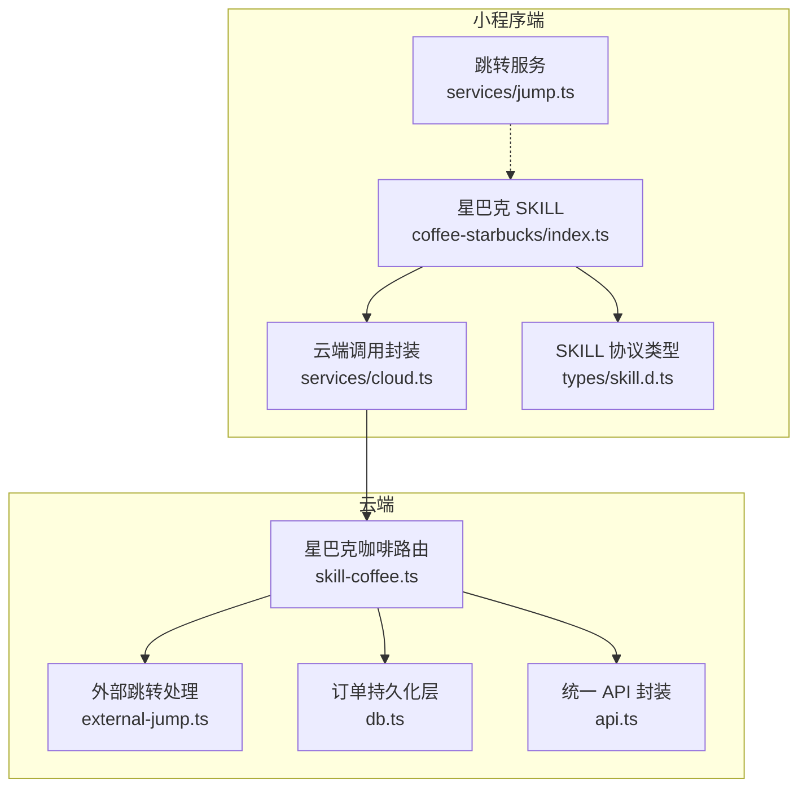
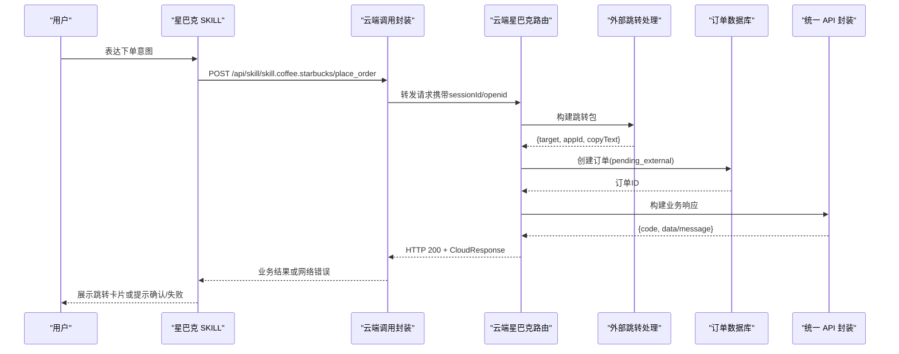
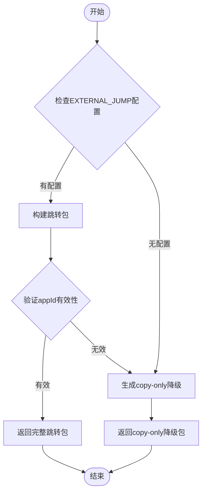
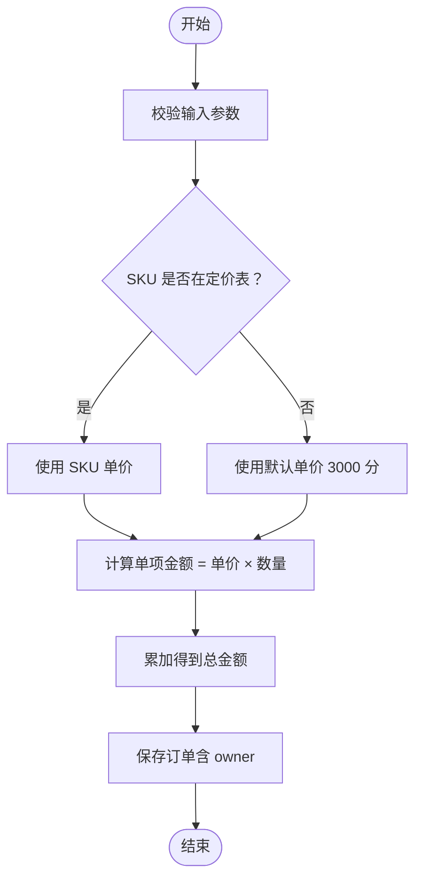
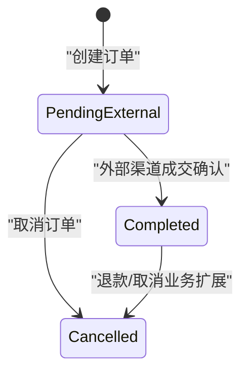
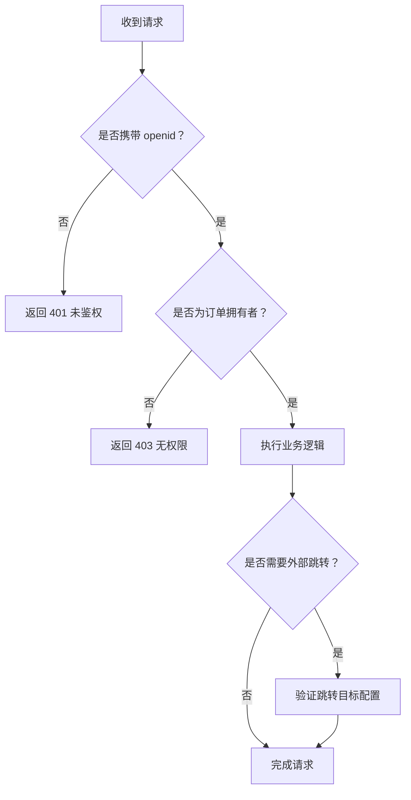
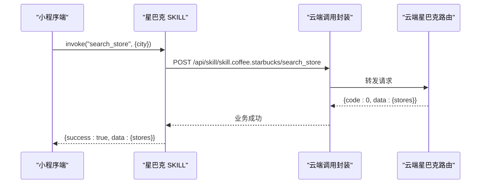
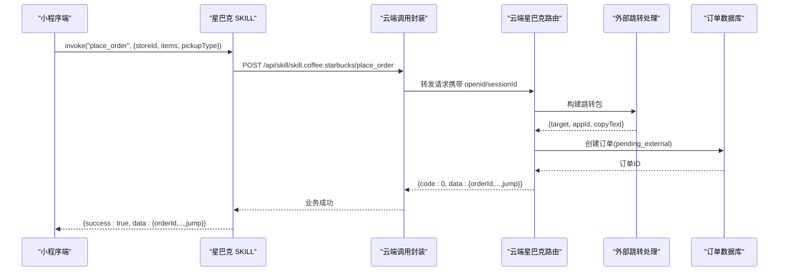
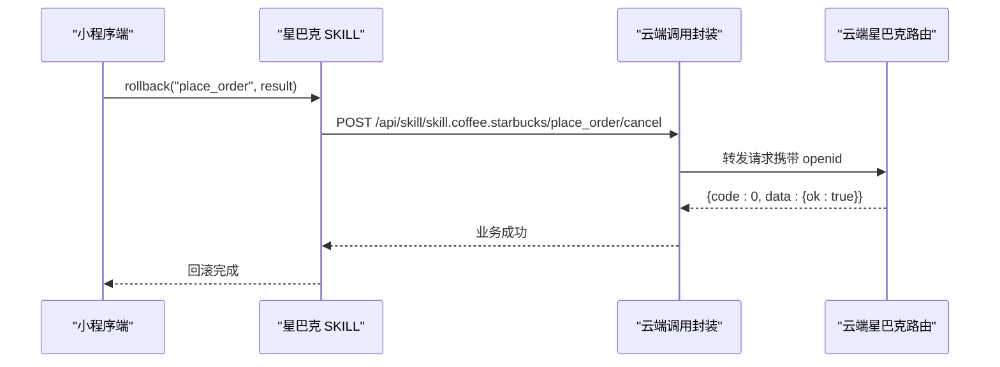
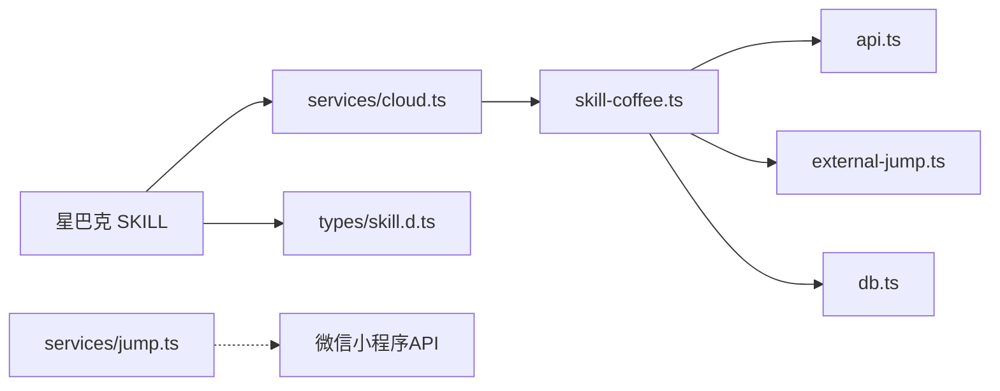

# 星巴克咖啡SKILL

<cite>
**本文引用的文件**   
- [miniprogram/src/skills/builtin/coffee-starbucks/index.ts](file://miniprogram/src/skills/builtin/coffee-starbucks/index.ts)
- [cloudrun/src/skill-coffee.ts](file://cloudrun/src/skill-coffee.ts)
- [cloudrun/src/external-jump.ts](file://cloudrun/src/external-jump.ts)
- [cloudrun/src/db.ts](file://cloudrun/src/db.ts)
- [miniprogram/src/services/cloud.ts](file://miniprogram/src/services/cloud.ts)
- [miniprogram/src/types/skill.d.ts](file://miniprogram/src/types/skill.d.ts)
- [miniprogram/src/services/jump.ts](file://miniprogram/src/services/jump.ts)
</cite>

## 更新摘要
**变更内容**   
- 新增跳转模式实现，支持外部应用重定向到星巴克小程序
- 引入JumpPackage类型和external-jump模块处理跳转逻辑
- 订单数据从内存Map迁移到MySQL数据库持久化存储
- 增强订单状态管理，支持pending_external、completed、cancelled状态流转
- 完善外部渠道跳转配置机制，支持环境变量动态配置

## 目录
1. [简介](#简介)
2. [项目结构](#项目结构)
3. [核心组件](#核心组件)
4. [架构总览](#架构总览)
5. [详细组件分析](#详细组件分析)
6. [依赖关系分析](#依赖关系分析)
7. [性能与扩展性](#性能与扩展性)
8. [故障排查指南](#故障排查指南)
9. [结论](#结论)

## 简介
本技术文档围绕"星巴克咖啡 SKILL"展开，说明其业务目标、能力边界、API 接口、SKU 价格体系、订单数据结构与安全机制，并提供调用示例与排错建议。该 SKILL 提供两项核心能力：
- 查询附近门店（search_store）
- 创建订单（place_order），并支持回滚取消（place_order/cancel）

**重要更新**：2026年10月六域回补后，由于星巴克开放平台仅面向企业资质ISV，个人主体无法获取API权限，因此place_order改为"点单需求卡（pending_external）+ 跳转星巴克官方小程序完成真实点单与支付"的模式，与train/flight同构。

小程序端通过 SKILL 协议封装调用云端容器 API；云端以 MySQL 数据库持久化存储订单，实现生产级部署。

## 项目结构
星巴克咖啡 SKILL 涉及小程序端与云端两部分：
- 小程序端
  - SKILL 定义与调用：miniprogram/src/skills/builtin/coffee-starbucks/index.ts
  - 云端调用封装：miniprogram/src/services/cloud.ts
  - 跳转服务：miniprogram/src/services/jump.ts
  - SKILL 协议类型：miniprogram/src/types/skill.d.ts
- 云端
  - 星巴克咖啡路由与业务逻辑：cloudrun/src/skill-coffee.ts
  - 外部跳转处理：cloudrun/src/external-jump.ts
  - 订单持久化层：cloudrun/src/db.ts
  - 统一 API 响应封装：cloudrun/src/api.ts

**图表来源**
- [miniprogram/src/skills/builtin/coffee-starbucks/index.ts:1-259](file://miniprogram/src/skills/builtin/coffee-starbucks/index.ts#L1-L259)
- [cloudrun/src/skill-coffee.ts:1-206](file://cloudrun/src/skill-coffee.ts#L1-L206)
- [cloudrun/src/external-jump.ts:1-114](file://cloudrun/src/external-jump.ts#L1-L114)
- [cloudrun/src/db.ts:1-266](file://cloudrun/src/db.ts#L1-L266)

**章节来源**
- [miniprogram/src/skills/builtin/coffee-starbucks/index.ts:1-259](file://miniprogram/src/skills/builtin/coffee-starbucks/index.ts#L1-L259)
- [cloudrun/src/skill-coffee.ts:1-206](file://cloudrun/src/skill-coffee.ts#L1-L206)
- [cloudrun/src/external-jump.ts:1-114](file://cloudrun/src/external-jump.ts#L1-L114)
- [cloudrun/src/db.ts:1-266](file://cloudrun/src/db.ts#L1-L266)

## 核心组件
- 星巴克 SKILL（小程序端）
  - 暴露 meta 与 instance，声明两个能力：search_store、place_order
  - invoke 分发到具体处理函数，rollback 调用取消接口
  - 对云端返回 code=0 视为成功，code=-1 走本地 mock 降级
  - 支持跳转模式，返回pending_external状态和jump包信息
- 云端星巴克路由
  - 提供三个 POST 端点：search_store、place_order、place_order/cancel
  - SKU 定价表 + 默认单价，计算订单金额
  - 使用MySQL数据库持久化存储订单，包含 owner 字段用于鉴权
  - 集成external-jump模块处理外部应用跳转
- 外部跳转处理
  - 集中管理跳转目标配置，支持环境变量动态配置
  - 构建统一的跳转包结构，支持appId空值时的copy-only降级
  - 支持多种跳转渠道：starbucks、damai等
- 订单持久化层
  - 支持MySQL数据库和内存Map双模式存储
  - 自动降级机制，数据库不可用时回退到内存存储
  - 提供完整的CRUD操作和状态管理
- 云端调用封装
  - 统一超时、重试、错误归一化
  - 开发环境将不可用场景降级为 code:-1，便于本地演示

**章节来源**
- [miniprogram/src/skills/builtin/coffee-starbucks/index.ts:155-184](file://miniprogram/src/skills/builtin/coffee-starbucks/index.ts#L155-L184)
- [cloudrun/src/skill-coffee.ts:110-175](file://cloudrun/src/skill-coffee.ts#L110-L175)
- [cloudrun/src/external-jump.ts:92-113](file://cloudrun/src/external-jump.ts#L92-L113)
- [cloudrun/src/db.ts:164-200](file://cloudrun/src/db.ts#L164-L200)

## 架构总览
小程序端通过 SKILL 协议调用云端容器 API，云端按路由分发给星巴克咖啡处理器，返回标准 CloudResponse。新增的跳转模式允许用户跳转到星巴克小程序完成真实交易。

**图表来源**
- [miniprogram/src/skills/builtin/coffee-starbucks/index.ts:207-249](file://miniprogram/src/skills/builtin/coffee-starbucks/index.ts#L207-L249)
- [cloudrun/src/skill-coffee.ts:146-175](file://cloudrun/src/skill-coffee.ts#L146-L175)
- [cloudrun/src/external-jump.ts:92-113](file://cloudrun/src/external-jump.ts#L92-L113)
- [cloudrun/src/db.ts:158-165](file://cloudrun/src/db.ts#L158-L165)

## 详细组件分析

### 接口定义与行为语义
- search_store
  - 幂等：是
  - 可回滚：否
  - 需人工确认：否
  - 预估延迟：约 1000ms
- place_order
  - 幂等：否
  - 可回滚：是
  - 需人工确认：是
  - 预估延迟：约 1500ms
  - **新增**：返回pending_external状态，支持外部跳转

上述语义由 SKILL 元信息 capabilities 声明，供 LLM 规划与调度使用。

**章节来源**
- [miniprogram/src/skills/builtin/coffee-starbucks/index.ts:75-152](file://miniprogram/src/skills/builtin/coffee-starbucks/index.ts#L75-L152)
- [miniprogram/src/types/skill.d.ts:37-58](file://miniprogram/src/types/skill.d.ts#L37-L58)

### API 接口规范

#### 查询附近门店 search_store
- 方法：POST
- 路径：/api/skill/skill.coffee.starbucks/search_store
- 请求体
  - city：必填，字符串
  - lat：可选，数字（用户纬度）
  - lng：可选，数字
  - limit：可选，整数，范围 1~20
- 响应体
  - stores：数组，元素包含 storeId、name、address、distanceM、openNow
- 业务逻辑
  - 校验 city 必填
  - 限制 limit 在合理范围内
  - 返回固定模拟门店列表

**章节来源**
- [miniprogram/src/skills/builtin/coffee-starbucks/index.ts:186-205](file://miniprogram/src/skills/builtin/coffee-starbucks/index.ts#L186-L205)
- [cloudrun/src/skill-coffee.ts:82-102](file://cloudrun/src/skill-coffee.ts#L82-L102)

#### 创建订单 place_order
- 方法：POST
- 路径：/api/skill/skill.coffee.starbucks/place_order
- 请求体
  - storeId：必填，字符串
  - pickupType：必填，枚举 in_store 或 takeaway
  - items：必填，数组，每项含 sku、quantity（≥1）、name（可选）、size（可选）
- 响应体
  - orderId：字符串
  - storeId：字符串
  - items：数组，每项含 sku、name、quantity、amountCent
  - amountCent：整数（单位：分）
  - status：**新增** pending_external | completed | cancelled
  - jump：**新增** JumpPackage对象，包含跳转信息
- 业务逻辑
  - 校验必填项与数量合法性
  - 校验 pickupType 枚举值
  - 校验每个 item 的 sku 与 quantity
  - 鉴权：必须携带 openid，否则拒绝
  - 计算单价与总价，写入数据库订单表
  - **新增**：生成跳转包，支持外部应用跳转

**章节来源**
- [miniprogram/src/skills/builtin/coffee-starbucks/index.ts:207-249](file://miniprogram/src/skills/builtin/coffee-starbucks/index.ts#L207-L249)
- [cloudrun/src/skill-coffee.ts:110-175](file://cloudrun/src/skill-coffee.ts#L110-L175)

#### 取消订单 place_order/cancel
- 方法：POST
- 路径：/api/skill/skill.coffee.starbucks/place_order/cancel
- 请求体
  - orderId：必填，字符串
- 响应体
  - ok：布尔
  - orderId：字符串
- 业务逻辑
  - 校验 orderId 必填
  - 鉴权：必须携带 openid
  - 查找订单，不存在则返回 404
  - 归属鉴权：仅订单拥有者可取消
  - 删除订单记录

**章节来源**
- [cloudrun/src/skill-coffee.ts:181-199](file://cloudrun/src/skill-coffee.ts#L181-L199)

### 跳转模式与外部应用重定向

**新增功能**：星巴克 SKILL 现已支持跳转模式，允许用户跳转到星巴克官方小程序完成真实交易。

#### 跳转包结构 (JumpPackage)
- target：跳转渠道标识符（'starbucks' | 'damai' | 'none'）
- appId：目标小程序 appId（空串表示copy-only降级）
- path：目标页面路径（可选）
- jCommand：跳转指令（可选）
- copyText：复制文本信息
- note：模式说明

#### 外部跳转处理流程

**图表来源**
- [cloudrun/src/external-jump.ts:60-85](file://cloudrun/src/external-jump.ts#L60-L85)
- [cloudrun/src/external-jump.ts:92-113](file://cloudrun/src/external-jump.ts#L92-L113)

**章节来源**
- [miniprogram/src/types/skill.d.ts:115-128](file://miniprogram/src/types/skill.d.ts#L115-L128)
- [cloudrun/src/external-jump.ts:1-114](file://cloudrun/src/external-jump.ts#L1-L114)

### SKU 价格体系与默认价格处理
- SKU 单价（单位：分）
  - latte：3300
  - americano：2700
  - cappuccino：3200
  - caramel_macchiato：3800
- 未列出的 SKU 采用默认单价：3000 分
- 订单金额计算
  - 单项金额 = 单价 × 数量
  - 总金额 = 所有单项金额之和

**图表来源**
- [cloudrun/src/skill-coffee.ts:29-36](file://cloudrun/src/skill-coffee.ts#L29-L36)
- [cloudrun/src/skill-coffee.ts:135-144](file://cloudrun/src/skill-coffee.ts#L135-L144)

**章节来源**
- [cloudrun/src/skill-coffee.ts:29-36](file://cloudrun/src/skill-coffee.ts#L29-L36)
- [cloudrun/src/skill-coffee.ts:135-144](file://cloudrun/src/skill-coffee.ts#L135-L144)

### 订单管理系统数据结构
- 数据库表：external_orders
- 订单字段
  - order_id：订单ID（主键）
  - owner：订单拥有者（openid）
  - domain：业务域（'coffee'）
  - status：订单状态
  - payload：JSON格式的订单详情
  - created_at：创建时间戳
- 状态流转
  - pending_external：已生成跳转信息，等待用户在外部渠道完成真实交易
  - completed：用户确认已在外部渠道成交
  - cancelled：已取消
- 用户归属验证
  - 写操作（下单）必须携带 openid
  - 取消操作需比对 order.owner 与 ctx.openid，不一致则拒绝

**图表来源**
- [cloudrun/src/db.ts:32-38](file://cloudrun/src/db.ts#L32-L38)
- [cloudrun/src/skill-coffee.ts:158-165](file://cloudrun/src/skill-coffee.ts#L158-L165)
- [cloudrun/src/db.ts:193-200](file://cloudrun/src/db.ts#L193-L200)

**章节来源**
- [cloudrun/src/db.ts:40-48](file://cloudrun/src/db.ts#L40-L48)
- [cloudrun/src/skill-coffee.ts:158-165](file://cloudrun/src/skill-coffee.ts#L158-L165)
- [cloudrun/src/db.ts:193-200](file://cloudrun/src/db.ts#L193-L200)

### 安全机制
- 用户身份验证
  - 云端从请求头 x-wx-openid 获取 openid
  - 写操作（下单、取消）强制要求 openid，缺失即拒绝
- 权限控制与防越权访问
  - 取消订单时比较 order.owner 与 ctx.openid，防止 IDOR（跨资源越权）
  - 数据库层面使用owner字段进行归属验证
- 会话关联
  - 小程序端通过 header x-micromate-session 传递 sessionId，便于链路追踪
- 外部跳转安全
  - 跳转目标通过环境变量集中配置，支持白名单管理
  - appId为空时自动降级为copy-only模式

**图表来源**
- [cloudrun/src/skill-coffee.ts:130-133](file://cloudrun/src/skill-coffee.ts#L130-L133)
- [cloudrun/src/skill-coffee.ts:193-197](file://cloudrun/src/skill-coffee.ts#L193-L197)
- [cloudrun/src/external-jump.ts:82-85](file://cloudrun/src/external-jump.ts#L82-L85)

**章节来源**
- [cloudrun/src/skill-coffee.ts:130-133](file://cloudrun/src/skill-coffee.ts#L130-L133)
- [cloudrun/src/skill-coffee.ts:193-197](file://cloudrun/src/skill-coffee.ts#L193-L197)
- [cloudrun/src/external-jump.ts:82-85](file://cloudrun/src/external-jump.ts#L82-L85)

### 调用示例与错误处理

#### 查询附近门店
- 成功响应
  - HTTP 200
  - body.code = 0
  - body.data.stores 为门店数组
- 常见错误
  - 缺少 city：HTTP 400，body.code = 400
  - 网络异常：小程序端重试或降级为本地 mock

**图表来源**
- [miniprogram/src/skills/builtin/coffee-starbucks/index.ts:186-205](file://miniprogram/src/skills/builtin/coffee-starbucks/index.ts#L186-L205)
- [cloudrun/src/skill-coffee.ts:82-102](file://cloudrun/src/skill-coffee.ts#L82-L102)

#### 创建订单（跳转模式）
- 成功响应
  - HTTP 200
  - body.code = 0
  - body.data 包含 orderId、storeId、items、amountCent、status='pending_external'、jump对象
- 常见错误
  - 参数缺失或非法：HTTP 400
  - 缺少 openid：HTTP 401
  - 网络异常：小程序端重试或降级为本地 mock

**图表来源**
- [miniprogram/src/skills/builtin/coffee-starbucks/index.ts:207-249](file://miniprogram/src/skills/builtin/coffee-starbucks/index.ts#L207-L249)
- [cloudrun/src/skill-coffee.ts:146-175](file://cloudrun/src/skill-coffee.ts#L146-L175)
- [cloudrun/src/external-jump.ts:92-113](file://cloudrun/src/external-jump.ts#L92-L113)

#### 取消订单
- 成功响应
  - HTTP 200
  - body.code = 0
  - body.data.ok = true
- 常见错误
  - 缺少 orderId：HTTP 400
  - 缺少 openid：HTTP 401
  - 订单不存在：HTTP 200，body.code = 404
  - 非订单拥有者：HTTP 403

**图表来源**
- [miniprogram/src/skills/builtin/coffee-starbucks/index.ts:170-183](file://miniprogram/src/skills/builtin/coffee-starbucks/index.ts#L170-L183)
- [cloudrun/src/skill-coffee.ts:181-199](file://cloudrun/src/skill-coffee.ts#L181-L199)

## 依赖关系分析
- 小程序端
  - SKILL 依赖 services/cloud.ts 进行云端调用
  - SKILL 依赖 types/skill.d.ts 的协议类型
  - 跳转服务依赖微信API进行小程序跳转
- 云端
  - skill-coffee.ts 依赖 api.ts 的统一响应封装
  - skill-coffee.ts 依赖 external-jump.ts 处理跳转逻辑
  - skill-coffee.ts 依赖 db.ts 进行订单持久化
  - 云端通过 RequestContext 获取 openid 与 sessionId

**图表来源**
- [miniprogram/src/skills/builtin/coffee-starbucks/index.ts:15-18](file://miniprogram/src/skills/builtin/coffee-starbucks/index.ts#L15-L18)
- [cloudrun/src/skill-coffee.ts:24-27](file://cloudrun/src/skill-coffee.ts#L24-L27)
- [miniprogram/src/services/jump.ts:53-87](file://miniprogram/src/services/jump.ts#L53-L87)

**章节来源**
- [miniprogram/src/skills/builtin/coffee-starbucks/index.ts:15-18](file://miniprogram/src/skills/builtin/coffee-starbucks/index.ts#L15-L18)
- [cloudrun/src/skill-coffee.ts:24-27](file://cloudrun/src/skill-coffee.ts#L24-L27)
- [miniprogram/src/services/jump.ts:53-87](file://miniprogram/src/services/jump.ts#L53-L87)

## 性能与扩展性
- 性能优化建议
  - 云端订单存储已从内存 Map 迁移至 MySQL 数据库，支持持久化存储和跨实例共享
  - 引入缓存层（如 Redis）缓存门店列表与 SKU 价格表，降低重复查询开销
  - 对高频接口增加限流与熔断策略，保护后端服务
  - 前端调用封装已内置超时与重试，可根据业务调整重试次数与退避策略
  - 数据库连接池优化，根据并发量调整连接数
- 扩展性考虑
  - SKU 价格表可扩展为配置中心或数据库表，支持动态调价与区域差异化定价
  - 订单状态机可扩展支付、退款、取货等状态，配合事件驱动架构
  - 鉴权机制可扩展角色权限与多租户隔离
  - SKILL 协议支持更多能力声明，便于接入其他品牌或品类
  - 外部跳转系统支持多渠道扩展，通过环境变量动态配置新的跳转目标
  - 数据库设计支持多业务域扩展，便于添加新的业务领域

**章节来源**
- [cloudrun/src/db.ts:1-19](file://cloudrun/src/db.ts#L1-L19)
- [cloudrun/src/external-jump.ts:1-16](file://cloudrun/src/external-jump.ts#L1-L16)

## 故障排查指南
- 常见问题
  - 云端不可用（开发环境）：小程序端 callContainer 返回 code:-1，SKILL 走本地 mock 降级
  - 参数校验失败：检查 city、storeId、pickupType、items 结构与取值范围
  - 鉴权失败：确保请求头携带 x-wx-openid
  - 越权取消：确认调用方 openid 与订单 owner 一致
  - 跳转失败：检查EXTERNAL_JUMP环境变量配置是否正确
  - 数据库连接失败：检查MYSQL_ADDRESS等数据库配置，系统会自动降级到内存存储
- 日志与诊断
  - 小程序端：关注 cloud.ts 的重试与超时日志
  - 云端：关注 api.ts 的错误封装与 handler 返回码
  - 跳转服务：关注external-jump.ts的配置解析日志
  - 数据库：关注db.ts的连接池和降级日志

**章节来源**
- [miniprogram/src/services/cloud.ts:105-118](file://miniprogram/src/services/cloud.ts#L105-L118)
- [cloudrun/src/external-jump.ts:73-75](file://cloudrun/src/external-jump.ts#L73-L75)
- [cloudrun/src/db.ts:120-123](file://cloudrun/src/db.ts#L120-L123)

## 结论
星巴克咖啡 SKILL 通过小程序端与云端的协同，实现了门店查询与订单创建的核心业务流程。经过2026年10月的重大更新，系统现已支持跳转模式，允许用户跳转到星巴克小程序完成真实交易。SKU 价格体系清晰，订单数据模型简洁，安全机制完善。当前系统使用MySQL数据库进行持久化存储，支持生产级部署。跳转模式和外部应用重定向功能的引入，使得系统在保持内部处理能力的基础上，能够无缝对接外部生态，为用户提供更完整的购物体验。SKILL 协议与统一 API 封装为扩展更多业务能力提供了良好基础。