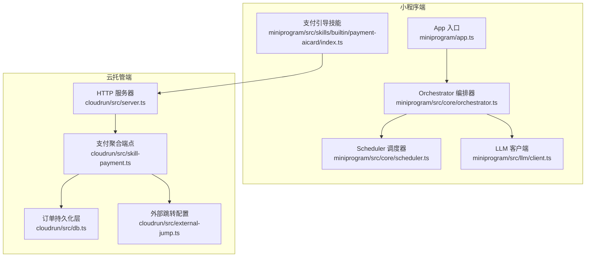
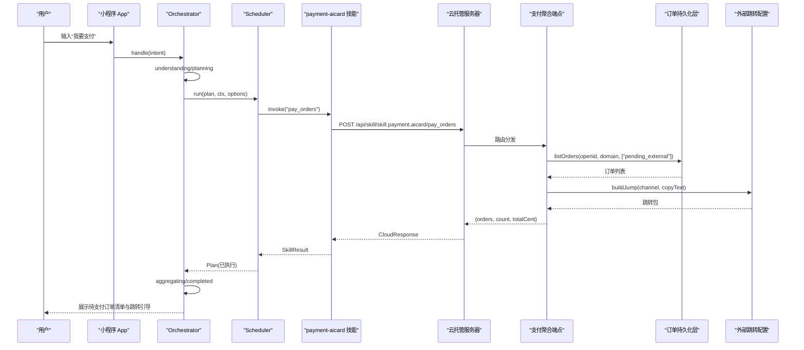
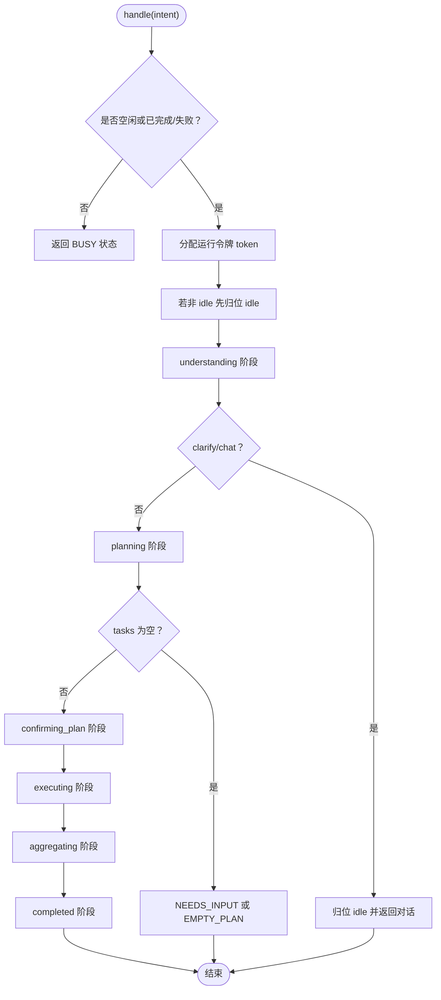
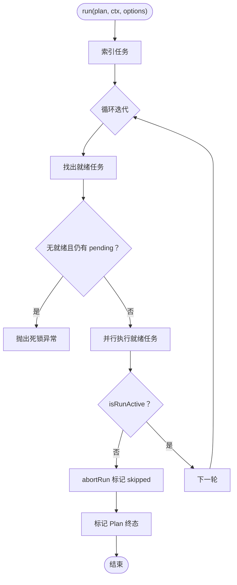
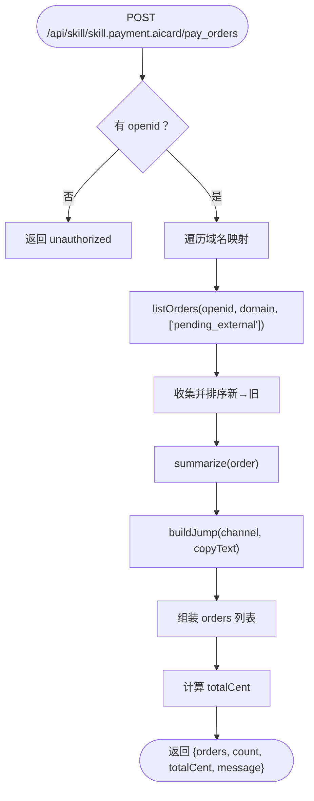
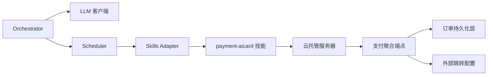

# 支付聚合系统

<cite>
**本文引用的文件**   
- [miniprogram/app.ts](file://miniprogram/app.ts)
- [miniprogram/src/core/orchestrator.ts](file://miniprogram/src/core/orchestrator.ts)
- [miniprogram/src/core/scheduler.ts](file://miniprogram/src/core/scheduler.ts)
- [miniprogram/src/llm/client.ts](file://miniprogram/src/llm/client.ts)
- [miniprogram/src/skills/index.ts](file://miniprogram/src/skills/index.ts)
- [miniprogram/src/skills/builtin/payment-aicard/index.ts](file://miniprogram/src/skills/builtin/payment-aicard/index.ts)
- [cloudrun/src/server.ts](file://cloudrun/src/server.ts)
- [cloudrun/src/skill-payment.ts](file://cloudrun/src/skill-payment.ts)
- [cloudrun/src/db.ts](file://cloudrun/src/db.ts)
- [cloudrun/src/external-jump.ts](file://cloudrun/src/external-jump.ts)
</cite>

## 目录
1. [引言](#引言)
2. [项目结构](#项目结构)
3. [核心组件](#核心组件)
4. [架构总览](#架构总览)
5. [详细组件分析](#详细组件分析)
6. [依赖关系分析](#依赖关系分析)
7. [性能与可靠性](#性能与可靠性)
8. [故障排查指南](#故障排查指南)
9. [结论](#结论)

## 引言
本文件聚焦“支付聚合系统”：在小程序侧通过技能（skill.payment.aicard）发起“聚合待支付订单”的调用，云端服务汇总各业务域的外部渠道待支付订单，并生成跳转包引导用户前往对应官方渠道完成真实支付。系统不直接处理资金流，而是承担“订单聚合 + 渠道跳转引导”的职责。

## 项目结构
围绕支付聚合的关键代码分布在小程序端与云托管服务端两部分：
- 小程序端
  - App 入口负责微信生命周期、登录与 Agent Runtime 懒加载。
  - Orchestrator 编排器驱动意图理解、规划、确认、执行与结果聚合的状态机。
  - Scheduler 调度 DAG 任务，支持人类确认与回滚。
  - LLM 客户端提供意图分类、规划与结果聚合能力，并内置规则式兜底。
  - payment-aicard 技能定义 pay_orders 能力，调用云端接口聚合待支付订单。
- 云托管端
  - server.ts 统一路由分发与健康检查。
  - skill-payment.ts 实现 pay_orders 聚合逻辑。
  - db.ts 提供外部订单持久化（MySQL + 内存降级）。
  - external-jump.ts 集中配置外部渠道跳转目标与构建跳转包。

图表来源
- [miniprogram/app.ts:26-58](file://miniprogram/app.ts#L26-L58)
- [miniprogram/src/core/orchestrator.ts:93-131](file://miniprogram/src/core/orchestrator.ts#L93-L131)
- [miniprogram/src/core/scheduler.ts:77-131](file://miniprogram/src/core/scheduler.ts#L77-L131)
- [miniprogram/src/llm/client.ts:185-310](file://miniprogram/src/llm/client.ts#L185-L310)
- [miniprogram/src/skills/builtin/payment-aicard/index.ts:91-116](file://miniprogram/src/skills/builtin/payment-aicard/index.ts#L91-L116)
- [cloudrun/src/server.ts:110-196](file://cloudrun/src/server.ts#L110-L196)
- [cloudrun/src/skill-payment.ts:82-119](file://cloudrun/src/skill-payment.ts#L82-L119)
- [cloudrun/src/db.ts:90-124](file://cloudrun/src/db.ts#L90-L124)
- [cloudrun/src/external-jump.ts:92-113](file://cloudrun/src/external-jump.ts#L92-L113)

章节来源
- [miniprogram/app.ts:26-58](file://miniprogram/app.ts#L26-L58)
- [cloudrun/src/server.ts:110-196](file://cloudrun/src/server.ts#L110-L196)

## 核心组件
- 小程序 App 入口
  - 负责微信生命周期、静默登录、日活埋点，以及全局品牌信息与 Agent Runtime 懒加载。
- Orchestrator 编排器
  - 维护状态机（idle → understanding → planning → confirming_plan → executing → aggregating → completed/failed），串联理解、规划、确认、执行与聚合。
- Scheduler 调度器
  - 按依赖关系并行执行任务，支持人类确认（checkpoint）、死锁检测、级联跳过与中止令牌。
- LLM 客户端
  - 意图分类与任务规划，包含规则式快速通道与本地降级策略；提供结果聚合文案。
- 支付引导技能（payment-aicard）
  - 暴露 pay_orders 能力，调用云端聚合接口，返回待支付订单清单与渠道跳转包。
- 云托管服务器
  - 统一 HTTP 路由、健康检查、请求体解析与错误归一。
- 支付聚合端点（skill-payment.ts）
  - 聚合多域 pending_external 订单，生成标题、金额摘要与渠道跳转包，返回统一响应。
- 订单持久化层（db.ts）
  - MySQL 持久化 + 内存降级 DAO，提供创建、查询、取消、完成、删除与列表等能力。
- 外部跳转配置（external-jump.ts）
  - 集中管理外部小程序 appId/path，构造跳转包，未配置时回退为复制文本模式。

章节来源
- [miniprogram/src/core/orchestrator.ts:93-425](file://miniprogram/src/core/orchestrator.ts#L93-L425)
- [miniprogram/src/core/scheduler.ts:77-249](file://miniprogram/src/core/scheduler.ts#L77-L249)
- [miniprogram/src/llm/client.ts:185-479](file://miniprogram/src/llm/client.ts#L185-L479)
- [miniprogram/src/skills/builtin/payment-aicard/index.ts:51-116](file://miniprogram/src/skills/builtin/payment-aicard/index.ts#L51-L116)
- [cloudrun/src/server.ts:110-196](file://cloudrun/src/server.ts#L110-L196)
- [cloudrun/src/skill-payment.ts:21-124](file://cloudrun/src/skill-payment.ts#L21-L124)
- [cloudrun/src/db.ts:21-266](file://cloudrun/src/db.ts#L21-L266)
- [cloudrun/src/external-jump.ts:18-113](file://cloudrun/src/external-jump.ts#L18-L113)

## 架构总览
支付聚合系统的端到端流程如下：
- 用户在小程序中触发“支付/付款”意图。
- Orchestrator 进入 understanding/planning 阶段，识别到 skill.payment.aicard.pay_orders。
- Scheduler 执行该只读任务，调用云端 /api/skill/skill.payment.aicard/pay_orders。
- 云端聚合各域 pending_external 订单，生成跳转包，返回订单清单与总金额。
- 前端渲染“待办订单清单”，逐单跳转到对应渠道完成真实支付。

图表来源
- [miniprogram/src/core/orchestrator.ts:127-304](file://miniprogram/src/core/orchestrator.ts#L127-L304)
- [miniprogram/src/core/scheduler.ts:143-208](file://miniprogram/src/core/scheduler.ts#L143-L208)
- [miniprogram/src/skills/builtin/payment-aicard/index.ts:91-116](file://miniprogram/src/skills/builtin/payment-aicard/index.ts#L91-L116)
- [cloudrun/src/server.ts:110-196](file://cloudrun/src/server.ts#L110-L196)
- [cloudrun/src/skill-payment.ts:82-119](file://cloudrun/src/skill-payment.ts#L82-L119)
- [cloudrun/src/db.ts:244-265](file://cloudrun/src/db.ts#L244-L265)
- [cloudrun/src/external-jump.ts:92-113](file://cloudrun/src/external-jump.ts#L92-L113)

## 详细组件分析

### Orchestrator 编排器
- 职责
  - 维护状态机，确保理解、规划、确认、执行、聚合各阶段有序流转。
  - 将计划落库（行程时间线）、失败回滚、任务更新联动 UI。
  - 提供 reset 强制通道，避免并发双跑与弹窗交错。
- 关键行为
  - handle 包装 run，附加记忆提議卡片。
  - run 内对 clarify/chat/空 tasks 提前返回并正确归位 idle。
  - 执行期间通过 isRunActive 探测令牌失效，丢弃后续流程。
  - 失败路径尝试回滚可逆任务，透出首个失败任务的业务错误信息。
  - 聚合阶段输出人类可读消息与结果卡片。

图表来源
- [miniprogram/src/core/orchestrator.ts:127-338](file://miniprogram/src/core/orchestrator.ts#L127-L338)

章节来源
- [miniprogram/src/core/orchestrator.ts:93-425](file://miniprogram/src/core/orchestrator.ts#L93-L425)

### Scheduler 调度器
- 职责
  - 按依赖关系并行执行任务，检测死锁，支持人类确认与级联跳过。
  - 通过 isRunActive 感知 Orchestrator reset，中止旧轮执行。
- 关键行为
  - 每轮找出 ready 任务，Promise.allSettled 并行执行。
  - requiresHumanConfirm 的任务走序列化 checkpoint，防止弹窗覆盖。
  - 绑定解析失败或任务失败时 cascadeSkip 下游任务。
  - 最终标记 Plan 为 done 或 failed。

图表来源
- [miniprogram/src/core/scheduler.ts:77-131](file://miniprogram/src/core/scheduler.ts#L77-L131)
- [miniprogram/src/core/scheduler.ts:143-208](file://miniprogram/src/core/scheduler.ts#L143-L208)
- [miniprogram/src/core/scheduler.ts:223-244](file://miniprogram/src/core/scheduler.ts#L223-L244)

章节来源
- [miniprogram/src/core/scheduler.ts:77-249](file://miniprogram/src/core/scheduler.ts#L77-L249)

### LLM 客户端（意图分类与规划）
- 职责
  - 意图分类（understand）：闲聊/元问题短路，明显任务词快速通道，否则调用 LLM 分类。
  - 任务规划（plan）：规则优先、LLM 兜底；参数缺失与绑定引用校验后回退规则规划。
  - 结果聚合（aggregate）：将成功任务转为人类可读摘要。
- 关键行为
  - 开发环境 LLM 不可用自动降级到规则规划器。
  - 乘车人槽位回填与实名缺失追问。
  - 记忆分层次沉淀（显式长期偏好直接落盘，推断提議待确认）。

章节来源
- [miniprogram/src/llm/client.ts:185-479](file://miniprogram/src/llm/client.ts#L185-L479)

### 支付引导技能（payment-aicard）
- 职责
  - 暴露 pay_orders 能力，调用云端聚合接口，返回待支付订单清单与渠道跳转包。
  - 云端不可用时返回空清单降級，不假装有订单。
- 关键行为
  - meta 声明 idempotent=true、reversible=false、requiresHumanConfirm=false。
  - instance.invoke 根据 action 路由到 pay_orders，postContainer 调用云端。
  - 对负数业务码（基础设施错误）走离线演示文案。

章节来源
- [miniprogram/src/skills/builtin/payment-aicard/index.ts:51-116](file://miniprogram/src/skills/builtin/payment-aicard/index.ts#L51-L116)

### 云托管服务器（server.ts）
- 职责
  - 监听端口、JSON body 解析、路由分发、健康检查、可选拉起 12306-MCP 子进程。
- 关键行为
  - 统一 sendJson 响应格式。
  - 捕获 PAYLOAD_TOO_LARGE、INVALID_JSON 等错误并返回标准码。
  - 注册各 skill 模块 entries 路由表。

章节来源
- [cloudrun/src/server.ts:110-196](file://cloudrun/src/server.ts#L110-L196)

### 支付聚合端点（skill-payment.ts）
- 职责
  - 聚合全部跳轉域的 pending_external 订单，重建跳转包，返回统一响应。
- 关键行为
  - DOMAIN_CHANNEL 映射域到渠道 key。
  - summarize 从 payload 窄化标题与金额（分）。
  - 按创建时间倒序排序，计算 totalCent。
  - 使用 buildJump 生成跳转包，包含 target/appId/path/copyText/note。

图表来源
- [cloudrun/src/skill-payment.ts:82-119](file://cloudrun/src/skill-payment.ts#L82-L119)
- [cloudrun/src/external-jump.ts:92-113](file://cloudrun/src/external-jump.ts#L92-L113)

章节来源
- [cloudrun/src/skill-payment.ts:21-124](file://cloudrun/src/skill-payment.ts#L21-L124)

### 订单持久化层（db.ts）
- 职责
  - 提供外部订单的持久化 DAO，支持 MySQL 与内存降级。
- 关键行为
  - initDb 惰性初始化连接池与建表，失败降级内存。
  - createOrder/getOrder/cancelOrder/completeOrder/deleteOrder/listOrders。
  - mutateStatus 原子性更新 + SELECT 分流 not_found/forbidden。
  - listOrders 支持按 owner/domain/status 过滤与 LIMIT 100。

章节来源
- [cloudrun/src/db.ts:90-266](file://cloudrun/src/db.ts#L90-L266)

### 外部跳转配置（external-jump.ts）
- 职责
  - 集中管理外部小程序 appId/path，构造跳转包。
- 关键行为
  - DEFAULT_TARGETS 默认表，EXTERNAL_JUMP 环境变量覆盖。
  - getJumpTarget 返回有效目标或 null（copy-only 降级）。
  - buildJump 统一返回 target/appId/path/jCommand/copyText/note。

章节来源
- [cloudrun/src/external-jump.ts:18-113](file://cloudrun/src/external-jump.ts#L18-L113)

## 依赖关系分析
- 小程序端
  - Orchestrator 依赖 LLM 客户端与 Scheduler，并通过 adapter 调用 Skills。
  - payment-aicard 技能依赖 services/cloud.postContainer 调用云端。
- 云托管端
  - server.ts 聚合各 skill 路由；skill-payment.ts 依赖 db.ts 与 external-jump.ts。
- 数据流向
  - 小程序 → 云端 → 数据库 → 跳转配置 → 返回聚合结果 → 小程序渲染。

图表来源
- [miniprogram/src/core/orchestrator.ts:13-28](file://miniprogram/src/core/orchestrator.ts#L13-L28)
- [miniprogram/src/llm/client.ts:9-31](file://miniprogram/src/llm/client.ts#L9-L31)
- [miniprogram/src/core/scheduler.ts:18-26](file://miniprogram/src/core/scheduler.ts#L18-L26)
- [miniprogram/src/skills/index.ts:1-7](file://miniprogram/src/skills/index.ts#L1-L7)
- [miniprogram/src/skills/builtin/payment-aicard/index.ts:18-21](file://miniprogram/src/skills/builtin/payment-aicard/index.ts#L18-L21)
- [cloudrun/src/server.ts:20-36](file://cloudrun/src/server.ts#L20-L36)
- [cloudrun/src/skill-payment.ts:21-24](file://cloudrun/src/skill-payment.ts#L21-L24)

章节来源
- [miniprogram/src/core/orchestrator.ts:13-28](file://miniprogram/src/core/orchestrator.ts#L13-L28)
- [miniprogram/src/llm/client.ts:9-31](file://miniprogram/src/llm/client.ts#L9-L31)
- [miniprogram/src/core/scheduler.ts:18-26](file://miniprogram/src/core/scheduler.ts#L18-L26)
- [miniprogram/src/skills/index.ts:1-7](file://miniprogram/src/skills/index.ts#L1-L7)
- [miniprogram/src/skills/builtin/payment-aicard/index.ts:18-21](file://miniprogram/src/skills/builtin/payment-aicard/index.ts#L18-L21)
- [cloudrun/src/server.ts:20-36](file://cloudrun/src/server.ts#L20-L36)
- [cloudrun/src/skill-payment.ts:21-24](file://cloudrun/src/skill-payment.ts#L21-L24)

## 性能与可靠性
- 性能
  - 规则式规划优先，减少 LLM 调用延迟。
  - Scheduler 并行执行就绪任务，缩短整体执行时间。
  - 云端 listOrders 限制 LIMIT 100，避免大结果集拖慢聚合。
- 可靠性
  - Orchestrator 状态机严格转移，reset 强制通道避免并发双跑。
  - Scheduler 死锁检测与级联跳过，保障任务图健壮性。
  - db.ts MySQL 初始化失败降级内存，保证服务可用。
  - external-jump 未配置 appId 时回退 copy-only，不影响主链路。
  - payment-aicard 云端不可用返回空清单，不误导用户。

[本节为通用指导，无需具体文件分析]

## 故障排查指南
- 小程序端
  - 若返回 BUSY：说明 Orchestrator 处于非空闲状态，等待当前任务完成或调用 reset。
  - 若返回 NEEDS_INPUT/EMPTY_PLAN：检查意图是否被规则或 LLM 识别，补充必要参数。
  - 若 LLM 调用失败：开发环境会降级规则规划；生产环境需检查 LLM_BASE_URL/KEY 与网络。
- 云端端点
  - 401/unauthorized：缺少 x-wx-openid，检查登录与会话头。
  - 413/PAYLOAD_TOO_LARGE：请求体超过 1MB，检查 payload 大小。
  - 400/INVALID_JSON：请求体非合法 JSON，检查客户端编码。
  - 500/内部错误：查看云端日志定位异常。
- 订单持久化
  - 若 MySQL 未配置或初始化失败：降级内存，重启后数据丢失属预期。
  - cancel/complete 返回 not_found/forbidden：检查 order_id 归属与权限。
- 跳转配置
  - 若 appId 为空：仅复制文本，不跳转；检查 EXTERNAL_JUMP 环境变量配置。

章节来源
- [miniprogram/src/core/orchestrator.ts:136-141](file://miniprogram/src/core/orchestrator.ts#L136-L141)
- [miniprogram/src/core/orchestrator.ts:188-207](file://miniprogram/src/core/orchestrator.ts#L188-L207)
- [miniprogram/src/llm/client.ts:229-249](file://miniprogram/src/llm/client.ts#L229-L249)
- [cloudrun/src/server.ts:178-195](file://cloudrun/src/server.ts#L178-L195)
- [cloudrun/src/db.ts:99-124](file://cloudrun/src/db.ts#L99-L124)
- [cloudrun/src/db.ts:193-221](file://cloudrun/src/db.ts#L193-L221)
- [cloudrun/src/external-jump.ts:82-85](file://cloudrun/src/external-jump.ts#L82-L85)

## 结论
支付聚合系统以 Orchestrator 为核心编排，结合 Scheduler 的任务调度与 LLM 的智能规划，形成稳定可靠的意图到执行的闭环。云端通过 skill-payment.ts 聚合多域订单，借助 db.ts 与 external-jump.ts 提供持久化与跳转能力，最终在前端呈现“待支付订单清单 + 渠道跳转引导”。系统在设计上强调幂等、可回滚、可降级与可观测，兼顾用户体验与工程稳健性。