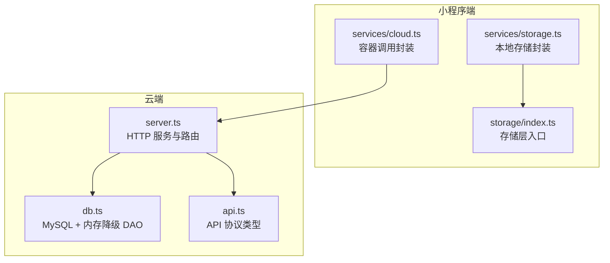
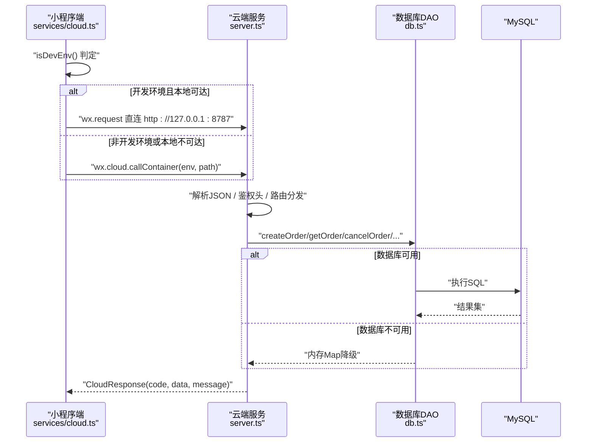
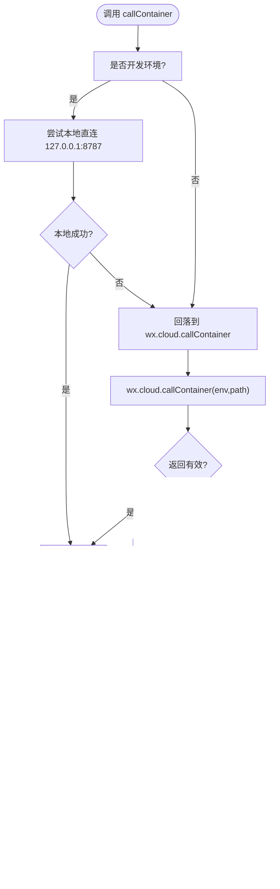
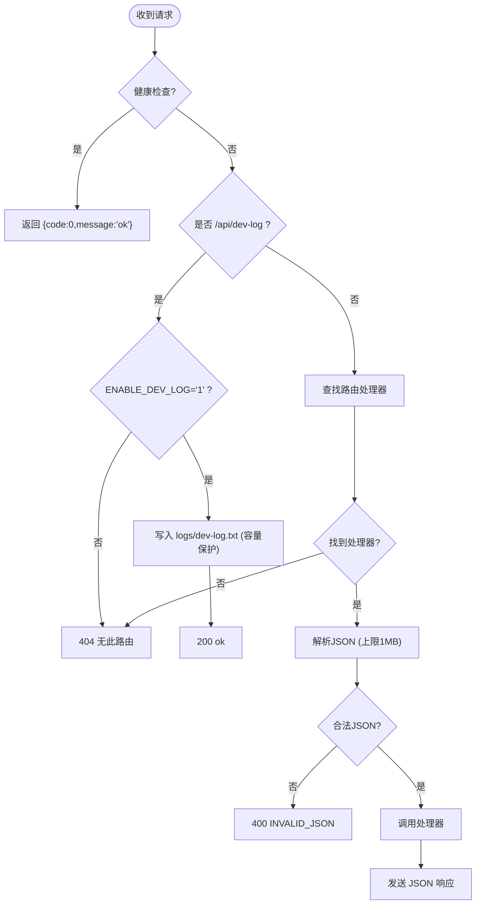
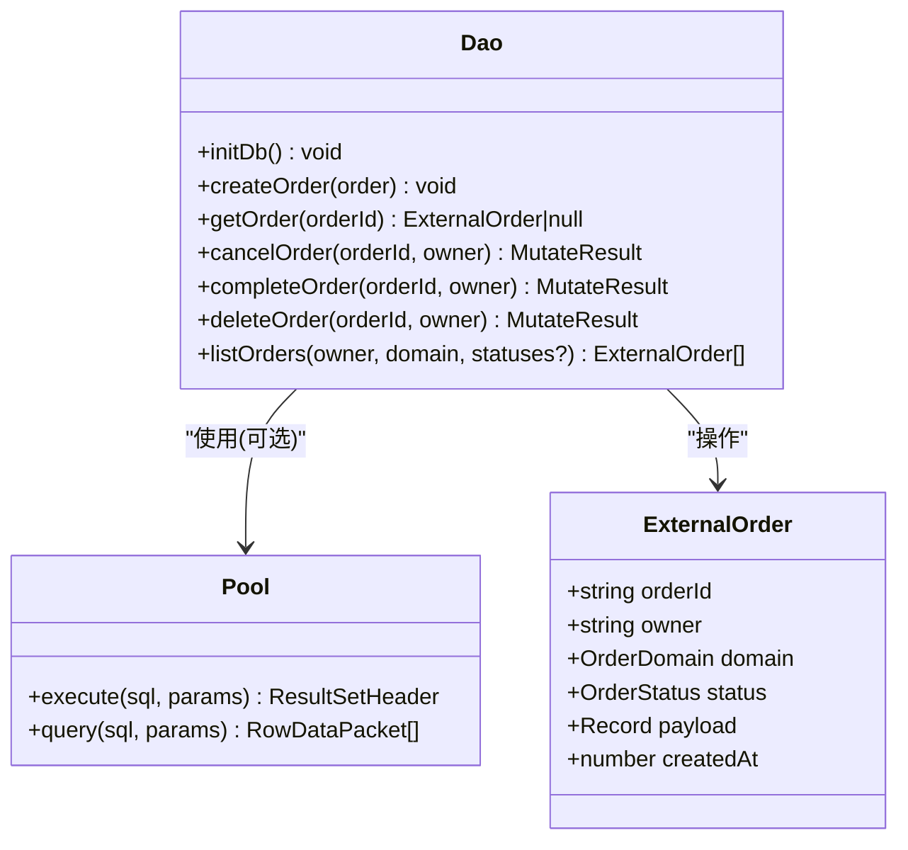
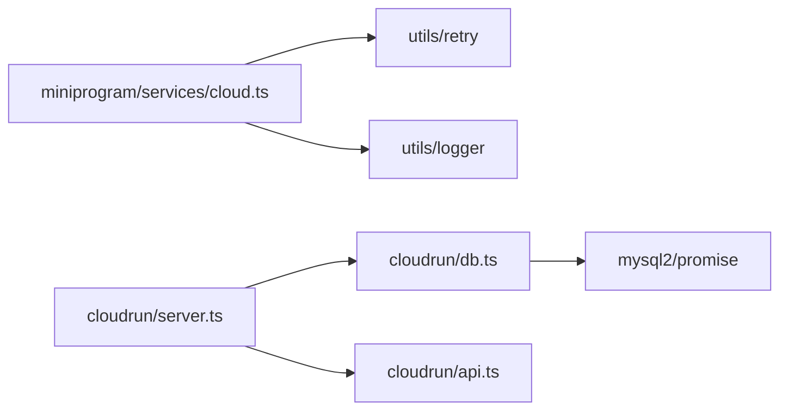

# 云数据库集成

<cite>
**本文引用的文件**   
- [cloudrun/src/db.ts](file://cloudrun/src/db.ts)
- [cloudrun/src/server.ts](file://cloudrun/src/server.ts)
- [cloudrun/src/api.ts](file://cloudrun/src/api.ts)
- [miniprogram/src/services/cloud.ts](file://miniprogram/src/services/cloud.ts)
- [miniprogram/src/services/storage.ts](file://miniprogram/src/services/storage.ts)
- [miniprogram/src/storage/index.ts](file://miniprogram/src/storage/index.ts)
</cite>

## 目录
1. [引言](#引言)
2. [项目结构](#项目结构)
3. [核心组件](#核心组件)
4. [架构总览](#架构总览)
5. [详细组件分析](#详细组件分析)
6. [依赖关系分析](#依赖关系分析)
7. [性能与可靠性](#性能与可靠性)
8. [故障排查指南](#故障排查指南)
9. [结论](#结论)

## 引言
本文件聚焦“云数据库集成”主题，梳理微信小程序端与云端托管服务之间的数据通路、订单持久化方案以及降级策略。整体目标：
- 小程序通过统一容器调用封装访问云端 API；
- 云端以轻量 HTTP 服务承载业务路由，并对接 MySQL 进行订单持久化；
- 在数据库不可用时自动降级到内存存储，保证服务可用性与演示连续性；
- 明确开发环境与正式环境的差异路径与风险边界。

## 项目结构
围绕云数据库集成，关键代码分布在小程序端与服务端两部分：
- 小程序端
  - services/cloud.ts：统一容器调用封装、超时重试、开发直连本地 cloudrun 服务、环境判定与初始化。
  - services/storage.ts：小程序本地同步存储封装（会话/缓存等）。
  - storage/index.ts：存储层统一导出入口。
- 云端
  - server.ts：HTTP 服务器、健康检查、请求解析、路由分发、日志旁路、MCP 子进程管理、数据库初始化。
  - db.ts：MySQL 连接池、建表 DDL、订单 DAO、内存降級 Map。
  - api.ts：云端标准响应体与上下文类型定义。

**图表来源**
- [miniprogram/src/services/cloud.ts:151-241](file://miniprogram/src/services/cloud.ts#L151-L241)
- [cloudrun/src/server.ts:108-194](file://cloudrun/src/server.ts#L108-L194)
- [cloudrun/src/db.ts:87-121](file://cloudrun/src/db.ts#L87-L121)
- [cloudrun/src/api.ts:10-38](file://cloudrun/src/api.ts#L10-L38)

**章节来源**
- [miniprogram/src/services/cloud.ts:1-329](file://miniprogram/src/services/cloud.ts#L1-L329)
- [cloudrun/src/server.ts:1-253](file://cloudrun/src/server.ts#L1-L253)
- [cloudrun/src/db.ts:1-263](file://cloudrun/src/db.ts#L1-L263)
- [cloudrun/src/api.ts:1-64](file://cloudrun/src/api.ts#L1-L64)
- [miniprogram/src/services/storage.ts:1-62](file://miniprogram/src/services/storage.ts#L1-L62)
- [miniprogram/src/storage/index.ts:1-8](file://miniprogram/src/storage/index.ts#L1-L8)

## 核心组件
- 小程序容器调用封装
  - 提供 callContainer/postContainer/getContainer，统一超时、重试、错误归一、开发直连本地 cloudrun 服务、环境判定与 wx.cloud.init 初始化。
- 云端 HTTP 服务
  - 监听端口、健康检查、JSON body 解析、路由分发、请求上下文注入、异常处理、可选 MCP 子进程管理、启动时初始化数据库。
- 订单持久化 DAO
  - 基于 mysql2 连接池，幂等建表，支持 createOrder/getOrder/cancelOrder/completeOrder/deleteOrder/listOrders；当数据库不可用或环境变量缺失时降级为内存 Map。
- API 协议类型
  - 定义 CloudResponse、RequestContext、HandlerResult 等类型，确保小程序与服务端协议一致。

**章节来源**
- [miniprogram/src/services/cloud.ts:151-241](file://miniprogram/src/services/cloud.ts#L151-L241)
- [cloudrun/src/server.ts:108-194](file://cloudrun/src/server.ts#L108-L194)
- [cloudrun/src/db.ts:87-121](file://cloudrun/src/db.ts#L87-L121)
- [cloudrun/src/api.ts:10-38](file://cloudrun/src/api.ts#L10-L38)

## 架构总览
小程序端通过 services/cloud.ts 发起容器调用，优先尝试本地 cloudrun 服务（开发环境），否则走微信云开发的 callContainer；服务端 server.ts 接收请求后解析 JSON、注入 RequestContext、分发给各 handler，并在启动时异步初始化数据库（失败不阻塞）；db.ts 负责 MySQL 连接与订单 CRUD，并提供内存降级。

**图表来源**
- [miniprogram/src/services/cloud.ts:151-241](file://miniprogram/src/services/cloud.ts#L151-L241)
- [cloudrun/src/server.ts:108-194](file://cloudrun/src/server.ts#L108-L194)
- [cloudrun/src/db.ts:161-262](file://cloudrun/src/db.ts#L161-L262)

## 详细组件分析

### 小程序容器调用封装（services/cloud.ts）
职责与要点：
- 统一超时与重试：默认 15s 单次超时，最多 3 次重试，可配置是否重试。
- 开发直连本地 cloudrun：开发环境优先尝试本地 127.0.0.1:8787，失败再回落云开发链路。
- 响应归一：空响应、5xx 视为网络错误；开发环境非标准响应体转为 code:-1；标准响应透传。
- 环境判定：根据 envVersion 区分 develop/trial/release，release 严格失败语义，develop/trial 允许降级。
- 初始化：ensureCloudInit 幂等初始化 wx.cloud.init，避免重复初始化。

**图表来源**
- [miniprogram/src/services/cloud.ts:86-103](file://miniprogram/src/services/cloud.ts#L86-L103)
- [miniprogram/src/services/cloud.ts:122-148](file://miniprogram/src/services/cloud.ts#L122-L148)
- [miniprogram/src/services/cloud.ts:151-241](file://miniprogram/src/services/cloud.ts#L151-L241)
- [miniprogram/src/services/cloud.ts:264-299](file://miniprogram/src/services/cloud.ts#L264-L299)

**章节来源**
- [miniprogram/src/services/cloud.ts:151-241](file://miniprogram/src/services/cloud.ts#L151-L241)
- [miniprogram/src/services/cloud.ts:264-299](file://miniprogram/src/services/cloud.ts#L264-L299)

### 云端 HTTP 服务（server.ts）
职责与要点：
- 健康检查：GET / 与 GET /healthz 返回服务状态。
- 请求解析：限制最大 body 大小（1MB），非法 JSON 返回 400。
- 路由分发：从 routes Map 查找处理器，构造 RequestContext（openid、sessionId）。
- 异常处理：PAYLOAD_TOO_LARGE → 413；INVALID_JSON → 400；其他 → 500。
- 开发日志旁路：POST /api/dev-log（需 ENABLE_DEV_LOG=1），落盘 logs/dev-log.txt，带容量保护。
- 启动流程：监听端口，fire-and-forget 初始化数据库，可选拉起 12306-MCP 子进程。

**图表来源**
- [cloudrun/src/server.ts:108-194](file://cloudrun/src/server.ts#L108-L194)
- [cloudrun/src/server.ts:196-253](file://cloudrun/src/server.ts#L196-L253)

**章节来源**
- [cloudrun/src/server.ts:108-194](file://cloudrun/src/server.ts#L108-L194)
- [cloudrun/src/server.ts:196-253](file://cloudrun/src/server.ts#L196-L253)

### 订单持久化 DAO（db.ts）
职责与要点：
- 连接池与 DDL：惰性初始化连接池，幂等建表 external_orders（order_id 主键，owner+domain 索引，payload JSON）。
- 降级策略：未配置 MYSQL_ADDRESS 或初始化失败时降级为内存 Map（重启丢失），仅首次 ERROR 提示。
- 领域模型：ExternalOrder（orderId、owner、domain、status、payload、createdAt），OrderDomain 与 OrderStatus 枚举。
- CRUD 接口：createOrder/getOrder/cancelOrder/completeOrder/deleteOrder/listOrders，均包含 owner 鉴权逻辑（防 IDOR）。
- 状态变更：取消即删除（内存）或标记 cancelled（DB），完成即标记 completed。

**图表来源**
- [cloudrun/src/db.ts:21-45](file://cloudrun/src/db.ts#L21-L45)
- [cloudrun/src/db.ts:87-121](file://cloudrun/src/db.ts#L87-L121)
- [cloudrun/src/db.ts:161-262](file://cloudrun/src/db.ts#L161-L262)

**章节来源**
- [cloudrun/src/db.ts:87-121](file://cloudrun/src/db.ts#L87-L121)
- [cloudrun/src/db.ts:161-262](file://cloudrun/src/db.ts#L161-L262)

### API 协议类型（api.ts）
职责与要点：
- CloudResponse：code（业务码）、message（人类可读消息）、data（业务数据）。
- RequestContext：openid（调用方身份）、sessionId（会话关联）。
- HandlerResult：httpStatus（HTTP 状态码）+ body（CloudResponse）。
- 辅助函数：ok/fail/badRequest/unauthorized/forbidden 用于构建标准化响应。

**章节来源**
- [cloudrun/src/api.ts:10-64](file://cloudrun/src/api.ts#L10-L64)

### 小程序本地存储（services/storage.ts 与 storage/index.ts）
职责与要点：
- 提供 getItem/setItem/removeItem/clearAll，统一命名空间前缀 micromate:，安全序列化 JSON。
- 错误静默处理，避免阻塞业务主流程。
- storage/index.ts 作为存储层统一导出入口，便于模块化管理。

**章节来源**
- [miniprogram/src/services/storage.ts:1-62](file://miniprogram/src/services/storage.ts#L1-L62)
- [miniprogram/src/storage/index.ts:1-8](file://miniprogram/src/storage/index.ts#L1-L8)

## 依赖关系分析
- 小程序端依赖
  - services/cloud.ts 依赖 utils/retry、utils/logger，封装 wx.cloud.callContainer 与 wx.request。
  - services/storage.ts 依赖 wx.* 同步存储 API。
- 云端依赖
  - server.ts 依赖 node:http/fs/child_process/path，导入各 skill 路由与 db.ts。
  - db.ts 依赖 mysql2/promise，实现连接池与 SQL 操作。
  - api.ts 被 server.ts 与各 handler 复用，定义协议类型。

**图表来源**
- [miniprogram/src/services/cloud.ts:13-14](file://miniprogram/src/services/cloud.ts#L13-L14)
- [cloudrun/src/server.ts:16-35](file://cloudrun/src/server.ts#L16-L35)
- [cloudrun/src/db.ts:21](file://cloudrun/src/db.ts#L21)
- [cloudrun/src/api.ts:1-64](file://cloudrun/src/api.ts#L1-L64)

**章节来源**
- [miniprogram/src/services/cloud.ts:13-14](file://miniprogram/src/services/cloud.ts#L13-L14)
- [cloudrun/src/server.ts:16-35](file://cloudrun/src/server.ts#L16-L35)
- [cloudrun/src/db.ts:21](file://cloudrun/src/db.ts#L21)

## 性能与可靠性
- 小程序端
  - 超时控制：单次调用默认 15s，避免长尾阻塞。
  - 重试策略：最多 3 次重试，指数退避（baseDelayMs=600ms），对网络闪断具备韧性。
  - 开发环境降级：非标准响应或云开发不可用时返回 code:-1，保障演示可用性。
- 云端
  - 连接池：connectionLimit=4，适合自用单实例场景；connectTimeout=8s，enableKeepAlive=true。
  - 降级策略：数据库不可用或环境变量缺失时降级内存 Map，仅首次 ERROR 提示，避免刷屏。
  - 容量保护：开发日志旁路写入 logs/dev-log.txt，超过 50MB 跳过写入，防止磁盘耗尽。
  - 健壮性：PAYLOAD_TOO_LARGE 与 INVALID_JSON 明确错误码，避免上游误判。

[本节为通用指导，无需具体文件引用]

## 故障排查指南
- 小程序端无法调用云端
  - 检查 isDevEnv 判定与 ensureCloudInit 是否成功初始化 wx.cloud.init。
  - 开发环境确认本地 cloudrun 服务已启动（127.0.0.1:8787），否则将回落到云开发链路。
  - 若 wx.cloud.callContainer 不可用，开发环境会返回 code:-1，需检查基础库与运行环境。
- 云端服务异常
  - 健康检查 GET / 或 /healthz 应返回 {code:0,message:'ok'}。
  - 若出现 400 INVALID_JSON，检查请求体是否为合法 JSON。
  - 若出现 413 PAYLOAD_TOO_LARGE，检查请求体大小是否超过 1MB。
  - 若出现 500 内部错误，查看服务端日志与 handler 异常堆栈。
- 订单持久化问题
  - 确认 MYSQL_ADDRESS/MYSQL_USERNAME/MYSQL_PASSWORD/MYSQL_DATABASE 环境变量是否正确配置。
  - 若数据库初始化失败，服务将降级内存 Map，重启后数据丢失；需检查数据库连通性与权限。
  - 订单状态变更（取消/完成）需传入正确 owner，否则返回 forbidden/not_found。

**章节来源**
- [miniprogram/src/services/cloud.ts:264-299](file://miniprogram/src/services/cloud.ts#L264-L299)
- [cloudrun/src/server.ts:108-194](file://cloudrun/src/server.ts#L108-L194)
- [cloudrun/src/db.ts:87-121](file://cloudrun/src/db.ts#L87-L121)

## 结论
本项目通过小程序端统一容器调用封装与云端轻量 HTTP 服务，构建了稳定可靠的云数据库集成方案。核心优势包括：
- 开发环境与正式环境差异化处理，提升本地开发与演示效率；
- 数据库不可用时的内存降级策略，保障服务可用性与用户体验；
- 统一的 API 协议与错误处理机制，降低前后端耦合与维护成本；
- 明确的鉴权与防越权设计（owner 校验），提升安全性。

建议在生产环境中：
- 完善数据库监控与告警，及时感知连接池与慢查询；
- 定期清理开发日志旁路文件，避免磁盘占用；
- 持续优化重试策略与超时参数，平衡用户体验与系统负载。

[本节为总结性内容，无需具体文件引用]