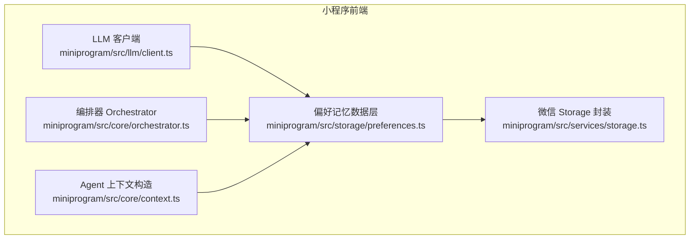
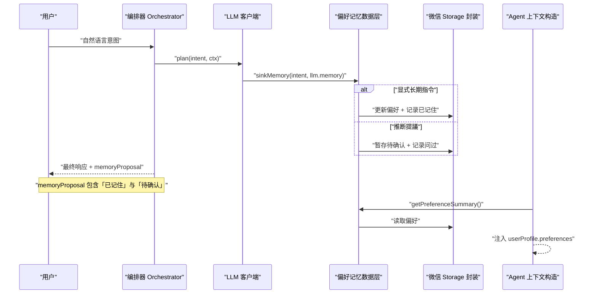
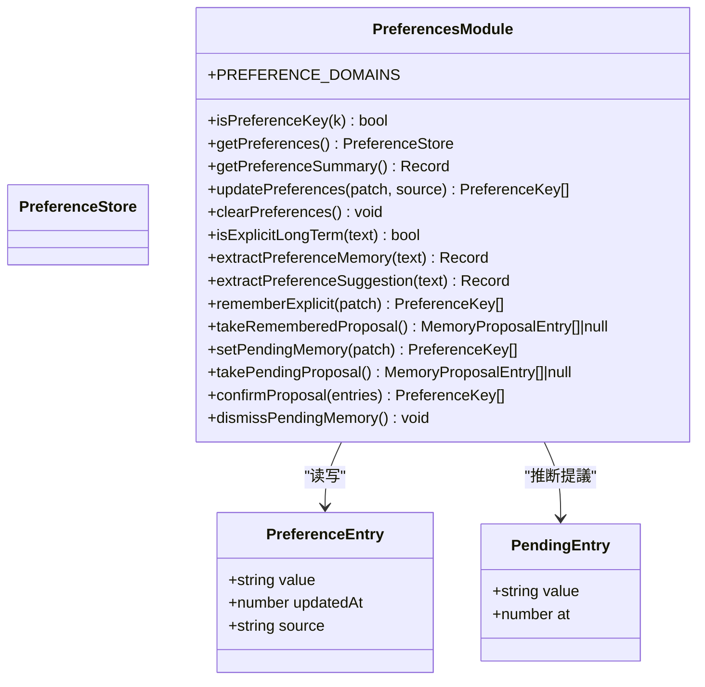
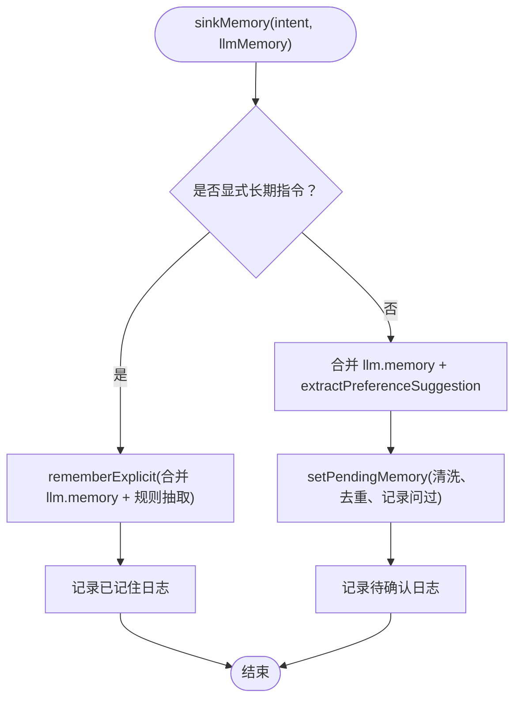
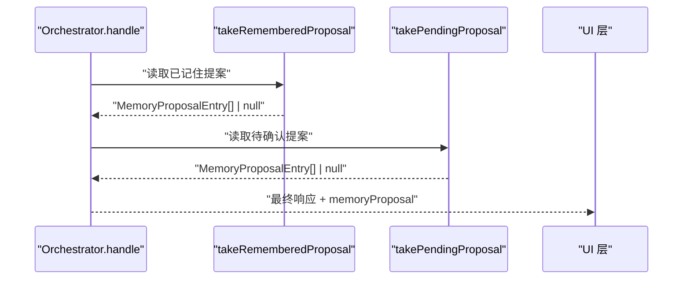
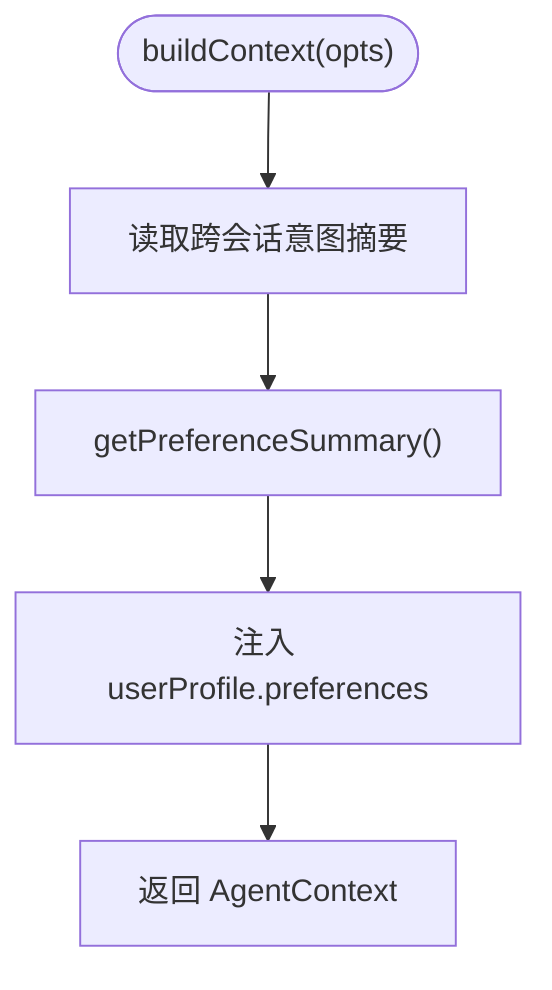
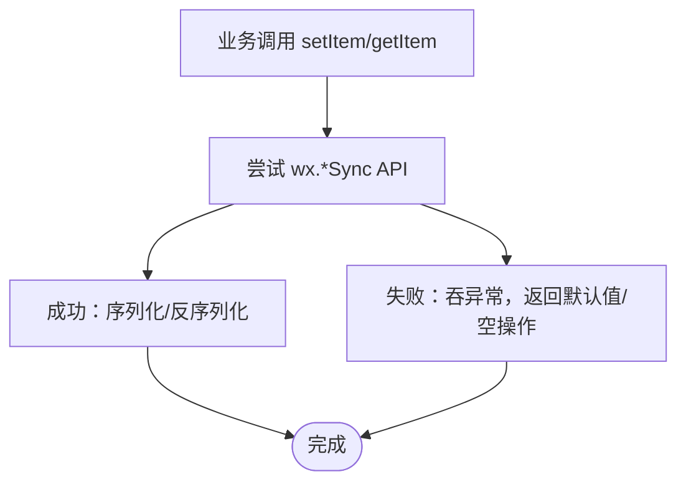
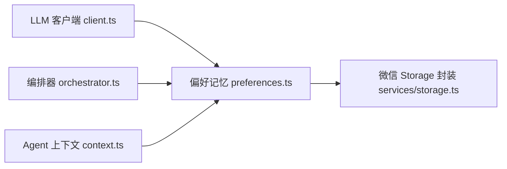

# 用户偏好记忆系统

<cite>
**本文引用的文件**   
- [miniprogram/src/storage/preferences.ts](file://miniprogram/src/storage/preferences.ts)
- [miniprogram/src/services/storage.ts](file://miniprogram/src/services/storage.ts)
- [miniprogram/src/core/context.ts](file://miniprogram/src/core/context.ts)
- [miniprogram/src/llm/client.ts](file://miniprogram/src/llm/client.ts)
- [miniprogram/src/core/orchestrator.ts](file://miniprogram/src/core/orchestrator.ts)
</cite>

## 目录
1. [引言](#引言)
2. [项目结构定位](#项目结构定位)
3. [核心组件](#核心组件)
4. [架构总览](#架构总览)
5. [详细组件分析](#详细组件分析)
6. [依赖关系分析](#依赖关系分析)
7. [性能与容量特性](#性能与容量特性)
8. [故障排查指南](#故障排查指南)
9. [结论](#结论)

## 引言
本文件聚焦“用户偏好记忆系统”，即小程序端用于长期沉淀用户偏好的数据层与协作流程。该系统以本地存储为当前 MVP，通过白名单域、值脱敏与截断控制注入规划器的上下文长度；同时预留云端同步接口形态，保证未来叠加云端后调用方无需改动。系统在交互上区分“显式长期指令”和“推断提議”，前者直接落盘并告知，后者经确认卡询问后再落盘，避免反复打扰。

## 项目结构定位
偏好记忆系统位于小程序前端代码中，主要涉及以下模块：
- 偏好数据层：`miniprogram/src/storage/preferences.ts`
- 微信 Storage 封装：`miniprogram/src/services/storage.ts`
- Agent 上下文构造（注入偏好摘要）：`miniprogram/src/core/context.ts`
- LLM 规划器（记忆下沉入口）：`miniprogram/src/llm/client.ts`
- 编排器（最终响应附加记忆提案）：`miniprogram/src/core/orchestrator.ts`

**图示来源**
- [miniprogram/src/llm/client.ts:134-152](file://miniprogram/src/llm/client.ts#L134-L152)
- [miniprogram/src/core/orchestrator.ts:127-131](file://miniprogram/src/core/orchestrator.ts#L127-L131)
- [miniprogram/src/core/context.ts:175-186](file://miniprogram/src/core/context.ts#L175-L186)
- [miniprogram/src/storage/preferences.ts:23-36](file://miniprogram/src/storage/preferences.ts#L23-L36)
- [miniprogram/src/services/storage.ts:10-34](file://miniprogram/src/services/storage.ts#L10-L34)

**章节来源**
- [miniprogram/src/storage/preferences.ts:1-36](file://miniprogram/src/storage/preferences.ts#L1-L36)
- [miniprogram/src/services/storage.ts:1-34](file://miniprogram/src/services/storage.ts#L1-L34)
- [miniprogram/src/core/context.ts:152-200](file://miniprogram/src/core/context.ts#L152-L200)
- [miniprogram/src/llm/client.ts:119-174](file://miniprogram/src/llm/client.ts#L119-L174)
- [miniprogram/src/core/orchestrator.ts:116-131](file://miniprogram/src/core/orchestrator.ts#L116-L131)

## 核心组件
- 偏好白名单与类型
  - 定义偏好域键与中文标签，提供键窄化校验，确保仅允许受信任字段进入存储与上下文。
- 偏好读写与摘要
  - 全量读取供 UI 管理与云端同步使用；摘要读取供 Planner 上下文消费，做二次窄化防御。
- 写入统一入口
  - 所有写操作走统一入口，执行白名单过滤、意图脱敏、短值截断与同值去重，保证 last-write-wins 合并稳定性。
- 显式长期偏好
  - 命中显式长期指令时直接落盘，并产出“已记住”回执条目，由编排器在最终响应中透出。
- 推断提議
  - 未命中显式长期但命中偏好域词时暂存待确认提議，记录“问过”避免重复打扰；确认后落盘，拒绝或忽略均清空待确认。
- 微信 Storage 封装
  - 提供同步读写的轻量封装，统一命名空间前缀、JSON 序列化与错误吞掉，避免业务阻塞。

**章节来源**
- [miniprogram/src/storage/preferences.ts:38-119](file://miniprogram/src/storage/preferences.ts#L38-L119)
- [miniprogram/src/storage/preferences.ts:146-180](file://miniprogram/src/storage/preferences.ts#L146-L180)
- [miniprogram/src/storage/preferences.ts:217-309](file://miniprogram/src/storage/preferences.ts#L217-L309)
- [miniprogram/src/services/storage.ts:12-45](file://miniprogram/src/services/storage.ts#L12-L45)

## 架构总览
偏好记忆系统贯穿“规划—编排—上下文注入—持久化”链路：
- 规划阶段：LLM 客户端根据意图与 memory 输出决定是显式直接落盘还是推断提議。
- 编排阶段：最终响应附加“已记住”与“待确认”两类记忆提案，UI 据此展示回执或确认卡。
- 上下文注入：构建 Agent 上下文时读取偏好摘要，注入 userProfile.preferences，供 Planner 消费。
- 持久化：所有读写经由微信 Storage 封装，带命名空间前缀与异常保护。

**图示来源**
- [miniprogram/src/core/orchestrator.ts:127-131](file://miniprogram/src/core/orchestrator.ts#L127-L131)
- [miniprogram/src/llm/client.ts:134-152](file://miniprogram/src/llm/client.ts#L134-L152)
- [miniprogram/src/storage/preferences.ts:217-309](file://miniprogram/src/storage/preferences.ts#L217-L309)
- [miniprogram/src/core/context.ts:175-186](file://miniprogram/src/core/context.ts#L175-L186)
- [miniprogram/src/services/storage.ts:12-34](file://miniprogram/src/services/storage.ts#L12-L34)

## 详细组件分析

### 偏好记忆数据层（preferences.ts）
该模块是偏好记忆系统的核心，职责包括：
- 白名单域管理：seat、cabin、coffee、diet、budget 等。
- 偏好条目结构：value、updatedAt、source（implicit/explicit）。
- 读写抽象：全量读取、摘要读取、增量写入、清空。
- 显式长期偏好：直接落盘并产出回执条目。
- 推断提議：暂存待确认、记录问过、确认后落盘、拒绝清空。
- 隐私防护：白名单 + sanitizeIntent 打码 + 短值截断。

**图示来源**
- [miniprogram/src/storage/preferences.ts:57-66](file://miniprogram/src/storage/preferences.ts#L57-L66)
- [miniprogram/src/storage/preferences.ts:194-200](file://miniprogram/src/storage/preferences.ts#L194-L200)
- [miniprogram/src/storage/preferences.ts:68-119](file://miniprogram/src/storage/preferences.ts#L68-L119)
- [miniprogram/src/storage/preferences.ts:146-180](file://miniprogram/src/storage/preferences.ts#L146-L180)
- [miniprogram/src/storage/preferences.ts:217-309](file://miniprogram/src/storage/preferences.ts#L217-L309)

**章节来源**
- [miniprogram/src/storage/preferences.ts:38-119](file://miniprogram/src/storage/preferences.ts#L38-L119)
- [miniprogram/src/storage/preferences.ts:146-180](file://miniprogram/src/storage/preferences.ts#L146-L180)
- [miniprogram/src/storage/preferences.ts:217-309](file://miniprogram/src/storage/preferences.ts#L217-L309)

### LLM 客户端记忆下沉（client.ts）
LLM 客户端负责将规划结果中的 memory 与意图文本结合，决定记忆沉降水路：
- 显式长期指令：直接落盘，并记录“已记住”。
- 非显式长期：合并 LLM memory 与规则抽取的推断提議，暂存待确认。
- 规则路径兜底：即使不走 LLM，也通过 sinkMemory 保持行为一致。

**图示来源**
- [miniprogram/src/llm/client.ts:134-152](file://miniprogram/src/llm/client.ts#L134-L152)
- [miniprogram/src/llm/client.ts:159-174](file://miniprogram/src/llm/client.ts#L159-L174)
- [miniprogram/src/storage/preferences.ts:217-268](file://miniprogram/src/storage/preferences.ts#L217-L268)

**章节来源**
- [miniprogram/src/llm/client.ts:119-174](file://miniprogram/src/llm/client.ts#L119-L174)

### 编排器记忆提案透传（orchestrator.ts）
编排器在每轮处理结束后，从偏好记忆数据层读取“已记住”和“待确认”两类提案，并附加到最终响应中，供 UI 展示回执或确认卡：
- takeRememberedProposal：读即清，避免重复透出。
- takePendingProposal：读即清，避免重复透出。
- handle：拼接两类提案，若存在则返回 memoryProposal。

**图示来源**
- [miniprogram/src/core/orchestrator.ts:127-131](file://miniprogram/src/core/orchestrator.ts#L127-L131)
- [miniprogram/src/storage/preferences.ts:234-239](file://miniprogram/src/storage/preferences.ts#L234-L239)
- [miniprogram/src/storage/preferences.ts:274-285](file://miniprogram/src/storage/preferences.ts#L274-L285)

**章节来源**
- [miniprogram/src/core/orchestrator.ts:116-131](file://miniprogram/src/core/orchestrator.ts#L116-L131)

### Agent 上下文注入偏好摘要（context.ts）
构建 Agent 上下文时，读取偏好摘要并注入 userProfile.preferences，供 Planner 消费：
- getPreferenceSummary：窄化防御 storage JSON 畸形条目，仅返回合法键值对。
- 注入顺序：先位置与历史，再偏好摘要，最后全局信息。

**图示来源**
- [miniprogram/src/core/context.ts:175-186](file://miniprogram/src/core/context.ts#L175-L186)
- [miniprogram/src/storage/preferences.ts:77-86](file://miniprogram/src/storage/preferences.ts#L77-L86)

**章节来源**
- [miniprogram/src/core/context.ts:152-200](file://miniprogram/src/core/context.ts#L152-L200)

### 微信 Storage 封装（services/storage.ts）
提供同步读写与清理能力，统一命名空间前缀与异常保护：
- getItem/setItem/removeItem/clearAll：封装 wx.storage API，失败不抛错。
- 命名空间：micromate: 前缀隔离应用数据。

**图示来源**
- [miniprogram/src/services/storage.ts:12-45](file://miniprogram/src/services/storage.ts#L12-L45)
- [miniprogram/src/services/storage.ts:47-62](file://miniprogram/src/services/storage.ts#L47-L62)

**章节来源**
- [miniprogram/src/services/storage.ts:1-62](file://miniprogram/src/services/storage.ts#L1-L62)

## 依赖关系分析
偏好记忆系统与其他模块的依赖方向如下：
- preferences.ts 依赖 services/storage.ts 进行持久化。
- client.ts 依赖 preferences.ts 进行记忆下沉。
- orchestrator.ts 依赖 preferences.ts 读取记忆提案。
- context.ts 依赖 preferences.ts 注入偏好摘要。

**图示来源**
- [miniprogram/src/llm/client.ts:16-22](file://miniprogram/src/llm/client.ts#L16-L22)
- [miniprogram/src/core/orchestrator.ts:17-17](file://miniprogram/src/core/orchestrator.ts#L17-L17)
- [miniprogram/src/core/context.ts:22-22](file://miniprogram/src/core/context.ts#L22-L22)
- [miniprogram/src/storage/preferences.ts:23-24](file://miniprogram/src/storage/preferences.ts#L23-L24)

**章节来源**
- [miniprogram/src/llm/client.ts:16-22](file://miniprogram/src/llm/client.ts#L16-L22)
- [miniprogram/src/core/orchestrator.ts:17-17](file://miniprogram/src/core/orchestrator.ts#L17-L17)
- [miniprogram/src/core/context.ts:22-22](file://miniprogram/src/core/context.ts#L22-L22)
- [miniprogram/src/storage/preferences.ts:23-24](file://miniprogram/src/storage/preferences.ts#L23-L24)

## 性能与容量特性
- 偏好值截断上限：单条偏好值最大长度限制，控制注入 Planner 的 token 消耗。
- 摘要读取：仅返回纯键值摘要，减少上下文体积。
- 同步读写：Storage 封装使用同步 API，避免异步回调复杂度，但需注意主线程阻塞风险（当前实现已尽量轻量）。
- 去重与问过机制：避免重复提議与重复落盘，降低存储与 UI 打扰成本。

[本节为通用性能讨论，不直接分析具体文件]

## 故障排查指南
常见问题与定位建议：
- 偏好未生效
  - 检查是否命中白名单键与值类型校验。
  - 检查 sanitizeIntent 是否将值清洗为空。
  - 检查是否被“问过”记录过滤（同键同值不再提議）。
- 频繁打扰
  - 检查推断提議逻辑是否正确记录 asked。
  - 检查 confirm/dismiss 是否清空 pending。
- 上下文未注入偏好
  - 检查 getPreferenceSummary 是否返回空对象。
  - 检查 buildContext 是否调用 getPreferenceSummary。
- 存储异常
  - 检查 wx.*Sync API 是否存在。
  - 检查 JSON 序列化/反序列化是否抛出异常。

**章节来源**
- [miniprogram/src/storage/preferences.ts:94-119](file://miniprogram/src/storage/preferences.ts#L94-L119)
- [miniprogram/src/storage/preferences.ts:248-268](file://miniprogram/src/storage/preferences.ts#L248-L268)
- [miniprogram/src/core/context.ts:175-186](file://miniprogram/src/core/context.ts#L175-L186)
- [miniprogram/src/services/storage.ts:12-45](file://miniprogram/src/services/storage.ts#L12-L45)

## 结论
用户偏好记忆系统在当前 MVP 中以本地存储为核心，通过白名单、脱敏与截断保障安全与性能；在交互上区分显式长期指令与推断提議，兼顾用户体验与隐私合规。未来可平滑叠加云端同步层，保持现有调用方零改动。整体设计清晰、职责分离，便于扩展与维护。