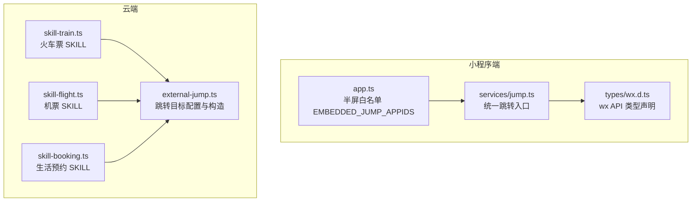
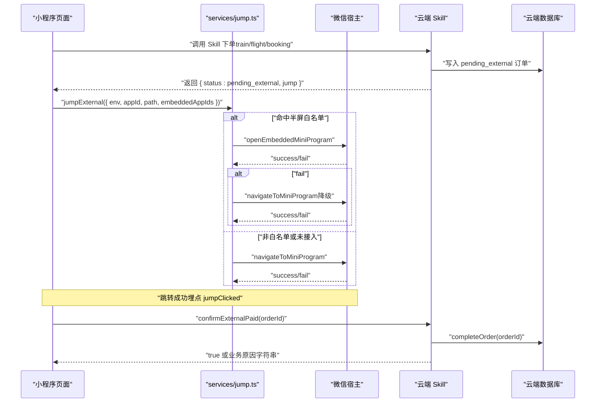
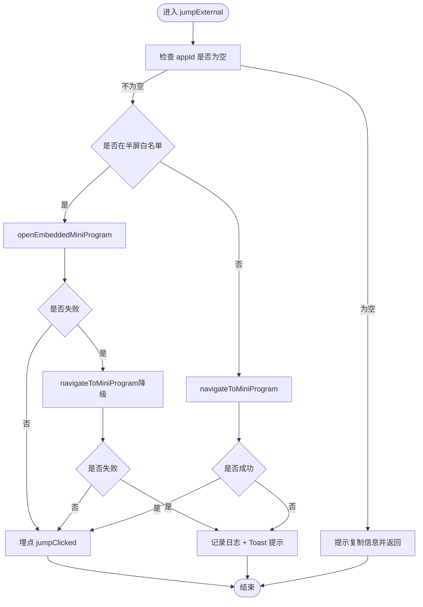
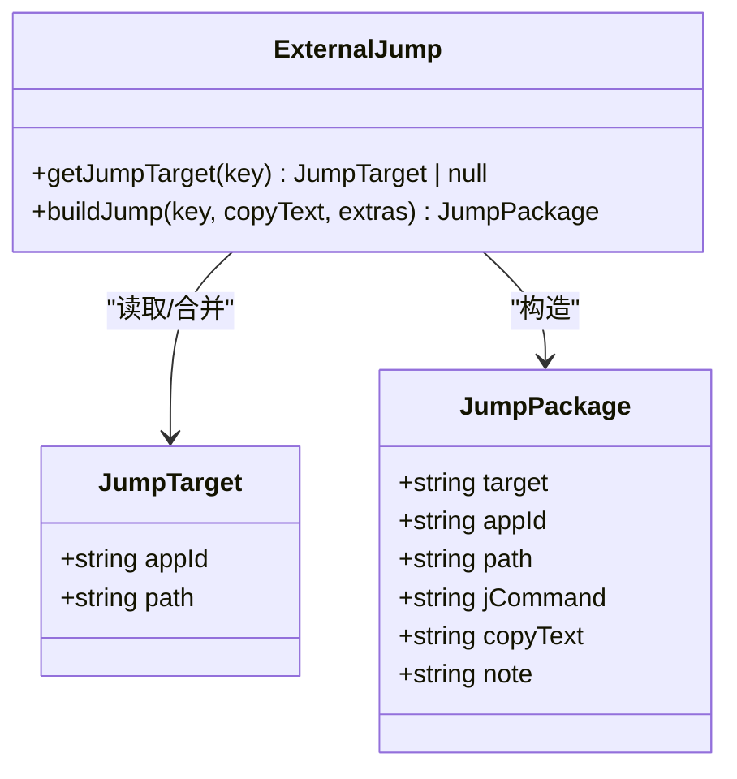
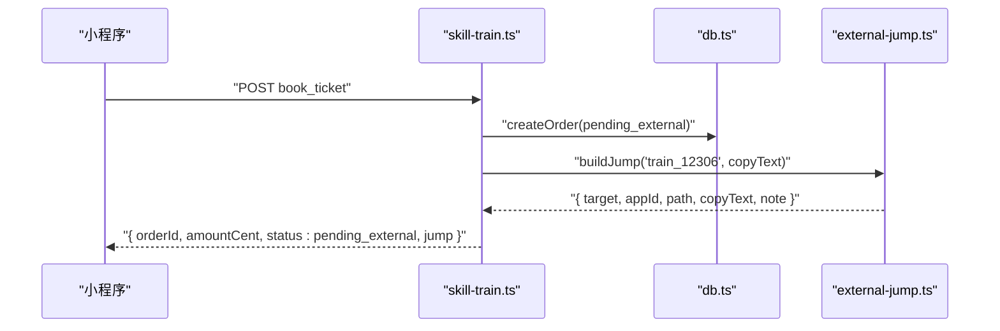
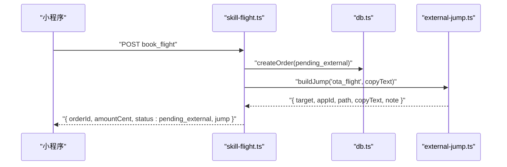
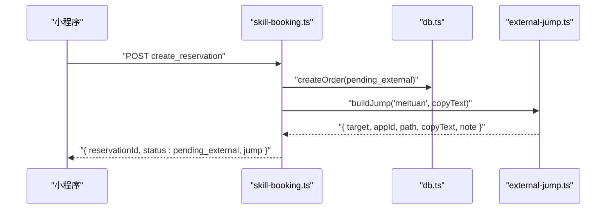
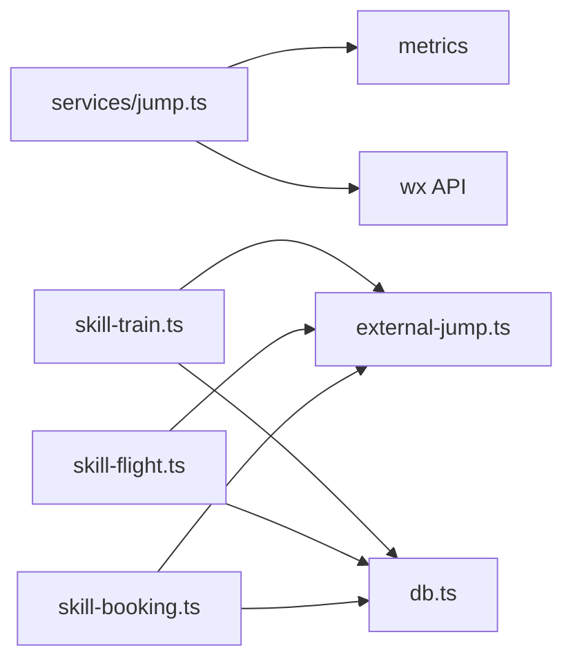

# 外部跳转框架

<cite>
**本文引用的文件**   
- [miniprogram/src/services/jump.ts](file://miniprogram/src/services/jump.ts)
- [cloudrun/src/external-jump.ts](file://cloudrun/src/external-jump.ts)
- [cloudrun/src/skill-train.ts](file://cloudrun/src/skill-train.ts)
- [cloudrun/src/skill-flight.ts](file://cloudrun/src/skill-flight.ts)
- [cloudrun/src/skill-booking.ts](file://cloudrun/src/skill-booking.ts)
- [miniprogram/src/app.ts](file://miniprogram/src/app.ts)
- [miniprogram/src/types/wx.d.ts](file://miniprogram/src/types/wx.d.ts)
</cite>

## 目录
1. [引言](#引言)
2. [项目结构](#项目结构)
3. [核心组件](#核心组件)
4. [架构总览](#架构总览)
5. [详细组件分析](#详细组件分析)
6. [依赖关系分析](#依赖关系分析)
7. [性能与行为特征](#性能与行为特征)
8. [故障排查指南](#故障排查指南)
9. [结论](#结论)

## 引言
本文件聚焦“外部跳转框架”，即小程序侧与云端协同的“跳转到外部官方小程序 + 成交确认”闭环。该方案用于火车票、机票、生活预约等场景：在小程序内生成订单信息卡，再跳转到 12306、OTA、美团、京东等外部小程序完成真实交易；用户完成后回到行程页标记已支付，云端将订单归档为已完成。

关键设计要点：
- 云端集中配置外部渠道 appId 与页面路径，支持环境变量覆盖。
- 小程序端统一封装半屏跳转与普通跳转，自动降级并埋点。
- 所有写操作返回 pending_external 状态与 jump 包，前端据此渲染跳转入口或仅复制文本。
- 成交确认通过专用 complete 端点完成，作为转化漏斗的最深观测点。

## 项目结构
围绕外部跳转的相关代码分布在小程序服务层与云端 Skill 路由中：

图示来源
- [miniprogram/src/services/jump.ts:24-87](file://miniprogram/src/services/jump.ts#L24-L87)
- [miniprogram/src/types/wx.d.ts:80-103](file://miniprogram/src/types/wx.d.ts#L80-L103)
- [miniprogram/src/app.ts:69-77](file://miniprogram/src/app.ts#L69-L77)
- [cloudrun/src/external-jump.ts:18-101](file://cloudrun/src/external-jump.ts#L18-L101)
- [cloudrun/src/skill-train.ts:29-331](file://cloudrun/src/skill-train.ts#L29-L331)
- [cloudrun/src/skill-flight.ts:29-421](file://cloudrun/src/skill-flight.ts#L29-L421)
- [cloudrun/src/skill-booking.ts:22-213](file://cloudrun/src/skill-booking.ts#L22-L213)

章节来源
- [miniprogram/src/services/jump.ts:1-113](file://miniprogram/src/services/jump.ts#L1-L113)
- [cloudrun/src/external-jump.ts:1-102](file://cloudrun/src/external-jump.ts#L1-L102)
- [cloudrun/src/skill-train.ts:1-393](file://cloudrun/src/skill-train.ts#L1-L393)
- [cloudrun/src/skill-flight.ts:1-481](file://cloudrun/src/skill-flight.ts#L1-L481)
- [cloudrun/src/skill-booking.ts:1-275](file://cloudrun/src/skill-booking.ts#L1-L275)
- [miniprogram/src/app.ts:69-77](file://miniprogram/src/app.ts#L69-L77)
- [miniprogram/src/types/wx.d.ts:80-103](file://miniprogram/src/types/wx.d.ts#L80-L103)

## 核心组件
- 小程序统一跳转服务：对外暴露 jumpExternal 与 confirmExternalPaid，负责半屏/普通跳转、失败降级、埋点与成交确认。
- 云端跳转目标配置：集中管理各渠道 appId 与 path，提供 buildJump 构造统一 jump 包。
- Skill 下单流程：火车票、机票、生活预约均返回 pending_external 与 jump 包，真实交易在外部小程序完成。
- 小程序环境配置：EMBEDDED_JUMP_APPIDS 控制半屏白名单。
- wx API 类型声明：navigateToMiniProgram 与 openEmbeddedMiniProgram 的类型定义。

章节来源
- [miniprogram/src/services/jump.ts:24-112](file://miniprogram/src/services/jump.ts#L24-L112)
- [cloudrun/src/external-jump.ts:18-101](file://cloudrun/src/external-jump.ts#L18-L101)
- [cloudrun/src/skill-train.ts:254-331](file://cloudrun/src/skill-train.ts#L254-L331)
- [cloudrun/src/skill-flight.ts:345-421](file://cloudrun/src/skill-flight.ts#L345-L421)
- [cloudrun/src/skill-booking.ts:150-213](file://cloudrun/src/skill-booking.ts#L150-L213)
- [miniprogram/src/app.ts:69-77](file://miniprogram/src/app.ts#L69-L77)
- [miniprogram/src/types/wx.d.ts:80-103](file://miniprogram/src/types/wx.d.ts#L80-L103)

## 架构总览
外部跳转的整体交互如下：Skill 创建 pending_external 订单并返回 jump 包；小程序根据 appId 决定半屏或普通跳转；若未接入则仅提示复制；用户在外端完成支付后回小程序标记已支付，云端归档 completed。

图示来源
- [cloudrun/src/skill-train.ts:254-331](file://cloudrun/src/skill-train.ts#L254-L331)
- [cloudrun/src/skill-flight.ts:345-421](file://cloudrun/src/skill-flight.ts#L345-L421)
- [cloudrun/src/skill-booking.ts:150-213](file://cloudrun/src/skill-booking.ts#L150-L213)
- [miniprogram/src/services/jump.ts:53-87](file://miniprogram/src/services/jump.ts#L53-L87)
- [miniprogram/src/services/jump.ts:98-112](file://miniprogram/src/services/jump.ts#L98-L112)

## 详细组件分析

### 小程序统一跳转服务（services/jump.ts）
职责：
- 统一入口 jumpExternal：按 appId 是否为空、是否在半屏白名单，选择 openEmbeddedMiniProgram 或 navigateToMiniProgram，并在 fail 时显式降级。
- 埋点：跳转成功统一记录 jumpClicked。
- 失败处理：日志取证 + Toast 引导手动打开渠道 App。
- 成交确认：confirmExternalPaid 调用云端 /api/skill/{skillId}/{action}/complete，返回 true 或业务原因字符串。

关键数据结构：
- JumpOptions：env、appId、path、embeddedAppIds。

行为说明：
- appId 为空：直接提示 copy-only，不发起跳转。
- 命中半屏白名单：优先半屏，allowFullScreen=true；失败时降级普通跳转。
- 非白名单：直接普通跳转。

图示来源
- [miniprogram/src/services/jump.ts:53-87](file://miniprogram/src/services/jump.ts#L53-L87)

章节来源
- [miniprogram/src/services/jump.ts:24-112](file://miniprogram/src/services/jump.ts#L24-L112)

### 云端跳转目标配置（external-jump.ts）
职责：
- 维护默认目标表 DEFAULT_TARGETS，包含 train_12306、ota_flight、jd、meituan、taobao、none。
- 解析环境变量 EXTERNAL_JUMP，合并覆盖默认表，缓存结果。
- getJumpTarget：返回 appId 非空的 JumpTarget，否则返回 null（表示 copy-only）。
- buildJump：构造统一 jump 包，包含 target、appId、path、jCommand、copyText、note。

注意：
- 淘宝系无微信小程序，固定走 copy-only。
- 每个小程序可跳转的外部小程序上限 10 个，当前 4 个，安全。

图示来源
- [cloudrun/src/external-jump.ts:18-101](file://cloudrun/src/external-jump.ts#L18-L101)

章节来源
- [cloudrun/src/external-jump.ts:1-102](file://cloudrun/src/external-jump.ts#L1-L102)

### 火车票 SKILL（skill-train.ts）
下单流程要点：
- 校验必填字段与 openid。
- 金额优先取 12306 真实票价（MCP 可用且 from/to 齐备），否则回退静态价目表。
- 生成 trn_ 前缀 orderId，写入 pending_external 订单。
- 返回 jump: buildJump('train_12306', copyText)。
- cancel 与 complete 分别实现取消与成交确认。

图示来源
- [cloudrun/src/skill-train.ts:254-331](file://cloudrun/src/skill-train.ts#L254-L331)
- [cloudrun/src/external-jump.ts:80-101](file://cloudrun/src/external-jump.ts#L80-L101)

章节来源
- [cloudrun/src/skill-train.ts:254-393](file://cloudrun/src/skill-train.ts#L254-L393)

### 机票 SKILL（skill-flight.ts）
下单流程要点：
- 校验必填字段与 openid。
- 金额优先取飞常準真实票价（Key 可用且 from/to 齐备），否则回退静态基准价。
- 生成 flg_ 前缀 orderId，写入 pending_external 订单。
- 返回 jump: buildJump('ota_flight', copyText)。
- cancel 与 complete 分别实现取消与成交确认。

图示来源
- [cloudrun/src/skill-flight.ts:345-421](file://cloudrun/src/skill-flight.ts#L345-L421)
- [cloudrun/src/external-jump.ts:80-101](file://cloudrun/src/external-jump.ts#L80-L101)

章节来源
- [cloudrun/src/skill-flight.ts:345-481](file://cloudrun/src/skill-flight.ts#L345-L481)

### 生活预约 SKILL（skill-booking.ts）
下单流程要点：
- 校验必填字段与 openid。
- 时段目录为演示性参考，真实时段以美团为准。
- 生成 rsv_ 前缀 reservationId，写入 pending_external 订单。
- 返回 jump: buildJump('meituan', copyText)。
- 提供 list_reservations 查询接口。

图示来源
- [cloudrun/src/skill-booking.ts:150-213](file://cloudrun/src/skill-booking.ts#L150-L213)
- [cloudrun/src/external-jump.ts:80-101](file://cloudrun/src/external-jump.ts#L80-L101)

章节来源
- [cloudrun/src/skill-booking.ts:150-275](file://cloudrun/src/skill-booking.ts#L150-L275)

### 小程序环境与 wx API 类型
- EMBEDDED_JUMP_APPIDS：半屏白名单，空数组表示全部普通跳转；半屏 fail 时 services/jump.ts 显式降级。
- wx.d.ts：声明 navigateToMiniProgram 与 openEmbeddedMiniProgram 的参数与回调，强调基础库版本与真机验证要求。

章节来源
- [miniprogram/src/app.ts:69-77](file://miniprogram/src/app.ts#L69-L77)
- [miniprogram/src/types/wx.d.ts:80-103](file://miniprogram/src/types/wx.d.ts#L80-L103)

## 依赖关系分析
- 小程序端 services/jump.ts 依赖：
  - cloud 容器请求（postContainer）用于成交确认。
  - metrics 埋点（recordEvent）。
  - wx API（navigateToMiniProgram、openEmbeddedMiniProgram）。
- 云端 external-jump.ts 被多个 Skill 复用：
  - skill-train.ts、skill-flight.ts、skill-booking.ts 均调用 buildJump 构造统一 jump 包。
- Skill 下单流程依赖 db.ts 进行订单持久化，并返回 pending_external 状态。

图示来源
- [miniprogram/src/services/jump.ts:17-21](file://miniprogram/src/services/jump.ts#L17-L21)
- [cloudrun/src/skill-train.ts:29-30](file://cloudrun/src/skill-train.ts#L29-L30)
- [cloudrun/src/skill-flight.ts:31-32](file://cloudrun/src/skill-flight.ts#L31-L32)
- [cloudrun/src/skill-booking.ts:24-25](file://cloudrun/src/skill-booking.ts#L24-L25)
- [cloudrun/src/external-jump.ts:80-101](file://cloudrun/src/external-jump.ts#L80-L101)

章节来源
- [miniprogram/src/services/jump.ts:17-21](file://miniprogram/src/services/jump.ts#L17-L21)
- [cloudrun/src/skill-train.ts:29-30](file://cloudrun/src/skill-train.ts#L29-L30)
- [cloudrun/src/skill-flight.ts:31-32](file://cloudrun/src/skill-flight.ts#L31-L32)
- [cloudrun/src/skill-booking.ts:24-25](file://cloudrun/src/skill-booking.ts#L24-L25)
- [cloudrun/src/external-jump.ts:80-101](file://cloudrun/src/external-jump.ts#L80-L101)

## 性能与行为特征
- 跳转链路短：小程序端直接调用 wx API，云端仅返回配置与订单状态，避免复杂网络往返。
- 半屏降级策略：当 openEmbeddedMiniProgram 失败时立即降级 navigateToMiniProgram，保证下单路径不断裂。
- 埋点口径统一：跳转成功统一记录 jumpClicked，便于漏斗分析。
- 成交确认超时：confirmExternalPaid 设置 10 秒超时，避免长时间阻塞。
- 云端配置缓存：EXTERNAL_JUMP 解析后缓存，减少重复解析开销。

[本节为通用指导，不涉及具体文件分析]

## 故障排查指南
常见问题与定位建议：
- 跳转按钮不可见或仅显示复制：
  - 检查云端 EXTERNAL_JUMP 是否配置对应渠道 appId；若为空，前端仅展示复制。
  - 参考：[cloudrun/src/external-jump.ts:48-73](file://cloudrun/src/external-jump.ts#L48-L73)
- 半屏跳转失败：
  - 确认后台“半屏小程序管理”已通过目标 appId；基础库需满足要求；开发者工具不支持，需真机验证。
  - 参考：[miniprogram/src/types/wx.d.ts:87-103](file://miniprogram/src/types/wx.d.ts#L87-L103)
- 跳转最终失败：
  - 查看日志中的 [jump] 跳轉小程序失敗 信息；Toast 会提示使用真机并引导手动打开渠道 App。
  - 参考：[miniprogram/src/services/jump.ts:41-44](file://miniprogram/src/services/jump.ts#L41-L44)
- 成交确认失败：
  - 确认 orderId 存在且未被取消；检查云端 complete 端点返回的业务原因。
  - 参考：[miniprogram/src/services/jump.ts:98-112](file://miniprogram/src/services/jump.ts#L98-L112)

章节来源
- [cloudrun/src/external-jump.ts:48-73](file://cloudrun/src/external-jump.ts#L48-L73)
- [miniprogram/src/types/wx.d.ts:87-103](file://miniprogram/src/types/wx.d.ts#L87-L103)
- [miniprogram/src/services/jump.ts:41-44](file://miniprogram/src/services/jump.ts#L41-L44)
- [miniprogram/src/services/jump.ts:98-112](file://miniprogram/src/services/jump.ts#L98-L112)

## 结论
外部跳转框架通过云端集中配置与小程序统一封装，实现了火车票、机票、生活预约等场景的稳定跳转与成交确认闭环。其核心优势在于：
- 配置集中、变更便捷：EXTERNAL_JUMP 环境变量一處修正全局生效。
- 体验稳健：半屏优先、自动降级、失败兜底，确保下单路径不断裂。
- 数据可观测：pending_external 状态与埋点事件构成完整漏斗。
- 合规清晰：真实交易发生在外部官方渠道，本系统不触碰支付与售后。

未来可在以下方面持续优化：
- 扩展更多外部渠道至 EXTERNAL_JUMP，并完善半屏白名单。
- 增强错误提示的可操作性，例如一键复制并打开渠道 App。
- 完善埋点维度，区分不同渠道与跳转模式（半屏/普通）的转化率。

[本节为总结性内容，不涉及具体文件分析]