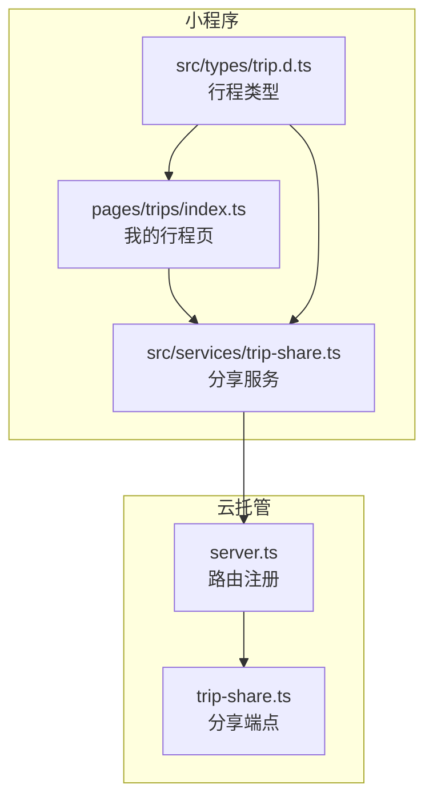
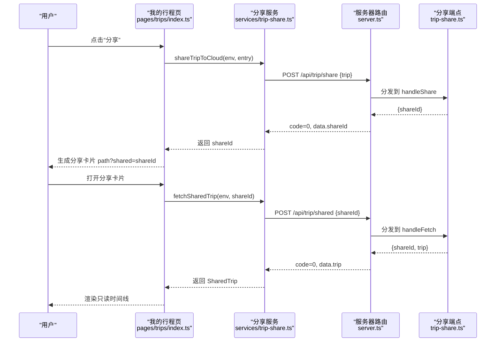
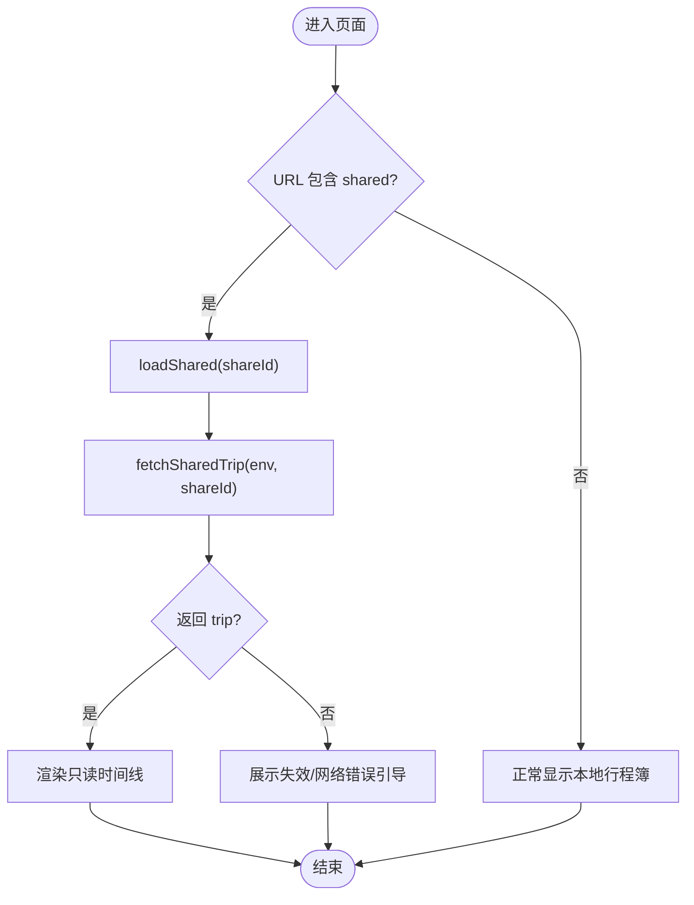
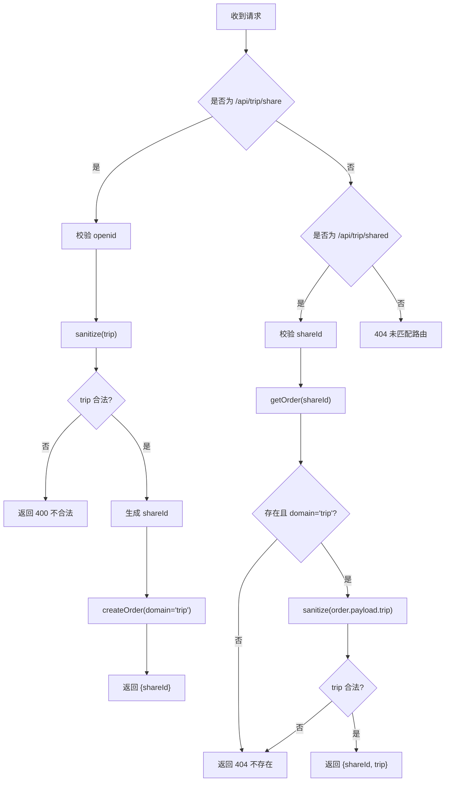
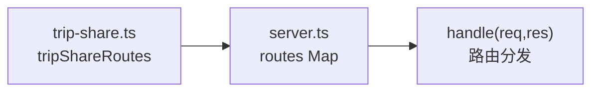
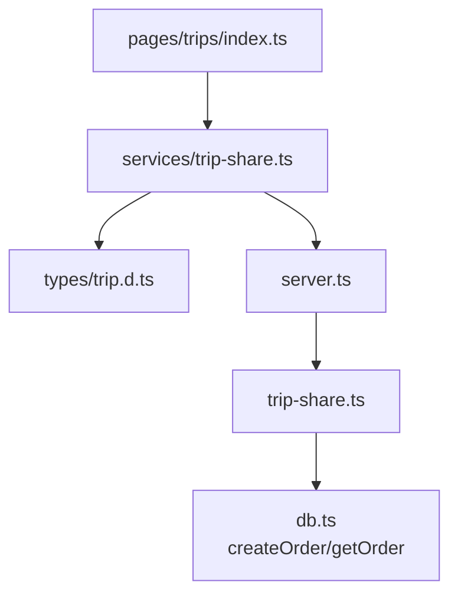

# 旅行分享功能

<cite>
**本文引用的文件**   
- [cloudrun/src/trip-share.ts](file://cloudrun/src/trip-share.ts)
- [miniprogram/src/services/trip-share.ts](file://miniprogram/src/services/trip-share.ts)
- [cloudrun/src/server.ts](file://cloudrun/src/server.ts)
- [miniprogram/pages/trips/index.ts](file://miniprogram/pages/trips/index.ts)
- [miniprogram/src/types/trip.d.ts](file://miniprogram/src/types/trip.d.ts)
</cite>

## 目录
1. [引言](#引言)
2. [项目结构](#项目结构)
3. [核心组件](#核心组件)
4. [架构总览](#架构总览)
5. [详细组件分析](#详细组件分析)
6. [依赖关系分析](#依赖关系分析)
7. [性能与可靠性](#性能与可靠性)
8. [故障排查指南](#故障排查指南)
9. [结论](#结论)

## 引言
本文件聚焦“旅行分享”能力：用户可在小程序内将本地行程白化后上传至云端，换取不可枚举的 shareId；同行同伴通过分享卡片打开小程序时，按 shareId 拉取只读行程时间线。该能力贯穿小程序页面、服务层与云托管后端，强调隐私白名单、跨设备可见性与稳健的错误处理。

## 项目结构
旅行分享涉及以下关键位置：
- 小程序页面：我的行程页负责触发分享、展示分享卡内容
- 小程序服务层：封装分享/拉取的 HTTP 调用与数据白化
- 云托管后端：提供 /api/trip/share 与 /api/trip/shared 两个端点，完成白化落库与只读读取
- 类型定义：TripEntry 等数据结构贯穿两端



**图表来源**
- [miniprogram/pages/trips/index.ts:184-236](file://miniprogram/pages/trips/index.ts#L184-L236)
- [miniprogram/src/services/trip-share.ts:16-73](file://miniprogram/src/services/trip-share.ts#L16-L73)
- [cloudrun/src/server.ts:44-59](file://cloudrun/src/server.ts#L44-L59)
- [cloudrun/src/trip-share.ts:74-115](file://cloudrun/src/trip-share.ts#L74-L115)
- [miniprogram/src/types/trip.d.ts:53-78](file://miniprogram/src/types/trip.d.ts#L53-L78)

**章节来源**
- [miniprogram/pages/trips/index.ts:1-24](file://miniprogram/pages/trips/index.ts#L1-L24)
- [cloudrun/src/server.ts:1-14](file://cloudrun/src/server.ts#L1-L14)

## 核心组件
- 小程序“我的行程”页：承载分享入口、分享卡展示、状态交互
- 小程序分享服务：本地 TripEntry → 白化 SharedTrip，HTTP 调用云端
- 云托管分享端点：校验身份、白化落库、按 shareId 只读返回
- 类型契约：SharedTrip 在两端对齐，TripEntry 作为持久化形态

**章节来源**
- [miniprogram/pages/trips/index.ts:102-138](file://miniprogram/pages/trips/index.ts#L102-L138)
- [miniprogram/src/services/trip-share.ts:16-73](file://miniprogram/src/services/trip-share.ts#L16-L73)
- [cloudrun/src/trip-share.ts:26-45](file://cloudrun/src/trip-share.ts#L26-L45)
- [miniprogram/src/types/trip.d.ts:53-78](file://miniprogram/src/types/trip.d.ts#L53-L78)

## 架构总览
旅行分享的整体流程如下：
- 发起方：点击分享按钮 → 页面调用分享服务 → 服务白化并 POST 到 /api/trip/share → 云端返回 shareId → 页面拼接 ?shared=shareId 路径进行转发
- 接收方：从分享卡片进入 → 页面解析 query.shared → 调用 /api/trip/shared → 云端返回白化后的 trip → 页面渲染只读时间线



**图表来源**
- [miniprogram/pages/trips/index.ts:212-236](file://miniprogram/pages/trips/index.ts#L212-L236)
- [miniprogram/pages/trips/index.ts:239-273](file://miniprogram/pages/trips/index.ts#L239-L273)
- [miniprogram/src/services/trip-share.ts:46-73](file://miniprogram/src/services/trip-share.ts#L46-L73)
- [cloudrun/src/server.ts:165-180](file://cloudrun/src/server.ts#L165-L180)
- [cloudrun/src/trip-share.ts:74-115](file://cloudrun/src/trip-share.ts#L74-L115)

## 详细组件分析

### 小程序“我的行程”页（分享入口与分享卡展示）
职责要点：
- 分享入口：onShareAppMessage 中根据是否来自按钮区分行为；若来自按钮则尝试白化上传云端换 shareId，失败回退为分享小程序首页
- 分享缓存：页面实例维护 shareIds 映射，避免重复上传同一行程
- 分享卡展示：onLoad 解析 query.shared，调用 fetchSharedTrip 拉取只读行程，失败时展示引导文案
- 状态映射：将任务状态映射为中文标签，用于分享卡时间线展示



**图表来源**
- [miniprogram/pages/trips/index.ts:191-202](file://miniprogram/pages/trips/index.ts#L191-L202)
- [miniprogram/pages/trips/index.ts:239-273](file://miniprogram/pages/trips/index.ts#L239-L273)

**章节来源**
- [miniprogram/pages/trips/index.ts:184-236](file://miniprogram/pages/trips/index.ts#L184-L236)
- [miniprogram/pages/trips/index.ts:239-273](file://miniprogram/pages/trips/index.ts#L239-L273)

### 小程序分享服务（白化与 HTTP 调用）
职责要点：
- toShareable：将本地 TripEntry 转换为 SharedTrip，仅保留 date/dateLabel/city/activity/timeline[{timeLabel,title,status}]
- shareTripToCloud：POST /api/trip/share，失败抛错由页面 toast 提示
- fetchSharedTrip：POST /api/trip/shared，失败或不存在返回 null，由页面展示引导

```mermaid
classDiagram
class SharedTrip {
+string date
+string dateLabel
+string city
+string activity
+{timeLabel,title,status}[] timeline
}
class TripEntry {
+string id
+string planId
+string date
+string dateLabel
+string city
+string activity
+string intent
+timeline[] timeline
+string status
+number remindedAt
+number subscribedAt
+number createdAt
}
class TripShareService {
+toShareable(entry) : SharedTrip
+shareTripToCloud(env, entry) : Promise~string~
+fetchSharedTrip(env, shareId) : Promise~SharedTrip|null~
}
TripEntry --> SharedTrip : "白化投影"
TripShareService --> SharedTrip : "使用"
```

**图表来源**
- [miniprogram/src/services/trip-share.ts:16-38](file://miniprogram/src/services/trip-share.ts#L16-L38)
- [miniprogram/src/services/trip-share.ts:46-73](file://miniprogram/src/services/trip-share.ts#L46-L73)
- [miniprogram/src/types/trip.d.ts:53-78](file://miniprogram/src/types/trip.d.ts#L53-L78)

**章节来源**
- [miniprogram/src/services/trip-share.ts:1-74](file://miniprogram/src/services/trip-share.ts#L1-L74)

### 云托管分享端点（白化落库与只读读取）
职责要点：
- 白化 sanitize：严格限制字段集合与长度，拒绝非对象输入，确保仅存储展示所需字段
- handleShare：校验 openid，生成 shareId，以 domain='trip' 写入订单表，返回 shareId
- handleFetch：校验 shareId，查询订单并二次白化，返回 {shareId, trip}



**图表来源**
- [cloudrun/src/trip-share.ts:52-72](file://cloudrun/src/trip-share.ts#L52-L72)
- [cloudrun/src/trip-share.ts:74-115](file://cloudrun/src/trip-share.ts#L74-L115)

**章节来源**
- [cloudrun/src/trip-share.ts:1-20](file://cloudrun/src/trip-share.ts#L1-L20)
- [cloudrun/src/trip-share.ts:74-115](file://cloudrun/src/trip-share.ts#L74-L115)

### 路由注册与统一入口
- server.ts 将所有模块导出的路由 entries 合并到 routes Map
- trip-share.ts 导出 tripShareRoutes，包含两个端点
- 请求体解析、健康检查、异常处理集中在 server.ts



**图表来源**
- [cloudrun/src/server.ts:44-59](file://cloudrun/src/server.ts#L44-L59)
- [cloudrun/src/trip-share.ts:112-115](file://cloudrun/src/trip-share.ts#L112-L115)

**章节来源**
- [cloudrun/src/server.ts:108-194](file://cloudrun/src/server.ts#L108-L194)

## 依赖关系分析
- 页面依赖分享服务：pages/trips/index.ts 导入 shareTripToCloud 与 fetchSharedTrip
- 分享服务依赖类型：services/trip-share.ts 使用 TripEntry 与 SharedTrip
- 服务端依赖数据库接口：trip-share.ts 使用 createOrder/getOrder
- 路由依赖：server.ts 聚合各模块路由



**图表来源**
- [miniprogram/pages/trips/index.ts:26-34](file://miniprogram/pages/trips/index.ts#L26-L34)
- [miniprogram/src/services/trip-share.ts:12-14](file://miniprogram/src/services/trip-share.ts#L12-L14)
- [cloudrun/src/server.ts:34-35](file://cloudrun/src/server.ts#L34-L35)
- [cloudrun/src/trip-share.ts:22-24](file://cloudrun/src/trip-share.ts#L22-L24)

**章节来源**
- [miniprogram/pages/trips/index.ts:26-34](file://miniprogram/pages/trips/index.ts#L26-L34)
- [miniprogram/src/services/trip-share.ts:12-14](file://miniprogram/src/services/trip-share.ts#L12-L14)
- [cloudrun/src/server.ts:34-35](file://cloudrun/src/server.ts#L34-L35)
- [cloudrun/src/trip-share.ts:22-24](file://cloudrun/src/trip-share.ts#L22-L24)

## 性能与可靠性
- 白化策略：两端均对字符串字段做截断与集合过滤，降低无效数据与注入风险
- 幂等与缓存：页面侧 shareIds 缓存避免重复上传同一行程
- 超时与重试：分享/拉取调用设置 timeoutMs 且关闭重试，避免长时间阻塞
- 错误降级：分享失败回退为分享小程序首页；分享卡拉取失败展示引导文案
- 身份校验：服务端要求 x-wx-openid，防止匿名创建分享

[本节为通用指导，不涉及具体代码片段]

## 故障排查指南
常见问题与定位建议：
- 分享建立失败
  - 现象：页面 toast 提示“分享建立失败，已改为分享小程序”
  - 可能原因：云端返回 code≠0 或缺少 shareId
  - 排查：确认 openid 头是否正确传递；检查 /api/trip/share 响应
- 分享卡无法加载
  - 现象：顶部区块显示“分享不存在或已失效”
  - 可能原因：shareId 无效、订单不存在或 domain 不匹配
  - 排查：检查 /api/trip/shared 响应；确认 shareId 来源正确
- 数据被白化导致信息缺失
  - 现象：分享卡时间线缺少某些字段
  - 可能原因：原始数据包含非白名单字段（如 intent/jump/taskId）
  - 排查：确认 toShareable 与服务端 sanitize 的字段范围

**章节来源**
- [miniprogram/pages/trips/index.ts:232-235](file://miniprogram/pages/trips/index.ts#L232-L235)
- [miniprogram/pages/trips/index.ts:268-272](file://miniprogram/pages/trips/index.ts#L268-L272)
- [cloudrun/src/trip-share.ts:74-115](file://cloudrun/src/trip-share.ts#L74-L115)

## 结论
旅行分享功能通过“小程序白化 + 云端落库 + 只读拉取”的分层设计，实现了隐私保护与跨设备可见性。页面侧提供友好的分享入口与分享卡展示，服务层封装 HTTP 调用与类型转换，服务端严格白化与身份校验，整体链路清晰、健壮且易于扩展。