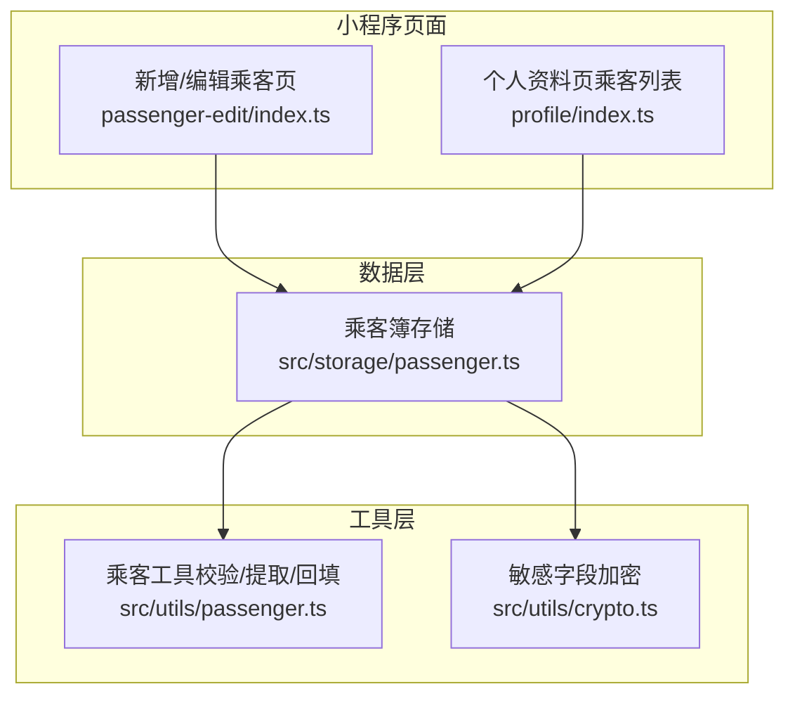
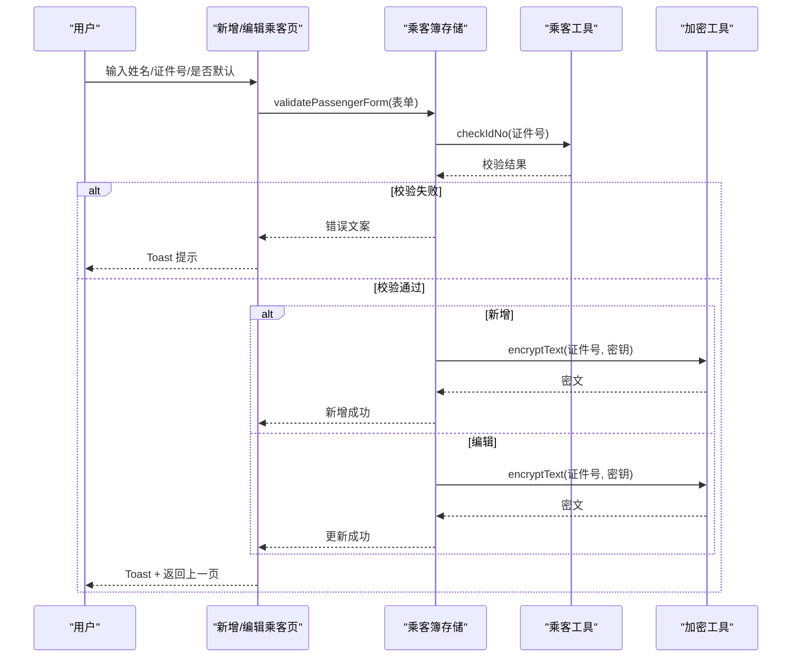
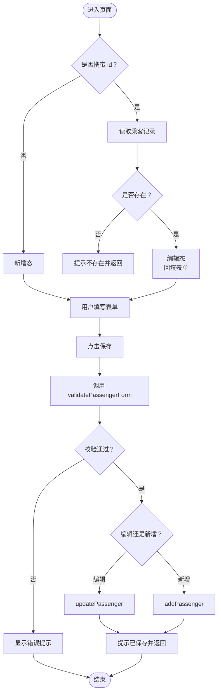
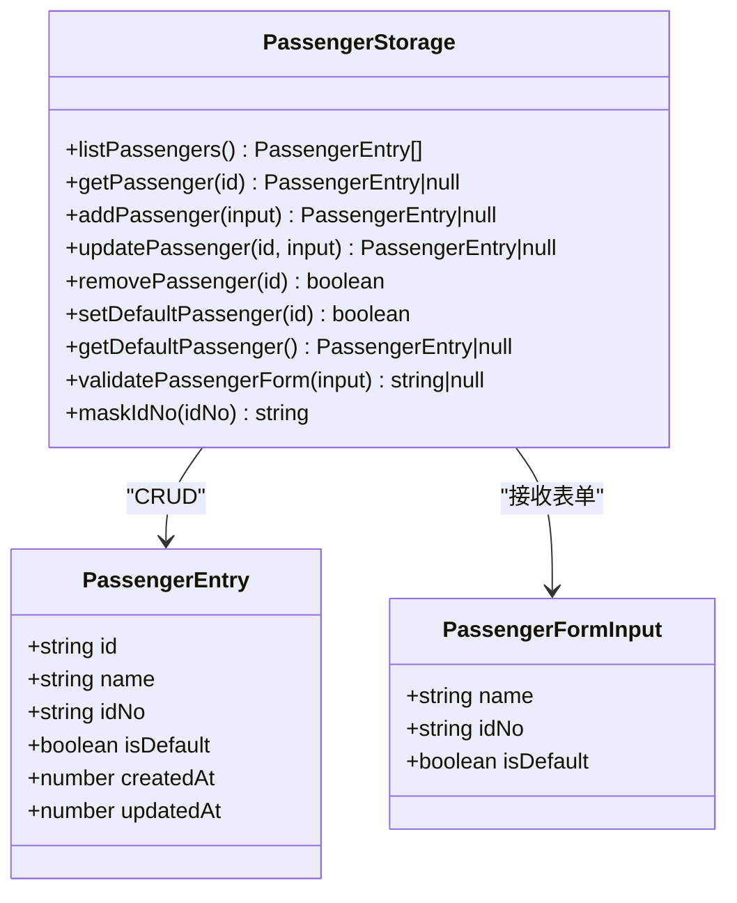
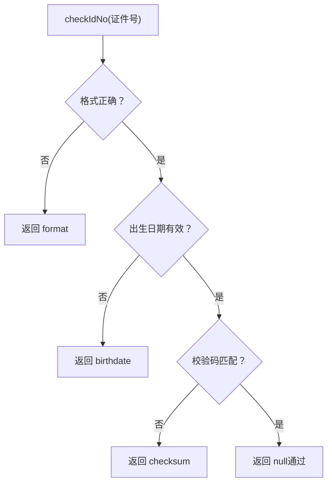
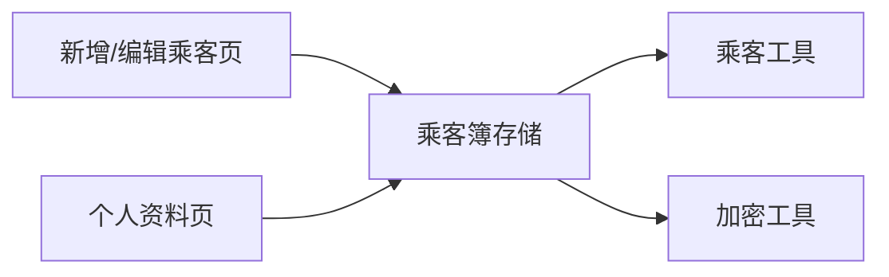

# 乘客信息管理

<cite>
**本文引用的文件**   
- [miniprogram/pages/passenger-edit/index.ts](file://miniprogram/pages/passenger-edit/index.ts)
- [miniprogram/pages/passenger-edit/index.wxml](file://miniprogram/pages/passenger-edit/index.wxml)
- [miniprogram/pages/passenger-edit/index.wxss](file://miniprogram/pages/passenger-edit/index.wxss)
- [miniprogram/src/storage/passenger.ts](file://miniprogram/src/storage/passenger.ts)
- [miniprogram/pages/profile/index.ts](file://miniprogram/pages/profile/index.ts)
- [miniprogram/src/utils/passenger.ts](file://miniprogram/src/utils/passenger.ts)
- [miniprogram/src/utils/crypto.ts](file://miniprogram/src/utils/crypto.ts)
</cite>

## 目录
1. [引言](#引言)
2. [项目结构](#项目结构)
3. [核心组件](#核心组件)
4. [架构总览](#架构总览)
5. [详细组件分析](#详细组件分析)
6. [依赖关系分析](#依赖关系分析)
7. [性能与容量特性](#性能与容量特性)
8. [故障排查指南](#故障排查指南)
9. [结论](#结论)

## 引言
本文件聚焦“乘客信息管理”能力，覆盖微信小程序端的乘客信息录入、编辑、列表展示、本地持久化与安全存储，以及与 LLM 规划后处理的数据回填协作。整体目标是在不暴露敏感明文的前提下，为火车票、机票等下单流程提供稳定可靠的默认乘客来源。

## 项目结构
围绕乘客信息管理的相关代码分布在以下位置：
- 页面层：新增/编辑乘客页、个人资料（乘客列表）页
- 数据层：乘客簿的增删改查、校验、脱敏、加密落盘
- 工具层：身份证号校验、对话提取与计划回填、本地敏感字段加密

**图表来源**
- [miniprogram/pages/passenger-edit/index.ts:1-146](file://miniprogram/pages/passenger-edit/index.ts#L1-L146)
- [miniprogram/pages/profile/index.ts:1-65](file://miniprogram/pages/profile/index.ts#L1-L65)
- [miniprogram/src/storage/passenger.ts:1-225](file://miniprogram/src/storage/passenger.ts#L1-L225)
- [miniprogram/src/utils/passenger.ts:1-256](file://miniprogram/src/utils/passenger.ts#L1-L256)
- [miniprogram/src/utils/crypto.ts:1-91](file://miniprogram/src/utils/crypto.ts#L1-L91)

**章节来源**
- [miniprogram/pages/passenger-edit/index.ts:1-146](file://miniprogram/pages/passenger-edit/index.ts#L1-L146)
- [miniprogram/pages/profile/index.ts:1-65](file://miniprogram/pages/profile/index.ts#L1-L65)
- [miniprogram/src/storage/passenger.ts:1-225](file://miniprogram/src/storage/passenger.ts#L1-L225)
- [miniprogram/src/utils/passenger.ts:1-256](file://miniprogram/src/utils/passenger.ts#L1-L256)
- [miniprogram/src/utils/crypto.ts:1-91](file://miniprogram/src/utils/crypto.ts#L1-L91)

## 核心组件
- 新增/编辑乘客页：负责表单状态、交互与导航；调用数据层完成校验与持久化。
- 个人资料页：只负责列出乘客并脱敏展示，点击行进入编辑态。
- 乘客簿存储：实现本地 CRUD、默认乘客唯一性、容量上限、脱敏与加密落盘。
- 乘客工具：身份证号三級校验、从对话历史提取乘客、对计划任务进行回填。
- 加密工具：安装级随机密钥、XOR 流加密/解密，保证证件号密文落盘。

**章节来源**
- [miniprogram/pages/passenger-edit/index.ts:1-146](file://miniprogram/pages/passenger-edit/index.ts#L1-L146)
- [miniprogram/pages/profile/index.ts:1-65](file://miniprogram/pages/profile/index.ts#L1-L65)
- [miniprogram/src/storage/passenger.ts:1-225](file://miniprogram/src/storage/passenger.ts#L1-L225)
- [miniprogram/src/utils/passenger.ts:1-256](file://miniprogram/src/utils/passenger.ts#L1-L256)
- [miniprogram/src/utils/crypto.ts:1-91](file://miniprogram/src/utils/crypto.ts#L1-L91)

## 架构总览
乘客信息管理采用“页面-数据-工具”分层：
- 页面仅做 UI 与交互，不直接操作 storage。
- 数据层集中承载业务规则（校验、默认唯一性、容量限制、脱敏）。
- 工具层提供纯函数能力（校验、提取、回填、加密），避免耦合 wx.*。

**图表来源**
- [miniprogram/pages/passenger-edit/index.ts:95-127](file://miniprogram/pages/passenger-edit/index.ts#L95-L127)
- [miniprogram/src/storage/passenger.ts:104-113](file://miniprogram/src/storage/passenger.ts#L104-L113)
- [miniprogram/src/utils/passenger.ts:55-79](file://miniprogram/src/utils/passenger.ts#L55-L79)
- [miniprogram/src/utils/crypto.ts:62-70](file://miniprogram/src/utils/crypto.ts#L62-L70)

## 详细组件分析

### 新增/编辑乘客页
职责边界：
- 支持两种进入形态：新增态与编辑态（通过 URL 参数 id 区分）。
- 编辑态加载既有乘客并回填表单，标题切换为“编辑乘車人”，并提供删除入口。
- 保存时统一走数据层校验与持久化；删除前弹出确认框。

关键流程要点：
- onLoad 中根据 id 判断编辑态，不存在则提示并返回。
- 保存逻辑先校验，再按编辑/新增分支调用 updatePassenger/addPassenger。
- 删除逻辑仅在编辑态可用，确认后调用 removePassenger。

**图表来源**
- [miniprogram/pages/passenger-edit/index.ts:60-78](file://miniprogram/pages/passenger-edit/index.ts#L60-L78)
- [miniprogram/pages/passenger-edit/index.ts:101-127](file://miniprogram/pages/passenger-edit/index.ts#L101-L127)

**章节来源**
- [miniprogram/pages/passenger-edit/index.ts:1-146](file://miniprogram/pages/passenger-edit/index.ts#L1-L146)
- [miniprogram/pages/passenger-edit/index.wxml:1-48](file://miniprogram/pages/passenger-edit/index.wxml#L1-L48)
- [miniprogram/pages/passenger-edit/index.wxss:1-157](file://miniprogram/pages/passenger-edit/index.wxss#L1-L157)

### 个人资料页（乘客列表）
职责边界：
- 仅负责展示乘客列表，并对证件号进行脱敏。
- 提供“新增”入口与“点击行进入编辑”的导航。
- onShow 刷新列表，确保从编辑页返回后同步最新数据。

交互要点：
- 列表项包含 id、name、idNoMasked、isDefault。
- 点击行将 id 作为查询参数传入编辑页。

**章节来源**
- [miniprogram/pages/profile/index.ts:1-65](file://miniprogram/pages/profile/index.ts#L1-L65)

### 乘客簿存储（本地持久化）
职责边界：
- 提供乘客簿的增删改查、默认唯一性维护、容量上限控制。
- 提供表单校验接口与脱敏展示接口。
- 管理本地存储键与加密密钥，保证证件号密文落盘。

数据结构与复杂度：
- 列表读取 listPassengers 时间复杂度 O(n)，n 为乘客数量（上限 20）。
- 新增/更新/删除均涉及一次遍历或查找，O(n)。
- 空间复杂度 O(n)，受 PASSENGER_LIMIT 限制。

加密与迁移：
- 使用安装级随机密钥，密钥与密文分键存放。
- 首次读取自动将历史明文迁移为密文；若解密失败或校验失败，清空待重录。

**图表来源**
- [miniprogram/src/storage/passenger.ts:75-94](file://miniprogram/src/storage/passenger.ts#L75-L94)
- [miniprogram/src/storage/passenger.ts:121-225](file://miniprogram/src/storage/passenger.ts#L121-L225)

**章节来源**
- [miniprogram/src/storage/passenger.ts:1-225](file://miniprogram/src/storage/passenger.ts#L1-L225)

### 乘客工具（校验/提取/回填）
职责边界：
- 身份证号三級校验：格式、出生日期、校验码。
- 从对话历史中提取最近一次提供的乘客信息。
- 对计划任务进行回填，优先使用对话提取，其次回退到默认乘客。

算法要点：
- checkIdNo 严格校验 GB 11643-1999 校验码，防止错误证号进入下游。
- extractPassenger 倒序扫描用户消息，匹配身份证号并提取左侧姓名。
- applyPassengerSlot 针对火车票/机票下单任务，覆盖演示占位值。

**图表来源**
- [miniprogram/src/utils/passenger.ts:55-79](file://miniprogram/src/utils/passenger.ts#L55-L79)

**章节来源**
- [miniprogram/src/utils/passenger.ts:1-256](file://miniprogram/src/utils/passenger.ts#L1-L256)

### 加密工具（敏感字段保护）
职责边界：
- 生成安装级随机密钥。
- 提供 XOR 流加密/解密，密文带 v1 前缀以便迁移识别。
- 明文与密钥分键存放，降低存储转储泄露风险。

安全说明：
- 非密码学承诺，但满足对抗存储转储的最低成本防护。
- 解密失败或金钥不符由调用方以业务校验兜底（如 checkIdNo）。

**章节来源**
- [miniprogram/src/utils/crypto.ts:1-91](file://miniprogram/src/utils/crypto.ts#L1-L91)

## 依赖关系分析
- 页面依赖数据层：新增/编辑页与资料页均通过 storage/passenger.ts 提供的 API 完成数据读写。
- 数据层依赖工具层：校验、脱敏、加密均由 utils/passenger.ts 与 utils/crypto.ts 提供。
- 无循环依赖：页面不直接导入加密工具，数据层封装了所有敏感处理。

**图表来源**
- [miniprogram/pages/passenger-edit/index.ts:15-23](file://miniprogram/pages/passenger-edit/index.ts#L15-L23)
- [miniprogram/pages/profile/index.ts:11-11](file://miniprogram/pages/profile/index.ts#L11-L11)
- [miniprogram/src/storage/passenger.ts:18-20](file://miniprogram/src/storage/passenger.ts#L18-L20)

**章节来源**
- [miniprogram/pages/passenger-edit/index.ts:15-23](file://miniprogram/pages/passenger-edit/index.ts#L15-L23)
- [miniprogram/pages/profile/index.ts:11-11](file://miniprogram/pages/profile/index.ts#L11-L11)
- [miniprogram/src/storage/passenger.ts:18-20](file://miniprogram/src/storage/passenger.ts#L18-L20)

## 性能与容量特性
- 容量上限：PASSENGER_LIMIT = 20，超过上限新增返回空，页面提示已达上限。
- 列表渲染：每次 onShow 重新拉取并映射脱敏数据，n ≤ 20，开销可忽略。
- 加密开销：每条记录的证件号在写入时进行一次 XOR 流加密，长度固定且短，影响极小。
- 默认乘客策略：首条自动设为默认；删除默认时若仍有记录，首条自动递补为默认，保证下单回填始终有候选。

[本节为通用性能讨论，不直接分析具体文件]

## 故障排查指南
常见问题与定位建议：
- 新增失败提示“已达上限”：检查当前乘客数量是否达到 20，必要时清理旧记录。
  - 参考路径：[miniprogram/pages/passenger-edit/index.ts:118-123](file://miniprogram/pages/passenger-edit/index.ts#L118-L123)
- 编辑时报“乘車人已不存在”：可能已被其他流程删除，返回列表重试。
  - 参考路径：[miniprogram/pages/passenger-edit/index.ts:112-117](file://miniprogram/pages/passenger-edit/index.ts#L112-L117)
- 证件号校验失败：
  - “请输入正确的 18 位身份證號碼”：格式不符合 17 位数字+末位数字/X。
  - “身份證出生日期無效”：日期越界或非真实日历日。
  - “身份證校驗碼不符”：GB 11643-1999 校验码不匹配。
  - 参考路径：[miniprogram/src/storage/passenger.ts:104-113](file://miniprogram/src/storage/passenger.ts#L104-L113)、[miniprogram/src/utils/passenger.ts:55-79](file://miniprogram/src/utils/passenger.ts#L55-L79)
- 列表未刷新：确认 onShow 是否被触发，或是否从编辑页返回。
  - 参考路径：[miniprogram/pages/profile/index.ts:41-51](file://miniprogram/pages/profile/index.ts#L41-L51)
- 密文异常或明文残留：首次读取会自动迁移；若仍异常，检查密钥是否损坏或存储键是否被外部修改。
  - 参考路径：[miniprogram/src/storage/passenger.ts:47-70](file://miniprogram/src/storage/passenger.ts#L47-L70)、[miniprogram/src/utils/crypto.ts:79-90](file://miniprogram/src/utils/crypto.ts#L79-L90)

**章节来源**
- [miniprogram/pages/passenger-edit/index.ts:101-144](file://miniprogram/pages/passenger-edit/index.ts#L101-L144)
- [miniprogram/pages/profile/index.ts:41-51](file://miniprogram/pages/profile/index.ts#L41-L51)
- [miniprogram/src/storage/passenger.ts:47-70](file://miniprogram/src/storage/passenger.ts#L47-L70)
- [miniprogram/src/utils/passenger.ts:55-79](file://miniprogram/src/utils/passenger.ts#L55-L79)
- [miniprogram/src/utils/crypto.ts:79-90](file://miniprogram/src/utils/crypto.ts#L79-L90)

## 结论
乘客信息管理模块以清晰的职责分层与严格的隐私保护为核心：页面专注交互，数据层集中业务规则，工具层提供纯函数能力。通过三級身份证校验、默认乘客唯一性与容量上限控制，以及安装级密钥的 XOR 流加密，系统在易用性与安全性之间取得平衡，并为火车票、机票等下单场景提供稳定的默认乘客来源。