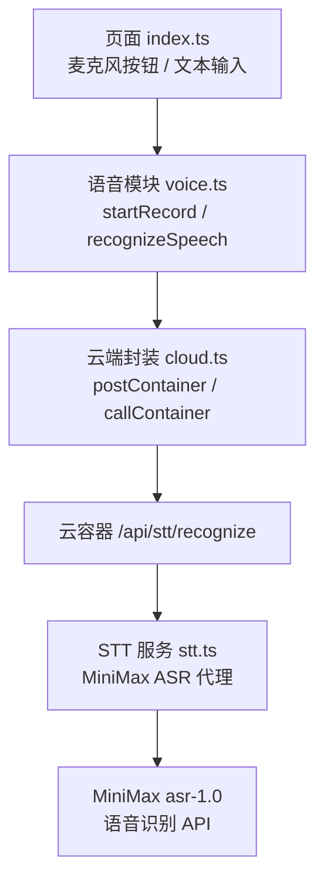
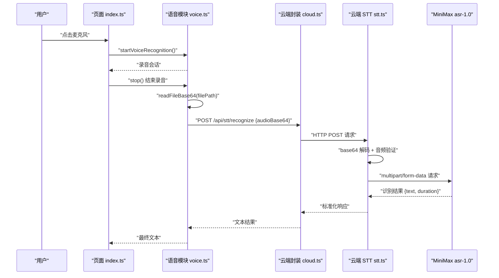
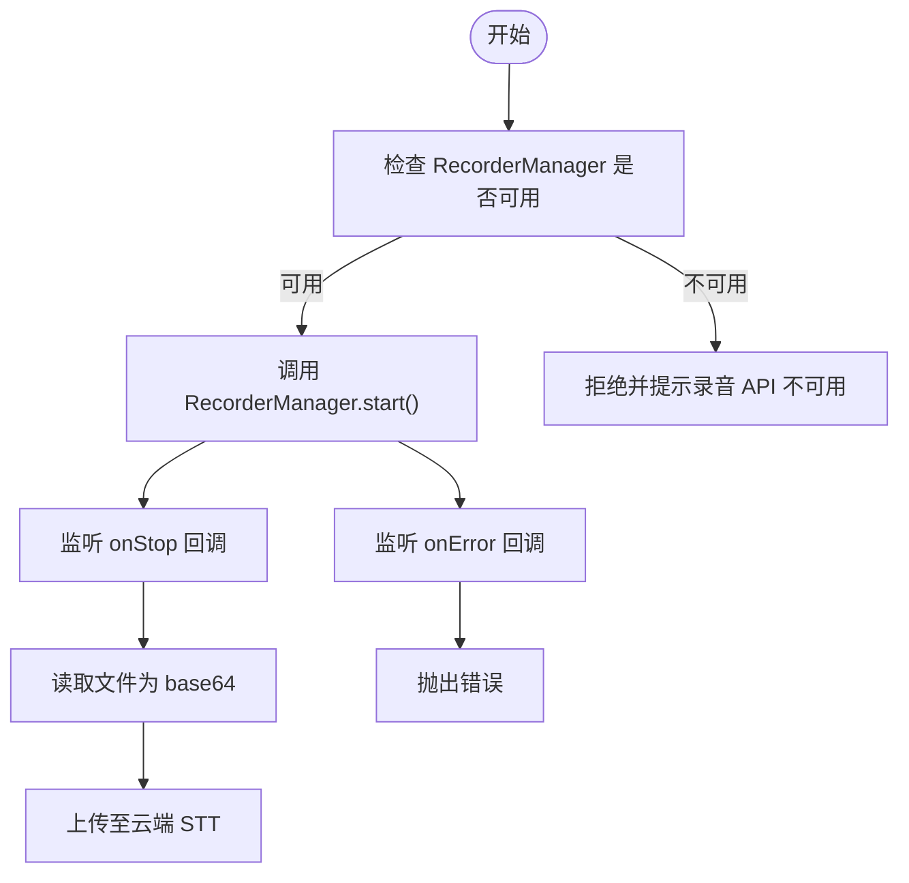
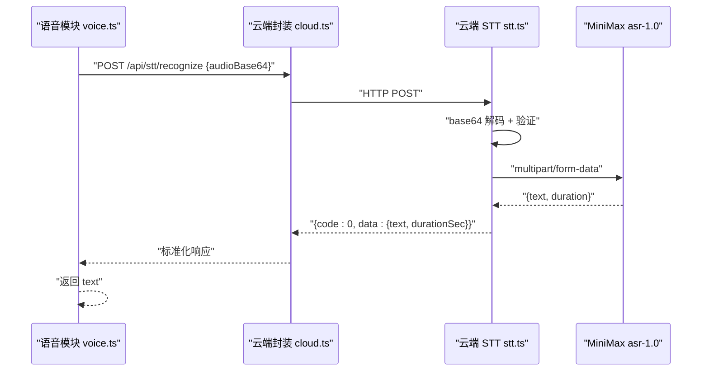
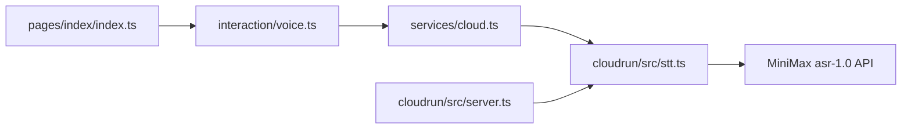

# 语音交互功能

<cite>
**本文引用的文件**   
- [voice.ts](file://miniprogram/src/interaction/voice.ts)
- [index.ts](file://miniprogram/pages/index/index.ts)
- [stt.ts](file://cloudrun/src/stt.ts)
- [server.ts](file://cloudrun/src/server.ts)
- [wx.d.ts](file://miniprogram/src/types/wx.d.ts)
</cite>

## 更新摘要
**变更内容**   
- 新增云端 STT 服务实现，基于 MiniMax ASR API
- 支持 base64 编码音频在 JSON 负载中的传输
- 完善语音识别的错误处理和重试机制
- 优化音频格式和传输性能

## 目录
1. [引言](#引言)
2. [项目结构](#项目结构)
3. [核心组件](#核心组件)
4. [架构总览](#架构总览)
5. [详细组件分析](#详细组件分析)
6. [依赖关系分析](#依赖关系分析)
7. [性能与优化](#性能与优化)
8. [故障排查指南](#故障排查指南)
9. [结论](#结论)

## 引言
本文件面向 WAIC-WeChat-MiniProgram 的语音交互能力，聚焦以下目标：
- 说明语音输入处理流程：录音权限获取、音频数据捕获、实时语音识别。
- 说明 STT（Speech-to-Text）服务集成方案：API 调用、结果解析与错误处理。
- 说明语音指令预处理与后处理：意图识别与命令格式化。
- 说明语音反馈实现：TTS（Text-to-Speech）播放控制与触发时机。
- 提供配置选项与性能优化策略：音频格式选择、网络请求优化与用户体验改进。

当前仓库已实现完整的云端 STT 服务，基于 MiniMax asr-1.0 模型，支持 base64 编码音频传输，提供稳定的语音识别能力。

## 项目结构
与语音交互直接相关的代码主要分布在以下位置：
- 交互层：`miniprogram/src/interaction/voice.ts`
- 页面入口：`miniprogram/pages/index/index.ts`
- 云端 STT 服务：`cloudrun/src/stt.ts`
- 云端服务器：`cloudrun/src/server.ts`
- 类型声明（含录音 API）：`miniprogram/src/types/wx.d.ts`

图示来源
- [index.ts:180-187](file://miniprogram/pages/index/index.ts#L180-L187)
- [voice.ts:17-64](file://miniprogram/src/interaction/voice.ts#L17-L64)
- [stt.ts:72-138](file://cloudrun/src/stt.ts#L72-L138)

章节来源
- [index.ts:180-187](file://miniprogram/pages/index/index.ts#L180-L187)
- [voice.ts:1-226](file://miniprogram/src/interaction/voice.ts#L1-L226)
- [stt.ts:1-139](file://cloudrun/src/stt.ts#L1-L139)
- [server.ts:44-59](file://cloudrun/src/server.ts#L44-L59)
- [wx.d.ts:176-179](file://miniprogram/src/types/wx.d.ts#L176-L179)

## 核心组件
- 语音模块 `voice.ts`
  - 负责录音启动与结束回调，返回临时录音文件路径。
  - 将录音文件转换为 base64 编码并上传至云端 STT 服务。
  - 封装云端 STT 调用，统一错误结构与重试语义。
- 云端 STT 服务 `stt.ts`
  - 提供 `/api/stt/recognize` 端点，代理 MiniMax asr-1.0 API。
  - 支持 base64 编码音频的接收、验证和处理。
  - 实现完善的错误处理和超时控制。
- 页面 `index.ts`
  - 提供麦克风按钮入口。
  - 管理对话状态、加载态与 Agent 事件订阅。
- 云端服务器 `server.ts`
  - 注册 STT 路由，处理 HTTP 请求。
  - 提供统一的请求体大小限制和错误处理。
- 类型声明 `wx.d.ts`
  - 定义录音相关 API 的类型，包括新版 RecorderManager。

章节来源
- [voice.ts:25-33](file://miniprogram/src/interaction/voice.ts#L25-L33)
- [stt.ts:46-49](file://cloudrun/src/stt.ts#L46-L49)
- [index.ts:189-194](file://miniprogram/pages/index/index.ts#L189-L194)
- [server.ts:37-38](file://cloudrun/src/server.ts#L37-L38)
- [wx.d.ts:176-179](file://miniprogram/src/types/wx.d.ts#L176-L179)

## 架构总览
语音交互的整体流程如下：
- 用户在页面点击麦克风按钮，进入语音入口。
- 调用录音模块启动录音，获取临时录音文件路径。
- 将录音文件读取为 base64 编码并通过 JSON 负载发送至云端 STT 接口。
- 云端 STT 服务解码 base64 音频并调用 MiniMax asr-1.0 API 进行识别。
- 识别结果返回给小程序端，进入编排器进行意图理解与任务规划。
- 根据任务执行结果更新 UI 状态与消息卡片。

图示来源
- [index.ts:726-751](file://miniprogram/pages/index/index.ts#L726-L751)
- [voice.ts:151-225](file://miniprogram/src/interaction/voice.ts#L151-L225)
- [stt.ts:72-138](file://cloudrun/src/stt.ts#L72-L138)

## 详细组件分析

### 语音输入处理流程
- 录音权限与设备能力检测
  - 优先使用新版 RecorderManager；若不可用则提示录音 API 不可用。
  - 通过 `isVoiceAvailable()` 函数检测录音能力可用性。
- 音频数据捕获
  - 设置最大录音时长（默认 60s）与音频格式（mp3，16kHz 单声道）。
  - 监听停止与错误回调，返回临时文件路径或抛出错误。
- Base64 音频转换
  - 使用 `readFileBase64()` 函数将临时录音文件读取为 base64 编码字符串。
  - 通过文件系统 API 完成二进制到 base64 的转换。

图示来源
- [voice.ts:76-86](file://miniprogram/src/interaction/voice.ts#L76-L86)
- [voice.ts:94-108](file://miniprogram/src/interaction/voice.ts#L94-L108)

章节来源
- [voice.ts:76-86](file://miniprogram/src/interaction/voice.ts#L76-L86)
- [voice.ts:94-108](file://miniprogram/src/interaction/voice.ts#L94-L108)

### STT 服务集成方案
- API 调用
  - 小程序端通过 `postContainer` 调用云端容器，路径为 `/api/stt/recognize`。
  - 传入 base64 编码的音频数据和环境 ID。
- 云端处理
  - STT 服务接收 base64 音频并进行解码和验证。
  - 将音频转换为 multipart/form-data 格式调用 MiniMax asr-1.0 API。
  - 支持语言提示（language: 'zh'）提升中文识别准确率。
- 结果解析
  - 标准响应包含 code、message、data。
  - 成功时从 data.text 提取识别文本，data.durationSec 提供音频时长信息。
- 错误处理
  - 当 code 不为 0 或 data 为空时抛出错误，携带 message 或 code 信息。
  - 区分可重试错误（503）和不可重试错误（业务失败码）。

图示来源
- [voice.ts:116-132](file://miniprogram/src/interaction/voice.ts#L116-L132)
- [stt.ts:72-138](file://cloudrun/src/stt.ts#L72-L138)

章节来源
- [voice.ts:116-132](file://miniprogram/src/interaction/voice.ts#L116-L132)
- [stt.ts:72-138](file://cloudrun/src/stt.ts#L72-L138)

### 云端 STT 服务实现
- 配置管理
  - 支持独立配置（STT_BASE_URL、STT_API_KEY）或回退到 LLM 配置。
  - 自动拼接 MiniMax speech_to_text 端点 URL。
- 音频处理
  - 验证 base64 音频的有效性、长度和内容。
  - 设置 700KB 音频大小上限，防止过大请求。
  - 使用 FormData 构造 multipart/form-data 请求。
- 超时控制
  - 上游 API 调用超时设置为 30 秒。
  - 区分超时错误和其他网络连接错误。
- 错误分类
  - 400/422 错误：音频格式非法或敏感内容，返回业务失败码。
  - 其他错误：认证失败、余额不足、限流等，返回 503 可重试错误。

章节来源
- [stt.ts:56-70](file://cloudrun/src/stt.ts#L56-L70)
- [stt.ts:78-88](file://cloudrun/src/stt.ts#L78-L88)
- [stt.ts:90-111](file://cloudrun/src/stt.ts#L90-L111)
- [stt.ts:113-122](file://cloudrun/src/stt.ts#L113-L122)

### 语音指令预处理与后处理
- 预处理
  - 页面接收 STT 返回的文本，作为自然语言意图传入编排器。
- 意图识别
  - 规则规划器基于关键词与正则匹配，判断是否为购票、咖啡下单等意图。
  - 抽取日期、城市、座位类型、饮品名等参数。
- 命令格式化
  - 将识别到的意图与参数转换为任务列表，供后续执行。

章节来源
- [index.ts:697-717](file://miniprogram/pages/index/index.ts#L697-L717)

### 语音反馈与 TTS 播放控制
- 当前实现
  - 页面未实现 TTS 播放；语音反馈主要通过文本消息与状态文案展示。
- 触发时机
  - 建议在 Agent 完成回复后，根据业务需要触发 TTS 播报。
  - 可在页面层增加 TTS 控制逻辑，结合状态变化与消息追加时机。

章节来源
- [index.ts:189-194](file://miniprogram/pages/index/index.ts#L189-L194)

## 依赖关系分析
- 页面 `index.ts` 依赖语音模块 `voice.ts` 处理录音和识别。
- 语音模块 `voice.ts` 依赖云端封装 `cloud.ts` 进行 STT 调用。
- 云端 STT 服务 `stt.ts` 依赖 MiniMax ASR API 进行语音识别。
- 云端服务器 `server.ts` 注册 STT 路由并提供统一的请求处理。

图示来源
- [index.ts:25-35](file://miniprogram/pages/index/index.ts#L25-L35)
- [voice.ts:22-23](file://miniprogram/src/interaction/voice.ts#L22-L23)
- [stt.ts:26-27](file://cloudrun/src/stt.ts#L26-L27)
- [server.ts:24-35](file://cloudrun/src/server.ts#L24-L35)

章节来源
- [index.ts:25-35](file://miniprogram/pages/index/index.ts#L25-L35)
- [voice.ts:22-23](file://miniprogram/src/interaction/voice.ts#L22-L23)
- [stt.ts:26-27](file://cloudrun/src/stt.ts#L26-L27)
- [server.ts:24-35](file://cloudrun/src/server.ts#L24-L35)

## 性能与优化
- 音频格式选择
  - 使用 mp3 格式，16kHz 采样率，单声道，兼顾兼容性与体积。
  - 60s 录音文件大小约 500KB，base64 后约 670KB，远低于 1MB 限制。
- 网络请求优化
  - 使用云端封装的统一超时与重试机制，提升稳定性。
  - 30 秒超时设置，适合短音频识别场景。
- 传输优化
  - Base64 编码在 JSON 负载中传输，避免 multipart 复杂性。
  - 服务端进行 base64 解码和音频验证，确保数据安全。
- 用户体验改进
  - 录音期间显示明确的状态提示（"正在听"）。
  - 识别过程中显示加载状态（transcribing）。
  - 对 STT 失败提供友好的错误提示和重试入口。

章节来源
- [voice.ts:199-207](file://miniprogram/src/interaction/voice.ts#L199-L207)
- [stt.ts:32-38](file://cloudrun/src/stt.ts#L32-L38)
- [stt.ts:29-30](file://cloudrun/src/stt.ts#L29-L30)

## 故障排查指南
- 录音 API 不可用
  - 现象：调用 startVoiceRecognition 直接报错，提示"录音能力未就绪"。
  - 排查：确认基础库版本与设备能力，检查 RecorderManager 可用性。
- STT 调用失败
  - 现象：云端返回 code 不为 0 或 data 为空。
  - 排查：检查云端容器路径、环境与网络连通性；查看错误 message。
- Base64 音频问题
  - 现象：STT 服务返回"audioBase64 不是合法的 base64 内容"。
  - 排查：确认音频文件读取成功，base64 编码正确。
- 音频过大
  - 现象：STT 服务返回"音頻過大"错误。
  - 排查：检查录音时长和格式，确保不超过 700KB 限制。
- 云端调用超时或网络异常
  - 现象：callContainer 抛出错误，触发重试。
  - 排查：检查网络状况与服务器状态；必要时调整超时与重试策略。
- MiniMax API 错误
  - 现象：返回 400（音频格式非法）、422（敏感内容）、401（认证失败）等。
  - 排查：检查音频格式、内容合规性和 API 密钥配置。

章节来源
- [voice.ts:152-158](file://miniprogram/src/interaction/voice.ts#L152-L158)
- [voice.ts:128-131](file://miniprogram/src/interaction/voice.ts#L128-L131)
- [stt.ts:79-88](file://cloudrun/src/stt.ts#L79-L88)
- [stt.ts:113-122](file://cloudrun/src/stt.ts#L113-L122)

## 结论
当前仓库已实现完整的语音交互系统，具备以下核心能力：
- **录音封装**：支持 RecorderManager 录音，提供会话式 API。
- **云端 STT 服务**：基于 MiniMax asr-1.0 模型，提供稳定的语音识别。
- **Base64 传输**：支持在 JSON 负载中传输 base64 编码音频。
- **错误处理**：完善的错误分类和重试机制。
- **性能优化**：合理的音频格式选择和传输优化。

系统采用前后端分离架构，小程序端负责录音和用户交互，云端服务负责语音识别和错误处理。通过 base64 编码和 JSON 传输，简化了数据传输复杂度，同时保证了良好的性能和用户体验。未来可在此基础上扩展更多语音功能和优化策略。