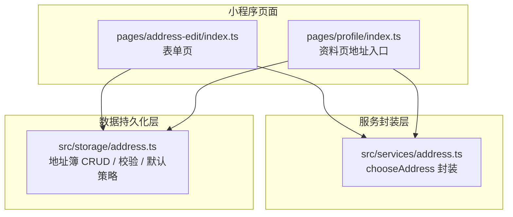
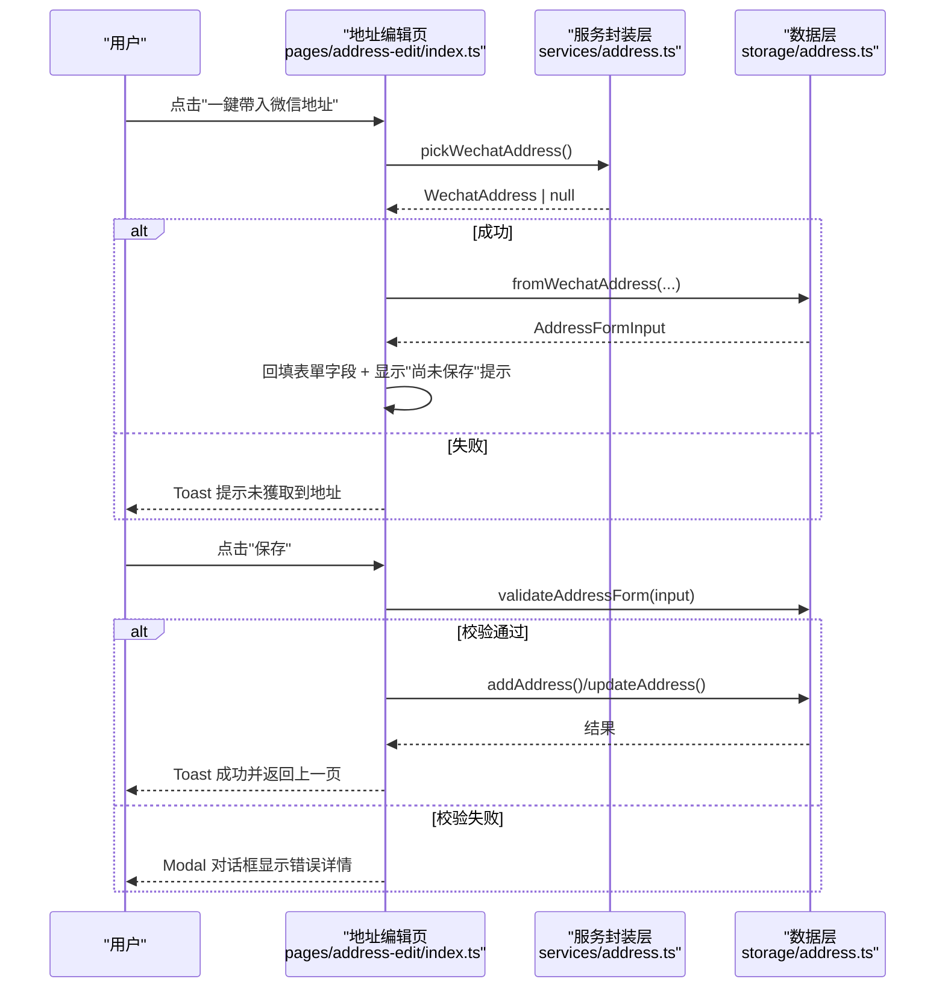
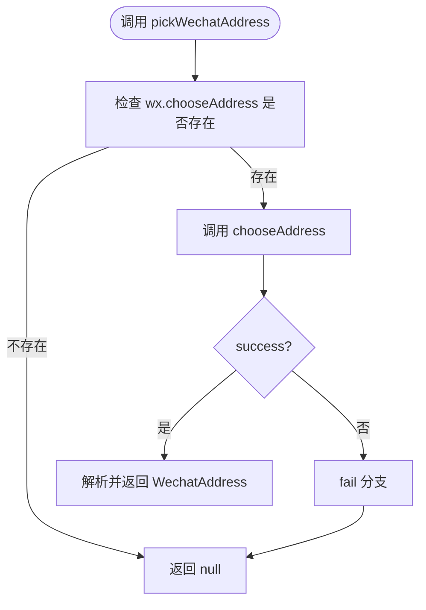
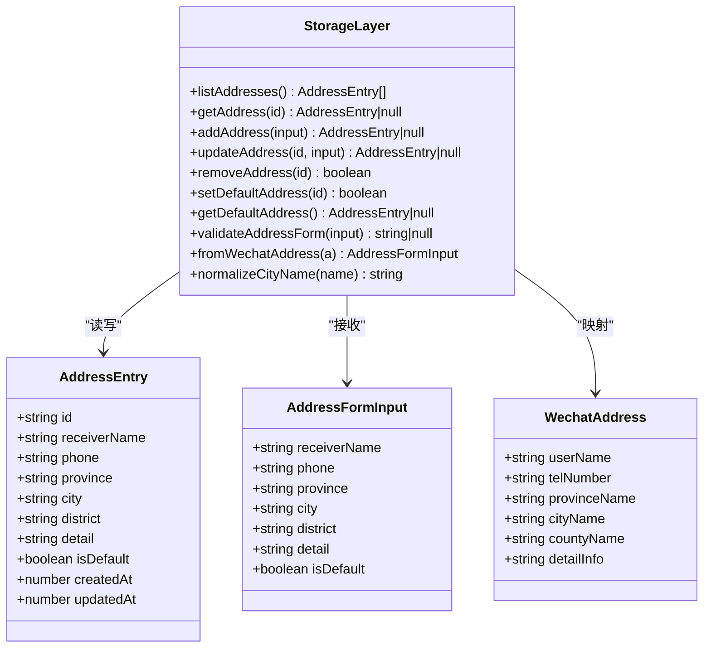
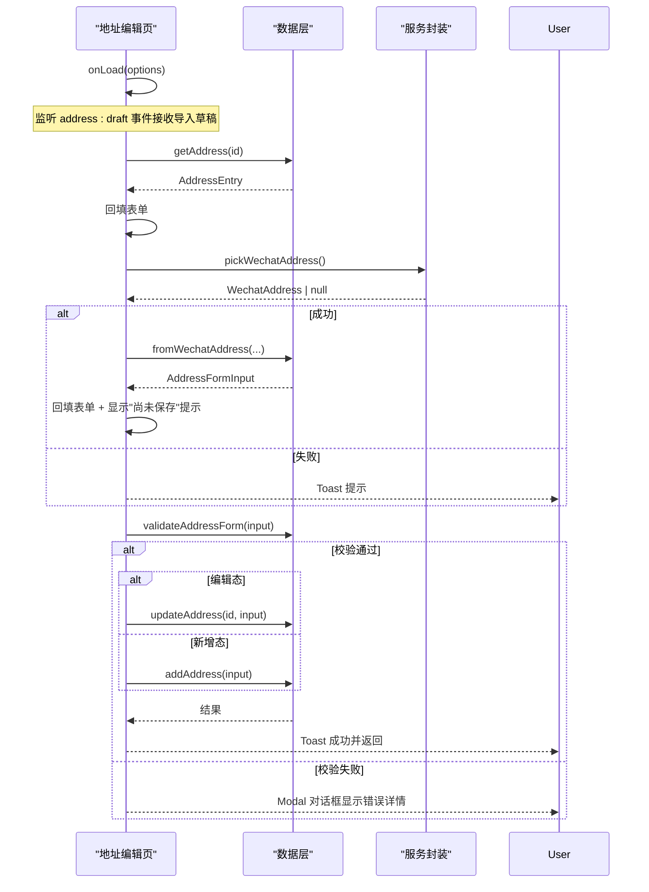
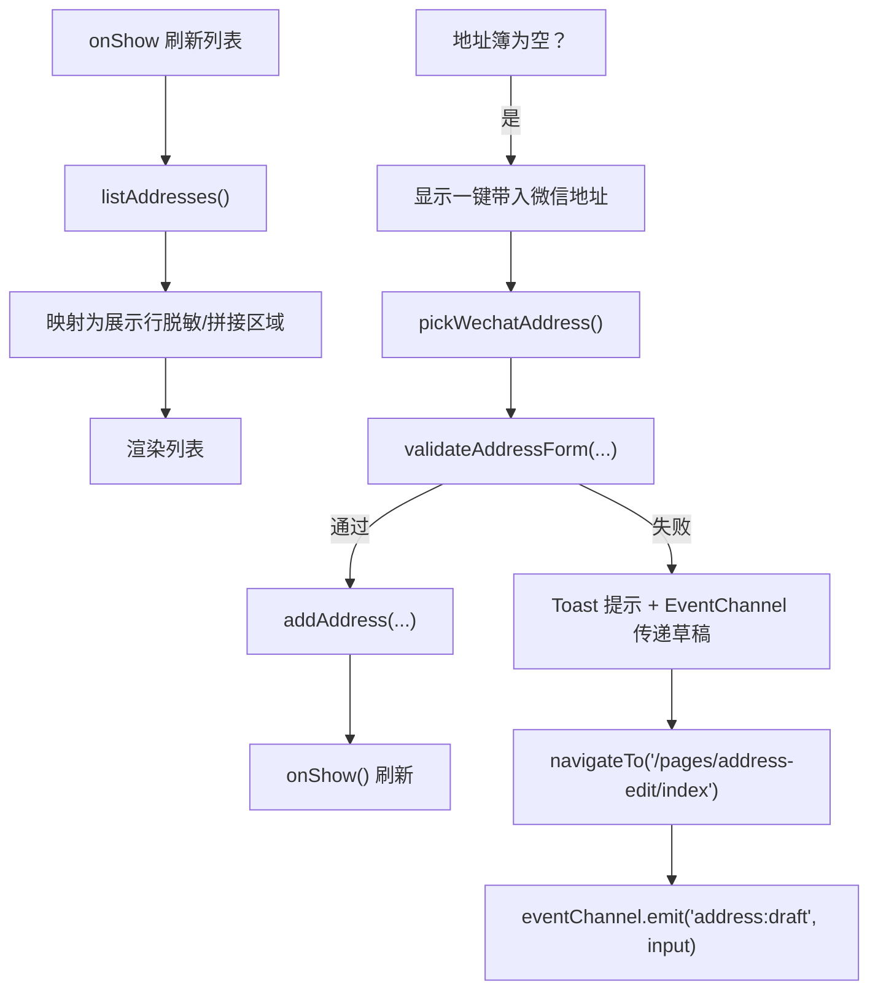
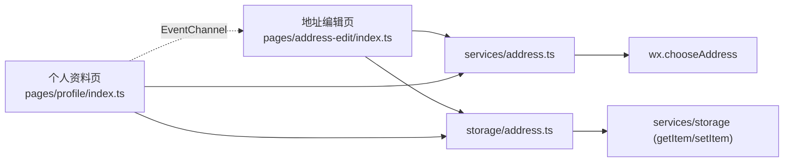

# 地址管理系统

<cite>
**本文引用的文件**   
- [miniprogram/src/services/address.ts](file://miniprogram/src/services/address.ts)
- [miniprogram/src/storage/address.ts](file://miniprogram/src/storage/address.ts)
- [miniprogram/pages/address-edit/index.ts](file://miniprogram/pages/address-edit/index.ts)
- [miniprogram/pages/address-edit/index.wxml](file://miniprogram/pages/address-edit/index.wxml)
- [miniprogram/pages/profile/index.ts](file://miniprogram/pages/profile/index.ts)
- [miniprogram/pages/profile/index.wxml](file://miniprogram/pages/profile/index.wxml)
- [miniprogram/app.json](file://miniprogram/app.json)
</cite>

## 更新摘要
**所做更改**   
- 更新了地址导入流程，新增 EventChannel 通信机制用于草稿传递
- 改进了验证错误处理，从 Toast 通知升级为模态对话框
- 新增了导入未保存状态的常驻提示条
- 优化了空地址簿导入的用户体验流程

## 目录
1. [简介](#简介)
2. [项目结构](#项目结构)
3. [核心组件](#核心组件)
4. [架构总览](#架构总览)
5. [详细组件分析](#详细组件分析)
6. [依赖关系分析](#依赖关系分析)
7. [性能与容量特性](#性能与容量特性)
8. [隐私与安全](#隐私与安全)
9. [故障排查指南](#故障排查指南)
10. [结论](#结论)

## 简介
本文件面向"地址管理系统"，聚焦微信小程序端收货地址的采集、编辑、持久化与展示，并说明其如何为出行规划提供"出发城市"推断来源。系统包含：
- 微信原生地址选择器封装层
- 本地地址簿数据层（CRUD、校验、默认地址策略）
- 新增/编辑表单页
- 个人资料页的地址列表入口与空簿一键导入

该功能遵循分层设计：页面仅负责交互与状态，业务规则与持久化下沉到 storage 层，平台 API 通过 services 层统一封装。

**更新** 新增了 EventChannel 通信机制和模态对话框错误处理，提升了用户体验和数据完整性保障。

## 项目结构
地址相关代码主要分布在以下路径：
- 服务封装层：`miniprogram/src/services/address.ts`
- 数据持久化层：`miniprogram/src/storage/address.ts`
- 表单页面：`miniprogram/pages/address-edit/index.{ts,wxml}`
- 列表入口：`miniprogram/pages/profile/index.{ts,wxml}`
- 应用配置：`miniprogram/app.json`

图示来源
- [miniprogram/pages/address-edit/index.ts:19-29](file://miniprogram/pages/address-edit/index.ts#L19-L29)
- [miniprogram/pages/profile/index.ts:15-22](file://miniprogram/pages/profile/index.ts#L15-L22)
- [miniprogram/src/services/address.ts:12-35](file://miniprogram/src/services/address.ts#L12-L35)
- [miniprogram/src/storage/address.ts:20-26](file://miniprogram/src/storage/address.ts#L20-L26)

章节来源
- [miniprogram/pages/address-edit/index.ts:1-17](file://miniprogram/pages/address-edit/index.ts#L1-L17)
- [miniprogram/pages/profile/index.ts:1-13](file://miniprogram/pages/profile/index.ts#L1-L13)
- [miniprogram/src/services/address.ts:1-10](file://miniprogram/src/services/address.ts#L1-L10)
- [miniprogram/src/storage/address.ts:1-18](file://miniprogram/src/storage/address.ts#L1-L18)

## 核心组件
- 微信地址选择器封装：对外暴露 `pickWechatAddress()`，统一处理用户取消、授权拒绝、无可用地址等场景，返回标准化对象或 null。
- 地址数据层：提供地址条目模型、表单输入模型、微信地址映射、表单校验、城市名归一化、地址簿 CRUD、默认地址策略、默认地址获取。
- 地址编辑页：支持新增与编辑两种形态；支持从微信地址回填表单项；保存时调用数据层校验与持久化；编辑态支持删除。**新增**：支持接收 EventChannel 导入草稿，显示"尚未保存"提示条。
- 个人资料页：展示乘人与地址双列表；空地址簿提供"一键带入微信地址"直存入口；非空列表行可跳转编辑。**新增**：通过 EventChannel 传递导入草稿到编辑页面。

章节来源
- [miniprogram/src/services/address.ts:14-35](file://miniprogram/src/services/address.ts#L14-L35)
- [miniprogram/src/storage/address.ts:28-82](file://miniprogram/src/storage/address.ts#L28-L82)
- [miniprogram/src/storage/address.ts:89-109](file://miniprogram/src/storage/address.ts#L89-L109)
- [miniprogram/src/storage/address.ts:111-219](file://miniprogram/src/storage/address.ts#L111-L219)
- [miniprogram/pages/address-edit/index.ts:31-63](file://miniprogram/pages/address-edit/index.ts#L31-L63)
- [miniprogram/pages/address-edit/index.ts:75-198](file://miniprogram/pages/address-edit/index.ts#L75-L198)
- [miniprogram/pages/profile/index.ts:24-59](file://miniprogram/pages/profile/index.ts#L24-L59)
- [miniprogram/pages/profile/index.ts:72-141](file://miniprogram/pages/profile/index.ts#L72-L141)

## 架构总览
地址管理采用"页面 → 服务封装 → 数据持久化"的分层结构，职责清晰、耦合低：
- 页面层：只负责 UI 状态与用户交互，不直接操作存储。
- 服务封装层：屏蔽 wx.chooseAddress 的差异与失败语义，向上返回稳定类型。
- 数据层：集中实现校验、默认地址策略、容量限制、持久化键与读写。

**更新** 新增了 EventChannel 通信机制，支持跨页面数据传递和更好的错误处理体验。

图示来源
- [miniprogram/pages/address-edit/index.ts:122-180](file://miniprogram/pages/address-edit/index.ts#L122-L180)
- [miniprogram/src/services/address.ts:14-35](file://miniprogram/src/services/address.ts#L14-L35)
- [miniprogram/src/storage/address.ts:71-98](file://miniprogram/src/storage/address.ts#L71-L98)
- [miniprogram/src/storage/address.ts:121-150](file://miniprogram/src/storage/address.ts#L121-L150)

## 详细组件分析

### 微信地址选择器封装（services/address.ts）
- 目标：对 `wx.chooseAddress` 做唯一封装，保证上层无需关心平台差异与失败分支。
- 行为：
  - 若环境不存在 API，直接返回 null。
  - success 分支返回原始地址对象。
  - fail 分支统一返回 null，由上层决定提示文案。
- 前置条件：需在 app.json 中声明 `requiredPrivateInfos` 包含 `chooseAddress`。

图示来源
- [miniprogram/src/services/address.ts:14-35](file://miniprogram/src/services/address.ts#L14-L35)

章节来源
- [miniprogram/src/services/address.ts:1-35](file://miniprogram/src/services/address.ts#L1-L35)
- [miniprogram/app.json:18-24](file://miniprogram/app.json#L18-L24)

### 地址数据层（storage/address.ts）
- 数据模型：
  - `AddressEntry`：持久化实体，含 id、姓名、手机号、省市区、详细地址、是否默认、时间戳。
  - `AddressFormInput`：表单输入模型，不含 id，id 由数据层生成。
  - `WechatAddress`：微信原生地址响应结构。
- 关键能力：
  - `fromWechatAddress`：将微信地址映射为表单输入。
  - `validateAddressForm`：纯函数校验，返回首个错误文案或 null。
  - `normalizeCityName`：去除市/自治州/地区后缀，对齐交通查询口径。
  - CRUD：`listAddresses`、`getAddress`、`addAddress`、`updateAddress`、`removeAddress`、`setDefaultAddress`、`getDefaultAddress`。
- 业务规则：
  - 首条自动设为默认，确保"出发城市"推断有源。
  - 默认地址唯一；设置默认时清除其他默认。
  - 删除默认地址且仍有剩余条目时，首条自动递补为默认。
  - 容量上限 `ADDRESS_LIMIT = 20`，超出时新增返回 null。

图示来源
- [miniprogram/src/storage/address.ts:28-82](file://miniprogram/src/storage/address.ts#L28-L82)
- [miniprogram/src/storage/address.ts:111-219](file://miniprogram/src/storage/address.ts#L111-L219)

章节来源
- [miniprogram/src/storage/address.ts:1-26](file://miniprogram/src/storage/address.ts#L1-L26)
- [miniprogram/src/storage/address.ts:28-82](file://miniprogram/src/storage/address.ts#L28-L82)
- [miniprogram/src/storage/address.ts:89-109](file://miniprogram/src/storage/address.ts#L89-L109)
- [miniprogram/src/storage/address.ts:111-219](file://miniprogram/src/storage/address.ts#L111-L219)

### 地址编辑页（pages/address-edit/index.ts）
- 两种进入形态：
  - 新增：无参数进入，标题为"新增地址"。
  - 编辑：携带 `id` 参数进入，标题切换为"编辑收货地址"，并提供删除入口。
- **新增**：EventChannel 草稿接收：监听 `address:draft` 事件，接收来自个人资料页面的导入草稿数据。
- 交互流程：
  - 加载：编辑态根据 id 读取地址并回填表单；无效 id 提示后返回。
  - 导入：调用 `pickWechatAddress`，成功后用 `fromWechatAddress` 映射并回填表单（不落盘），**新增**：显示"尚未保存"常驻提示条。
  - 保存：组装 `AddressFormInput`，调用 `validateAddressForm`；新增走 `addAddress`，编辑走 `updateAddress`；**更新**：验证失败时使用模态对话框而非 Toast 提示。
  - 删除：编辑态显示删除按钮，二次确认后调用 `removeAddress`。

**更新** 新增了 EventChannel 通信支持和改进的错误处理机制。

图示来源
- [miniprogram/pages/address-edit/index.ts:75-198](file://miniprogram/pages/address-edit/index.ts#L75-L198)
- [miniprogram/src/storage/address.ts:71-98](file://miniprogram/src/storage/address.ts#L71-L98)
- [miniprogram/src/storage/address.ts:121-180](file://miniprogram/src/storage/address.ts#L121-L180)
- [miniprogram/src/services/address.ts:14-35](file://miniprogram/src/services/address.ts#L14-L35)

章节来源
- [miniprogram/pages/address-edit/index.ts:1-17](file://miniprogram/pages/address-edit/index.ts#L1-L17)
- [miniprogram/pages/address-edit/index.ts:31-63](file://miniprogram/pages/address-edit/index.ts#L31-L63)
- [miniprogram/pages/address-edit/index.ts:75-198](file://miniprogram/pages/address-edit/index.ts#L75-L198)

### 个人资料页地址入口（pages/profile/index.ts）
- 列表展示：从数据层读取地址簿，脱敏手机号，拼接省市区行，标记默认地址。
- 导航：新增地址跳转到编辑页新增态；编辑地址跳转到编辑页编辑态。
- **更新**：空簿导入增强：当地址簿为空时，提供"一键带入微信地址"入口，导入即存，并自动设默认。**新增**：当微信地址信息不完整时，通过 EventChannel 传递草稿数据到编辑页面进行补全，避免数据丢失。

**更新** 改进了空地址簿导入流程，增加了 EventChannel 通信支持。

图示来源
- [miniprogram/pages/profile/index.ts:72-141](file://miniprogram/pages/profile/index.ts#L72-L141)
- [miniprogram/src/storage/address.ts:111-150](file://miniprogram/src/storage/address.ts#L111-L150)
- [miniprogram/src/services/address.ts:14-35](file://miniprogram/src/services/address.ts#L14-L35)

章节来源
- [miniprogram/pages/profile/index.ts:1-13](file://miniprogram/pages/profile/index.ts#L1-L13)
- [miniprogram/pages/profile/index.ts:24-59](file://miniprogram/pages/profile/index.ts#L24-L59)
- [miniprogram/pages/profile/index.ts:72-141](file://miniprogram/pages/profile/index.ts#L72-L141)

### 视图层（WXML）
- 地址编辑页：
  - 顶部"一键带入微信地址"按钮。
  - **新增**："尚未保存"常驻提示条，防止用户误以为已保存直接返回导致数据丢失。
  - 表单卡片：收货人、手机号、省市区三段 picker、详细地址 textarea、默认地址开关。
  - 底部主操作"保存"；编辑态额外显示"删除此地址"。
- 个人资料页：
  - 地址区块：空簿提示与导入按钮；列表行展示收货人、脱敏手机、区域行、详细地址、默认标签。

**更新** 新增了"尚未保存"提示条以提升用户体验。

章节来源
- [miniprogram/pages/address-edit/index.wxml:1-84](file://miniprogram/pages/address-edit/index.wxml#L1-L84)
- [miniprogram/pages/profile/index.wxml:33-76](file://miniprogram/pages/profile/index.wxml#L33-L76)

## 依赖关系分析
- 页面依赖：
  - 地址编辑页依赖数据层的 CRUD、校验、映射以及服务封装的选择器。**新增**：依赖 EventChannel 进行跨页面数据通信。
  - 个人资料页依赖数据层的列表读取、新增、校验、映射以及服务封装的选择器。**新增**：通过 EventChannel 向编辑页面传递导入草稿。
- 服务封装依赖：
  - 仅依赖全局 wx API，不做业务加工。
- 数据层依赖：
  - 依赖通用存储接口（getItem/setItem），使用固定键名 `address:book`。
- 权限配置：
  - app.json 声明 `requiredPrivateInfos` 包含 `chooseAddress`，以拉起原生地址选择器。

**更新** 新增了 EventChannel 通信依赖关系。

图示来源
- [miniprogram/pages/address-edit/index.ts:19-29](file://miniprogram/pages/address-edit/index.ts#L19-L29)
- [miniprogram/pages/profile/index.ts:15-22](file://miniprogram/pages/profile/index.ts#L15-L22)
- [miniprogram/src/services/address.ts:12-35](file://miniprogram/src/services/address.ts#L12-L35)
- [miniprogram/src/storage/address.ts:20-26](file://miniprogram/src/storage/address.ts#L20-L26)
- [miniprogram/app.json:18-24](file://miniprogram/app.json#L18-L24)

章节来源
- [miniprogram/pages/address-edit/index.ts:19-29](file://miniprogram/pages/address-edit/index.ts#L19-L29)
- [miniprogram/pages/profile/index.ts:15-22](file://miniprogram/pages/profile/index.ts#L15-L22)
- [miniprogram/src/services/address.ts:12-35](file://miniprogram/src/services/address.ts#L12-L35)
- [miniprogram/src/storage/address.ts:20-26](file://miniprogram/src/storage/address.ts#L20-L26)
- [miniprogram/app.json:18-24](file://miniprogram/app.json#L18-L24)

## 性能与容量特性
- 容量上限：地址簿最多 20 条，超出时新增返回 null，页面侧给出明确提示。
- 默认地址策略：
  - 新增首条自动默认，保障"出发城市"推断始终有源。
  - 设置默认时清除其他默认，维持唯一性。
  - 删除默认地址且仍有剩余条目时，首条自动递补默认。
- 列表展示优化：个人资料页 onShow 刷新，避免重复网络请求，仅本地读取。

章节来源
- [miniprogram/src/storage/address.ts:25-26](file://miniprogram/src/storage/address.ts#L25-L26)
- [miniprogram/src/storage/address.ts:121-150](file://miniprogram/src/storage/address.ts#L121-L150)
- [miniprogram/src/storage/address.ts:182-209](file://miniprogram/src/storage/address.ts#L182-L209)
- [miniprogram/pages/profile/index.ts:72-90](file://miniprogram/pages/profile/index.ts#L72-L90)

## 隐私与安全
- 数据存储：地址信息仅存本机，不上云。
- 敏感字段：手机号与详细地址明文存储（无强加密需求），列表展示仅脱敏摘要。
- 权限声明：app.json 声明 `requiredPrivateInfos` 包含 `chooseAddress`，用于拉起原生地址选择器。

章节来源
- [miniprogram/src/storage/address.ts:16-18](file://miniprogram/src/storage/address.ts#L16-L18)
- [miniprogram/pages/profile/index.ts:61-64](file://miniprogram/pages/profile/index.ts#L61-L64)
- [miniprogram/app.json:18-24](file://miniprogram/app.json#L18-L24)

## 故障排查指南
- 无法拉起微信地址选择器：
  - 检查 app.json 是否声明 `requiredPrivateInfos` 包含 `chooseAddress`。
  - 用户授权拒绝或取消时，服务封装层统一返回 null，页面会提示"未获取到微信地址"。
- 导入后仍提示校验失败：
  - 微信地址可能缺失必填字段（如详细地址），个人资料页空簿导入会通过 EventChannel 引导跳转表单补全，避免数据丢失。
- 新增失败：
  - 达到容量上限（20 条）时新增返回 null，页面提示已达上限。
- 编辑保存失败：
  - 若编辑的目标地址已被删除，更新返回 null，页面使用模态对话框提示"地址已被删除，请返回重试"。
- 默认地址异常：
  - 确认默认地址唯一性逻辑：设置默认会清除其他默认；删除默认且仍有剩余条目时首条自动递补默认。
- **新增**：EventChannel 通信问题：
  - 确认基础库版本支持 EventChannel（2.7.3+）。
  - 检查 `getOpenerEventChannel` 方法是否正确调用。

**更新** 新增了 EventChannel 相关的故障排查指导。

章节来源
- [miniprogram/app.json:18-24](file://miniprogram/app.json#L18-L24)
- [miniprogram/pages/address-edit/index.ts:122-180](file://miniprogram/pages/address-edit/index.ts#L122-L180)
- [miniprogram/pages/profile/index.ts:116-141](file://miniprogram/pages/profile/index.ts#L116-L141)
- [miniprogram/src/storage/address.ts:121-180](file://miniprogram/src/storage/address.ts#L121-L180)

## 结论
地址管理系统通过清晰的分层设计与明确的业务规则，实现了：
- 稳定的微信地址导入体验
- 可靠的本地地址簿管理与默认地址策略
- 与出行规划"出发城市"推断的无缝衔接
- 良好的隐私保护与用户体验反馈

**更新** 本次改进进一步提升了用户体验：
- 通过 EventChannel 通信机制，实现了更流畅的导入草稿传递
- 使用模态对话框替代 Toast 通知，提供更清晰的错误反馈
- 新增"尚未保存"提示条，有效防止用户误操作导致的数据丢失

建议在后续迭代中：
- 持续保持页面与数据层解耦，避免在页面中直接操作存储。
- 对校验文案进行国际化扩展，提升多语言支持。
- 考虑对敏感字段增加可选的本地加密策略，以满足更高安全要求。
- 继续优化 EventChannel 通信的健壮性和错误处理机制。