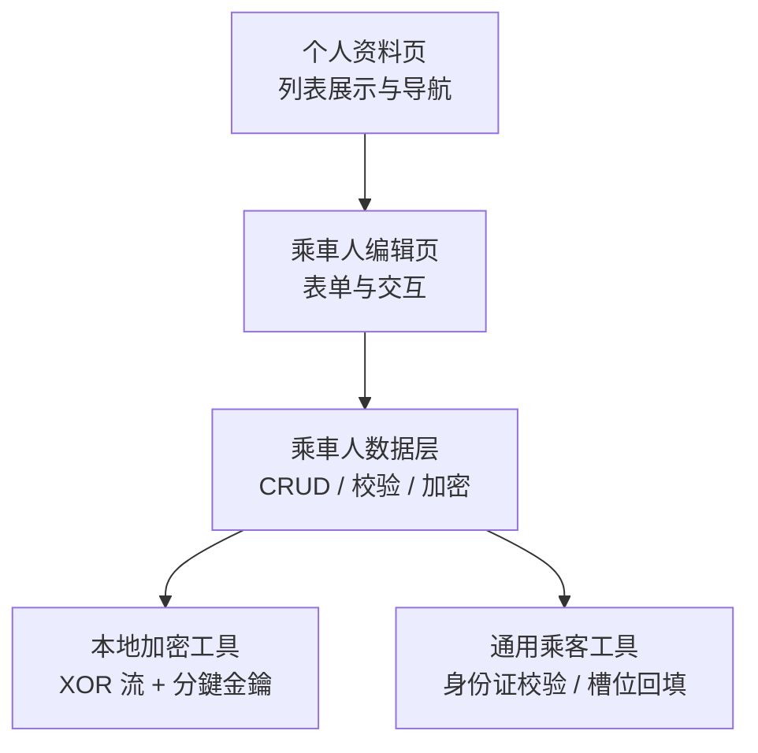
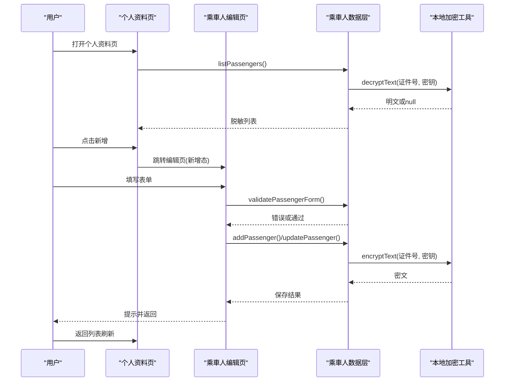
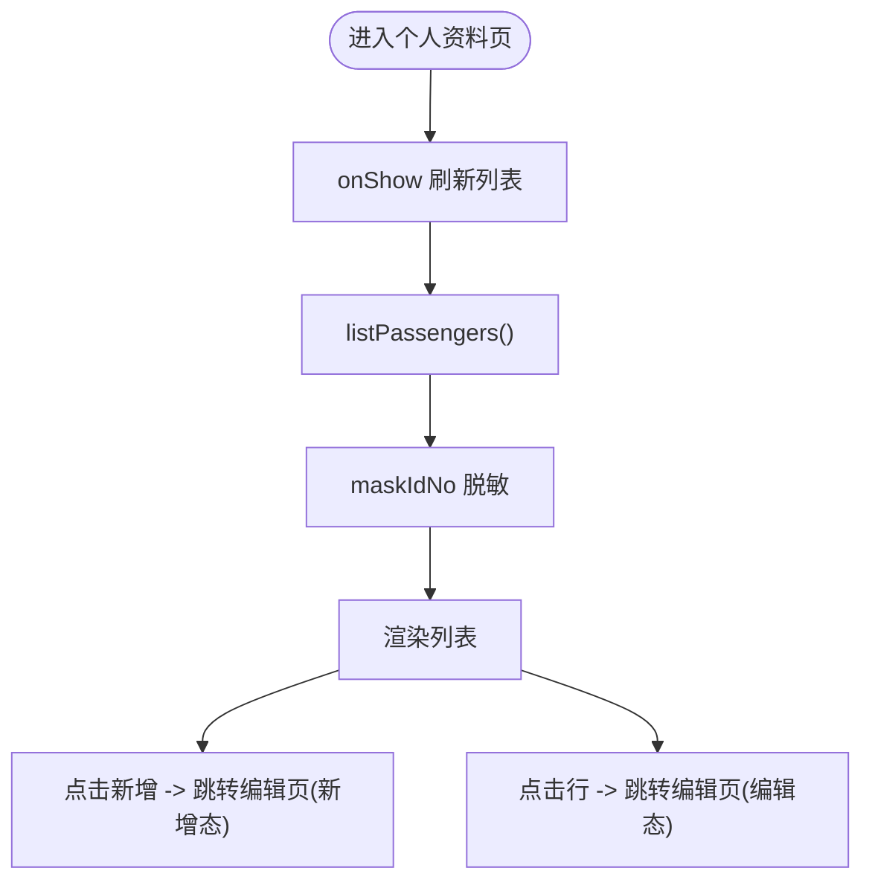
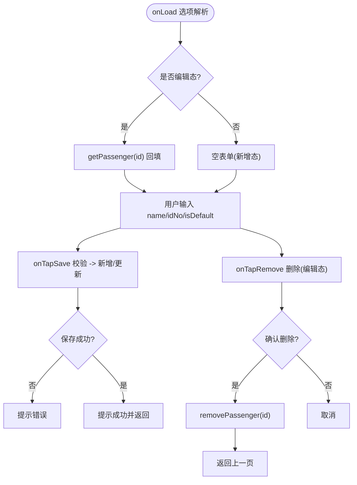
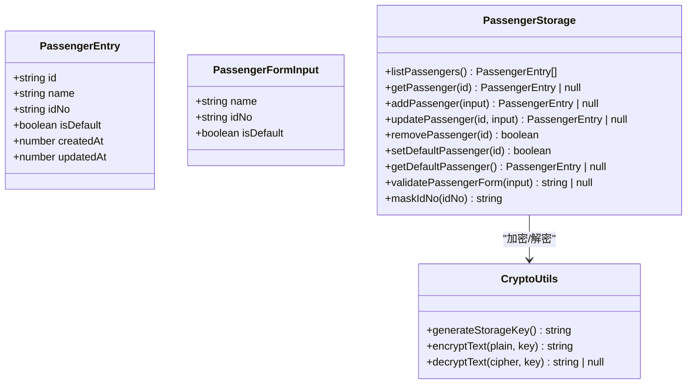
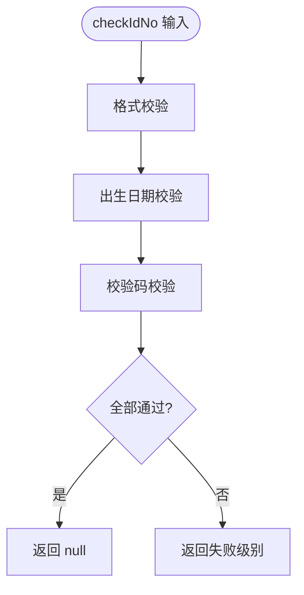
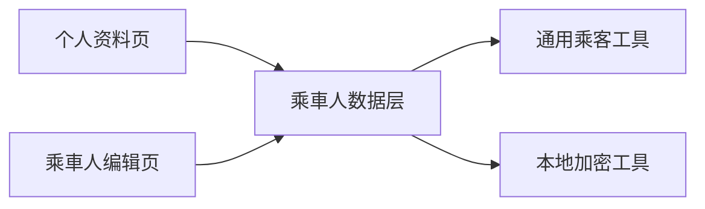

# 用户资料管理

<cite>
**本文引用的文件**   
- [miniprogram/pages/profile/index.ts](file://miniprogram/pages/profile/index.ts)
- [miniprogram/pages/passenger-edit/index.ts](file://miniprogram/pages/passenger-edit/index.ts)
- [miniprogram/src/storage/passenger.ts](file://miniprogram/src/storage/passenger.ts)
- [miniprogram/src/utils/passenger.ts](file://miniprogram/src/utils/passenger.ts)
- [miniprogram/src/utils/crypto.ts](file://miniprogram/src/utils/crypto.ts)
- [miniprogram/src/services/identity.ts](file://miniprogram/src/services/identity.ts)
</cite>

## 目录
1. [引言](#引言)
2. [项目结构](#项目结构)
3. [核心组件](#核心组件)
4. [架构总览](#架构总览)
5. [详细组件分析](#详细组件分析)
6. [依赖关系分析](#依赖关系分析)
7. [性能与容量特性](#性能与容量特性)
8. [故障排查指南](#故障排查指南)
9. [结论](#结论)

## 引言
本文件聚焦小程序端的“用户资料管理”能力，围绕实名乘車人簿的展示、新增、编辑、删除、默认值维护以及敏感信息加密存储展开。该功能为火车票、机票、演出票等下单任务提供自动带入的实名信息来源，同时保证证件号在本地落盘时进行加密，并在列表展示时脱敏。

## 项目结构
用户资料管理涉及两个页面与一个数据层模块：
- 个人资料页：仅负责列表展示与导航，不直接处理业务规则。
- 乘車人编辑页：承载表单输入、校验提示与保存/删除交互。
- 乘車人数据层：实现本地持久化、加密、校验、默认值策略与查询接口。

**图表来源**
- [miniprogram/pages/profile/index.ts:11-64](file://miniprogram/pages/profile/index.ts#L11-L64)
- [miniprogram/pages/passenger-edit/index.ts:15-146](file://miniprogram/pages/passenger-edit/index.ts#L15-L146)
- [miniprogram/src/storage/passenger.ts:1-225](file://miniprogram/src/storage/passenger.ts#L1-L225)
- [miniprogram/src/utils/crypto.ts:1-91](file://miniprogram/src/utils/crypto.ts#L1-L91)
- [miniprogram/src/utils/passenger.ts:1-256](file://miniprogram/src/utils/passenger.ts#L1-L256)

**章节来源**
- [miniprogram/pages/profile/index.ts:1-64](file://miniprogram/pages/profile/index.ts#L1-L64)
- [miniprogram/pages/passenger-edit/index.ts:1-146](file://miniprogram/pages/passenger-edit/index.ts#L1-L146)
- [miniprogram/src/storage/passenger.ts:1-225](file://miniprogram/src/storage/passenger.ts#L1-L225)

## 核心组件
- 个人资料页：加载并展示脱敏后的乘車人列表；支持新增与跳转到编辑页。
- 乘車人编辑页：新增/编辑态切换；统一调用数据层进行校验与持久化；提供删除入口。
- 乘車人数据层：
  - 本地持久化：以分區键存储整本簿，敏感字段（证件号）加密落盘。
  - 表单校验：姓名长度与字符限制、身份证格式/出生日期/校验码三级校验。
  - 默认值策略：首条自动默认；设置默认时清除其他默认；删除默认项后由首条递補。
  - 脱敏展示：列表展示使用 maskIdNo 保留前六位与后四位。
- 通用乘客工具：提供身份证深度校验、从对话历史提取乘客信息、下單任务缺省回填与缺失检查。
- 本地加密工具：安装级随机密钥、v1 密文格式、位置独立密钥流、明文迁移逻辑。

**章节来源**
- [miniprogram/pages/profile/index.ts:11-64](file://miniprogram/pages/profile/index.ts#L11-L64)
- [miniprogram/pages/passenger-edit/index.ts:15-146](file://miniprogram/pages/passenger-edit/index.ts#L15-L146)
- [miniprogram/src/storage/passenger.ts:1-225](file://miniprogram/src/storage/passenger.ts#L1-L225)
- [miniprogram/src/utils/passenger.ts:1-256](file://miniprogram/src/utils/passenger.ts#L1-L256)
- [miniprogram/src/utils/crypto.ts:1-91](file://miniprogram/src/utils/crypto.ts#L1-L91)

## 架构总览
用户资料管理的整体流程如下：
- 进入个人资料页：onShow 刷新列表，读取本地簿并脱敏展示。
- 点击新增：跳转至编辑页新增态。
- 点击列表行：跳转至编辑页编辑态并回填数据。
- 保存：编辑页调用数据层校验与持久化，返回成功或错误提示。
- 删除：编辑页确认后调用数据层删除，默认值自动递補。
- 敏感信息保护：证件号在落盘时加密，读取时解密并进行合法性校验；历史明文自动迁移。

**图表来源**
- [miniprogram/pages/profile/index.ts:41-64](file://miniprogram/pages/profile/index.ts#L41-L64)
- [miniprogram/pages/passenger-edit/index.ts:60-146](file://miniprogram/pages/passenger-edit/index.ts#L60-L146)
- [miniprogram/src/storage/passenger.ts:104-219](file://miniprogram/src/storage/passenger.ts#L104-L219)
- [miniprogram/src/utils/crypto.ts:62-90](file://miniprogram/src/utils/crypto.ts#L62-L90)

## 详细组件分析

### 个人资料页（列表与导航）
- 职责：
  - onShow 刷新：读取本地簿，映射为脱敏展示对象。
  - 新增：无参跳转编辑页新增态。
  - 编辑：携带 id 跳转编辑页编辑态。
- 关键行为：
  - 列表数据来自 listPassengers，展示时使用 maskIdNo 脱敏。
  - 不直接处理增删改逻辑，保持页面薄、数据厚。

**图表来源**
- [miniprogram/pages/profile/index.ts:41-64](file://miniprogram/pages/profile/index.ts#L41-L64)

**章节来源**
- [miniprogram/pages/profile/index.ts:11-64](file://miniprogram/pages/profile/index.ts#L11-L64)

### 乘車人编辑页（表单与交互）
- 职责：
  - 新增态：清空表单，保存调用 addPassenger。
  - 编辑态：根据 id 回填表单，保存调用 updatePassenger，并提供删除入口。
- 关键行为：
  - 表单输入受控，校验文案统一来自 validatePassengerForm。
  - 上限提示：达到 PASSENGER_LIMIT 时提示无法新增。
  - 删除确认：modal 确认后调用 removePassenger，成功后返回上一页。

**图表来源**
- [miniprogram/pages/passenger-edit/index.ts:60-146](file://miniprogram/pages/passenger-edit/index.ts#L60-L146)
- [miniprogram/src/storage/passenger.ts:139-209](file://miniprogram/src/storage/passenger.ts#L139-L209)

**章节来源**
- [miniprogram/pages/passenger-edit/index.ts:15-146](file://miniprogram/pages/passenger-edit/index.ts#L15-L146)

### 乘車人数据层（CRUD、校验、默认值、加密）
- 数据结构：
  - PassengerEntry：包含 id、name、idNo、isDefault、createdAt、updatedAt。
  - PassengerFormInput：表单输入（name、idNo、isDefault）。
- 持久化：
  - BOOK_KEY 存储整本簿，SEC_KEY 存储安装级密钥，二者分离。
  - toDisk/fromDisk 负责加密/解密与历史明文迁移。
- 校验：
  - validatePassengerForm 调用 checkIdNo 进行三級校验（格式/出生日期/校验码）。
- 默认值策略：
  - 首条自动默认；设置默认时清除其他默认；删除默认项后由首条递補。
- 查询：
  - listPassengers/getPassenger/getDefaultPassenger/setDefaultPassenger。

**图表来源**
- [miniprogram/src/storage/passenger.ts:72-225](file://miniprogram/src/storage/passenger.ts#L72-L225)
- [miniprogram/src/utils/crypto.ts:56-90](file://miniprogram/src/utils/crypto.ts#L56-L90)

**章节来源**
- [miniprogram/src/storage/passenger.ts:1-225](file://miniprogram/src/storage/passenger.ts#L1-L225)
- [miniprogram/src/utils/crypto.ts:1-91](file://miniprogram/src/utils/crypto.ts#L1-L91)

### 通用乘客工具（身份证校验与槽位回填）
- 身份证校验：
  - checkIdNo 实现三級校验：格式、出生日期、GB 11643-1999 校验码。
- 槽位回填：
  - extractPassenger 从对话历史提取最近一次提供的姓名与证件号。
  - applyPassengerSlot 在下单任务缺省时回填（优先对话明说，其次默认乘客）。
  - findFirstMissingBookingPassenger 检查下單任务是否仍缺实名信息。

**图表来源**
- [miniprogram/src/utils/passenger.ts:55-79](file://miniprogram/src/utils/passenger.ts#L55-L79)

**章节来源**
- [miniprogram/src/utils/passenger.ts:1-256](file://miniprogram/src/utils/passenger.ts#L1-L256)

### 用户身份服务（可选关联）
- 作用：获取 openid/session，用于云端鉴权与用户标识。
- 与资料管理的关系：资料管理主要基于本地存储，但小程序启动时可静默登录以增强安全性与上下文一致性。

**章节来源**
- [miniprogram/src/services/identity.ts:1-100](file://miniprogram/src/services/identity.ts#L1-L100)

## 依赖关系分析
- 页面层依赖数据层：
  - 个人资料页依赖 listPassengers 与 maskIdNo。
  - 编辑页依赖 validatePassengerForm、addPassenger、updatePassenger、removePassenger、PASSENGER_LIMIT。
- 数据层依赖工具层：
  - passenger.ts 依赖 utils/passenger.ts（checkIdNo）与 utils/crypto.ts（encryptText/decryptText/generateStorageKey）。
- 工具层无外部 UI 依赖：
  - crypto.ts 与 passenger.ts 均为纯函数，避免耦合 wx.*，便于测试与复用。

**图表来源**
- [miniprogram/pages/profile/index.ts:11-64](file://miniprogram/pages/profile/index.ts#L11-L64)
- [miniprogram/pages/passenger-edit/index.ts:15-146](file://miniprogram/pages/passenger-edit/index.ts#L15-L146)
- [miniprogram/src/storage/passenger.ts:1-225](file://miniprogram/src/storage/passenger.ts#L1-L225)
- [miniprogram/src/utils/passenger.ts:1-256](file://miniprogram/src/utils/passenger.ts#L1-L256)
- [miniprogram/src/utils/crypto.ts:1-91](file://miniprogram/src/utils/crypto.ts#L1-L91)

**章节来源**
- [miniprogram/pages/profile/index.ts:11-64](file://miniprogram/pages/profile/index.ts#L11-L64)
- [miniprogram/pages/passenger-edit/index.ts:15-146](file://miniprogram/pages/passenger-edit/index.ts#L15-L146)
- [miniprogram/src/storage/passenger.ts:1-225](file://miniprogram/src/storage/passenger.ts#L1-L225)

## 性能与容量特性
- 容量上限：PASSENGER_LIMIT = 20，防止簿无限膨胀；超过上限时新增返回 null，页面提示。
- 读写路径：每次操作均读取整本簿并写回，适合小规模本地数据；若未来扩展大量乘車人，可考虑分页或增量写入优化。
- 加密开销：每条记录的证件号在写入时加密、读取时解密，开销较小；密钥生成与缓存避免重复计算。
- 默认值维护：设置或删除默认值时遍历簿数组，时间复杂度 O(n)，n ≤ 20，影响可忽略。

[本节为一般性讨论，不直接分析具体代码文件]

## 故障排查指南
- 新增失败：
  - 检查 validatePassengerForm 返回的错误文案，常见原因包括姓名长度不符、包含数字、身份证号格式/出生日期/校验码错误。
  - 若提示数量已达上限，需先删除多余记录。
- 编辑失败：
  - 确认传入的 id 是否存在；不存在会提示“乘車人不存在”。
  - 更新失败可能因并发删除导致条目消失，应提示返回重试。
- 删除异常：
  - 删除默认项后，系统会自动将首条设为默认；如未生效，检查 setDefaultPassenger 逻辑。
- 敏感信息泄露风险：
  - 确保所有列表展示走 maskIdNo；检查 fromDisk 是否正确解密与迁移历史明文。
  - 验证 SEC_KEY 与 BOOK_KEY 是否分离存储，且密钥未被硬编码。

**章节来源**
- [miniprogram/pages/passenger-edit/index.ts:101-146](file://miniprogram/pages/passenger-edit/index.ts#L101-L146)
- [miniprogram/src/storage/passenger.ts:104-219](file://miniprogram/src/storage/passenger.ts#L104-L219)
- [miniprogram/src/utils/passenger.ts:55-79](file://miniprogram/src/utils/passenger.ts#L55-L79)

## 结论
用户资料管理模块通过清晰的页面分层与数据层封装，实现了乘車人簿的完整生命周期管理，并在隐私安全方面采取了本地加密与脱敏展示措施。校验逻辑下沉至数据层，保证了业务规则的一致性与可复用性。未来可在大数据量场景下优化读写性能，并考虑引入更严格的密钥管理机制以提升安全性。

[本节为总结性内容，不直接分析具体代码文件]